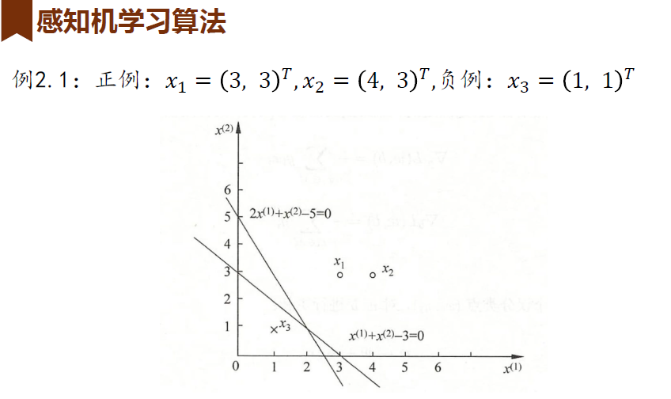
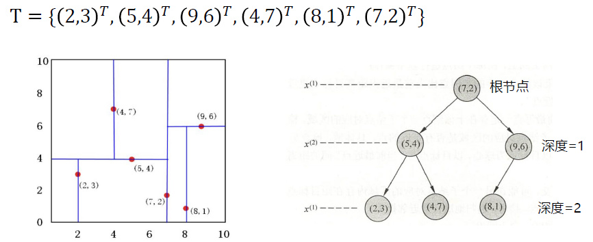
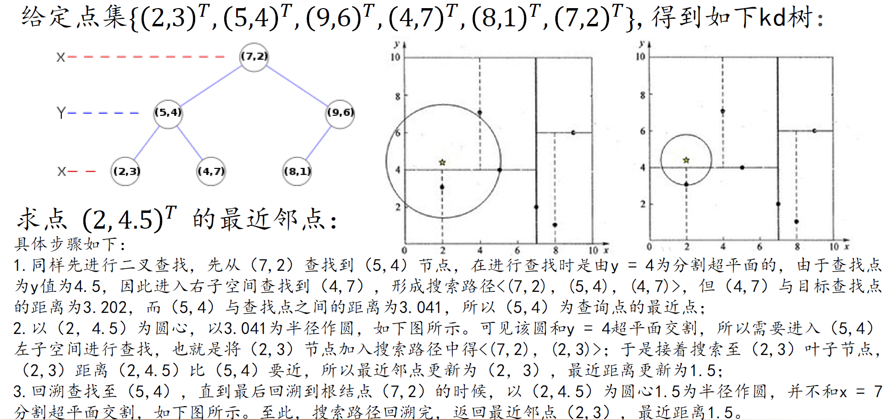
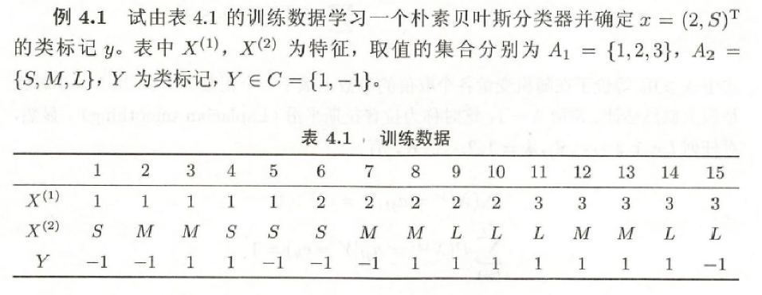
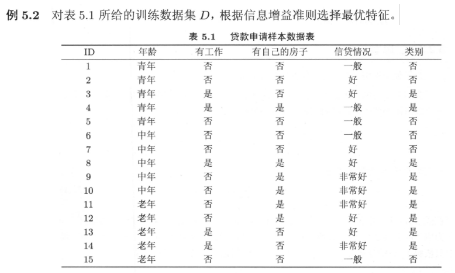
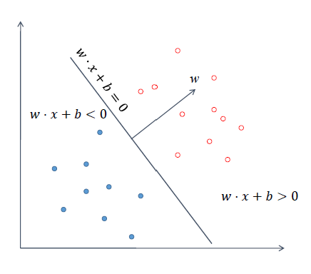
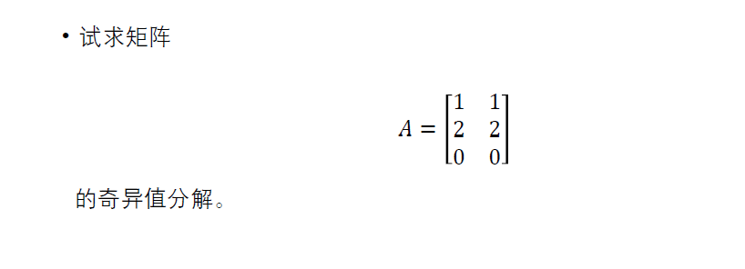
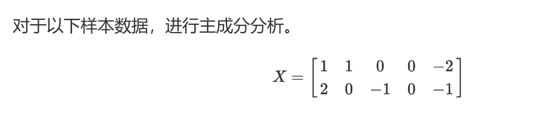
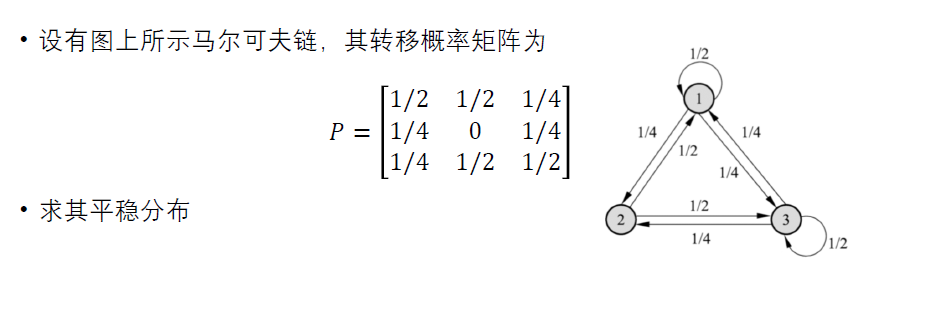

# 复习

## 1 导论

>机器学习的基本概念

### 1.1 统计机器学习的概念

统计机器学习是关于计算机基于数据构建概率统计模型并运用模型对数据进行预测与分析的一门学科。

### 1.2 统计机器学习的分类

#### 按数据类型

- 监督学习：从标注数据中学习预测模型，本质是学习输入与输出的映射统计规律。

- 无监督学习：从无标注数据中学习预测模型，本质是学习数据的统计规律或者潜在结构。

- 半监督学习：少量标注数据，大量未标注数据。

- 强化学习：智能系统在与环境的连续互动中学习最优行为策略。

#### 按模型

- 概率模型与非概率模型：概率模型可以表示为联合概率分布的形式，而非概率模型不一定存在这样的联合概率分布。
    - 概率模型举例：决策树、朴素贝叶斯、隐马尔可夫模型……
    - 非概率模型举例：感知机、支持向量机、k近邻……

- 线性模型与非线性模型：若函数 $y = f(x)$ 或者 $z = g(x)$ 是线性函数，则为线性模型，否则为非线性模型。
    - 线性模型举例：感知机、k近邻、线性支持向量机……
    - 非线性模型举例：基于核函数的支持向量机、深度学习……

- 参数化模型与非参数化模型
    - 参数化模型：假设模型参数的维度固定，模型可以由有限维参数完全刻画。
    - 非参数化模型：假设模型参数的维度不固定或者无穷大，随着训练数据量的增加而不断增大。

#### 按算法

- 在线学习

- 批量学习 / 离线学习

#### 按技巧

- 贝叶斯学习：模型估计整个后验概率分布，通常取后验概率最大的模型。

- 核方法：使用核函数表示和学习非线性模型，不显式地定义输入空间到特征空间的映射，而是直接定义核函数，即映射之后在特征空间的内积。

### 1.3 统计机器学习三要素

- 模型
    - 决策函数 or 条件概率
    - 参数空间

- 策略：目标是选择风险最小的模型，实际策略是经验风险与结构风险最小化。
    - 损失函数：$L(Y, f(X))$
    - 风险函数：$R(f) = E[L(Y, f(X))]$
    - 经验风险：$R(f) = \frac{1}{N} \sum_{i=1}^N L(y_i, f(x_i))$
    - 结构风险：$R(f) = \frac{1}{N} \sum_{i=1}^N L(y_i, f(x_i)) + \lambda \cdot J(f)$  `👉【防止过拟合】`

- 算法：求解最优化问题。

### 1.4 模型评估与选择

- 训练误差与测试误差 $\frac{1}{N} \sum_{i=1}^N L(y_i, \hat{f}(x_i))$

- 过拟合与欠拟合
    - 交叉验证、正则化等方法可以减轻过拟合现象。

### 1.5 泛化能力

泛化能力是指由该方法学习得到的模型对未知数据的预测能力，学到的模型 $\hat{f}$ 对未知数据的预测的误差即为泛化误差
$$
R(\hat{f}) = E[L(Y, \hat{f}(X))].
$$

比较学习方法的泛化能力，一般是比较泛化误差的上界。

### 1.6 生成模型与判别模型

#### 判别方法

判别方法由数据直接学习决策函数或条件概率分布作为预测的模型，即判别模型。
 - 举例：k近邻、感知机、决策树、logistic回归……

#### 生成方法

生成方法由数据学习联合概率分布，然后求出条件概率分布作为预测的模型，即生成模型
$$
P(Y|X) = \frac{P(X, Y)}{P(X)}.
$$
 - 举例：朴素贝叶斯、隐马尔可夫……

## 2 感知机

>感知机原理、模型与学习算法

### 2.1 定义

假设输入空间（特征空间）是 $\mathbf{X} \subseteq \mathbf{R}^n$ ，输出空间 $\mathbf{Y} = \{+1, -1\}$ ，输入 $x \in \mathbf{X}$ 表示实例的特征向量，输出 $y \in \mathbf{Y}$ 表示实例的类别。由输入空间到输出空间的函数
$$
f(x) = \text{sign}(w \cdot x + b)
$$
称为感知机，其中 $w$ 为权值，$b$ 为偏置，$\text{sign}$ 为符号函数，自变量非负取 1 ，负取 -1 。

#### 数据集的线性可分性

给定数据集 $T = \{ (x_1, y_1), (x_2, y_2), \cdots , (x_N, y_N) \}$ ，如果存在某个超平面 $S$
$$
\omega \cdot x + b
$$
能够将数据集的正实例点和负实例点完全正确地划分到超平面的两侧，即对所有 $y_i = 1$ 的实例 $i$ ，有 $w \cdot x_i + b > 0$ ，对所有 $y_i = -1$ 的实例 $i$ ，有 $w \cdot x + b < 0$ ，则 $T$ 为线性可分数据集。

### 2.2 学习策略

误分类点表示为 $-y_i (w \cdot x_i + b) > 0$ 。

定义损失函数为
$$
L(w, b) = - \sum_{x_i \in M} y_i (w \cdot x_i + b)
$$
其中 $M$ 为误分类点的集合。

不难看出，没有误分类点时 $L$ 最小到 0 ，有误分类点时变大。

### 2.3 学习算法

求解最优化问题 
$$
\min_{w, b}{L(w, b)}
$$
采用随机梯度下降法
$$
\nabla_w L(w, b) = - \sum_{x_i \in M} y_i x_i \\
\nabla_b L(w, b) = \sum_{x_i \in M} y_i
$$

#### 原始形式

输入训练数据集 $T$ ，设置学习率 $\eta \in (0, 1]$ 。

1. 选取初值 $w_0$ 和 $b_0$ ；

2. 在训练集中选取数据 $(x_i, y_i)$ ；

3. 如果 $y_i (w \cdot x_i + b) \le 0$ ，那么 $$w \leftarrow w + \eta y_i x_i \\ b \leftarrow b + \eta y_i$$ 

4. 转至 2 直至训练集中没有误分类点。

```
👉问题：
1. 解不唯一。
2. 不同初值得到的解可能不同。
3. 对线性可分数据集收敛。
```

#### 收敛性

设训练数据集 $T$ 线性可分，记 $\hat{w} = (w^\text{T}, b)^{\text{T}}$ ，$\hat{x} = (x^\text{T}, 1)^{\text{T}}$ ，则
1. 存在满足条件 $||\hat{w}|| = 1$ 的超平面将训练集完全正确分开；且存在 $\gamma > 0$ 对所有训练数据满足 $$y_i (\hat{w} \cdot \hat{x}_i) = y_i (w \cdot x_i + b) \ge \gamma$$
2. 令 $R = \max{||\hat{x}_i||}$ ，则上述算法在训练集上的误分类次数 $k$ 满足 $$k \le (\frac{R}{\gamma})^2$$ 


举例👇


#### 对偶形式

基本想法是将 $w$ 和 $b$ 表示为实例 $x_i$ 和标记 $y_i$ 的线性组合，求解系数
$$
w = \sum_{i=1}^N \alpha_i y_i x_i \\
b = \sum_{i=1}^N \alpha_i y_i
$$
其中 $\alpha = (\alpha_1, \alpha_2, \cdots , \alpha_N)^\text{T}$ 。

1. $\alpha \leftarrow 0, \quad b \leftarrow 0$ ；

2. 在训练集中选取数据 $(x_i, y_i)$ ；

3. 如果 $y_i (\sum_{j=1}^N \alpha_j y_j x_j \cdot x_i + b) \le 0$ ，则 $$\alpha_i \leftarrow \alpha_i + \eta \\ b \leftarrow b + \eta y_i$$ 

4. 转至 2 直至训练集中没有误分类点。

## 3 k-近邻法

>k近邻算法，度量学习，kd树

### 3.1 定义

输入训练数据集 $T = \{ (x_1, y_1), (x_2, y_2), \cdots , (x_N, y_N) \}$ ，其中实例的特征向量为 $x_i \in \mathbf{X} \subseteq \mathbf{R}^n$ ，类别为 $y_i \in \mathbf{Y} = \{c_1, c_2, \cdots , c_K\}$。

1. 根据给定的距离度量，在 $T$ 中找出与 $x$ 最邻近的 $k$ 个点，涵盖这 $k$ 个点的 $x$ 的邻域记作 $N_k(x)$ ；
2. 在 $N_k(x)$ 中根据分类决策规则决定 $x$ 的类别 $y$ ，如多数表决
    $$
    y = \arg{\max_{c_j}{\sum_{x_i \in N_k(x)} \mathbb{I}(y_i = c_j)}}, \quad i = 1, 2, \cdots , N \quad j = 1, 2, \cdots , K
    $$


`👉三要素：k值的选择、距离度量、分类决策规则`

### 3.2 k 值的选择

- $k$ 值太小意味着整体模型太复杂，容易发生过拟合；
- $k$ 值太大意味着整体的模型太简单，容易欠拟合。

$k$ 值一般不大，常用交叉验证法选取。

### 3.3 距离度量

记两个点分别为 $x_i = (x_i^{(1)}, x_i^{(2)}, \cdots , x_i^{(n)})^\text{T}$ ，$x_j = (x_j^{(1)}, x_j^{(2)}, \cdots , x_j^{(n)})^\text{T}$ 。

常见的距离度量有
 - $L_p$ 距离 $L_p(x_i, x_j) = (\sum_{l=1}^n |x_i^{(l)} - x_j^{(l)}|^p)^{\frac{1}{p}}$
 - 欧式距离，取 $p = 2$
 - 曼哈顿距离，取 $p = 1$
 - $L_\infty$ 距离，取 $p = \infty$


### 3.4 kd 树

kd 树对 $k$ 维空间中的实例点进行存储以便对其进行快速检索，它表示对 $k$ 维空间的一个划分，构造 kd 树相当于不断地用垂直于坐标轴的超平面将 $k$ 维空间切分，构成一系列的 $k$ 维超矩形区域。

这里的 k 与 kNN 的 k 不同，例如 $k = 2$ 意味着对平面图形进行划分。

#### 构造平衡 kd 树

输入 $k$ 维空间数据集 $T = \{ (x_1, y_1), (x_2, y_2), \cdots , (x_N, y_N) \}$ ，其中实例 $x_i = (x_i^{(1)}, x_i^{(2)}, \cdots , x_i^{(k)})^\text{T}$ ，从构造根节点开始，深度为 0 。每次切分的规则是：
 - 选择 $x^{(l)}$ 为坐标轴，满足 $l = j (\mod{k}) + 1$ ，其中 $j$ 是当前深度；
 - 以 $T$ 中所有实例的 $x^{(l)}$ 坐标的中位数为切分点，通过它与坐标轴垂直切分；
    - 中位数的求取是序列的长度除以 2 向下取整后的下一个数（升序排序），如序列长度为 7 则中位数为 4 ，长度为 8 则中位数为 5 。
 - 落在切分超平面上的实例点保存到当前切分点，其他实例点按位置分到左、右子区域中；
 - 子区域没有实例存在时结束。


举例👇


#### kd 树搜索最近邻

输入已构造的 kd 树和目标点 $x$ ，寻找 $x$ 的最近邻点
 - 从 kd 树的根节点出发，若 $x$ 当前维的坐标小于当前节点的坐标则移动到左子节点，否则移动到右子节点，直到当前节点为叶节点；
 - 以此叶节点为当前最近点；
 - 向上回退，在每个节点
    - 计算该节点到 $x$ 的距离，如果比当前最近点更小就更新，
    - 检查该节点的另一个子节点对应的区域是否与以 $x$ 为球形、以当前最近距离为半径的超球体相交，如果相交则移动到那个子节点，否则向上回退；
 - 回退到根节点时结束，取最后的当前最近点。

举例👇



## 4 朴素贝叶斯

>朴素贝叶斯的学习与分类，参数估计

### 4.0 概率知识回顾

- 样本空间的划分
- 全概率公式
- 极大似然估计
- 贝叶斯定理 $$P(Y = c_k|X = x) = \frac{P(X = x|Y = c_k)P(Y = c_k)}{\sum_k P(X = x|Y = c_k)P(Y = c_k)}$$

### 4.1 朴素贝叶斯

训练数据集 $T = \{ (x_1, y_1), (x_2, y_2), \cdots , (x_N, y_N) \}$ 由 $X$ 和 $Y$ 的联合概率分布 $P(X, Y)$ 独立同分布产生，朴素贝叶斯从中学习 $P(X, Y)$ ，即
 - 先验概率分布 $P(Y = c_k), \quad k = 1, 2, \cdots , K$
 - 条件概率分布 $P(X = x|Y = c_k)$

朴素贝叶斯需要条件独立性假设，即
$$
P(X = x|Y = c_k) = P(X^{(1)} = x^{(1)}, \cdots , X^{(n)} = x^{(n)}|Y = c_k) = \prod_{j=1}^n P(X^{(j)} = x^{(j)}|Y = c_k).
$$

在这个假设下，根据贝叶斯定理，得到贝叶斯分类器
$$
y = \arg{\max_{c_k} \frac{P(Y = c_k) \prod_{j=1}^n P(X^{(j)} = x^{(j)}|Y = c_k)}{\sum_k P(Y = c_k) \prod_{j=1}^n P(X^{(j)} = x^{(j)}|Y = c_k)}}
$$

由于对所有 $k$ 分母相同，所以可以去掉分母
$$
y = \arg{\max_{c_k} P(Y = c_k) \prod_{j=1}^n P(X^{(j)} = x^{(j)}|Y = c_k)}
$$

#### 后验概率最大化的含义

朴素贝叶斯将实例分到后验概率最大的类中，等价于期望风险最小化。

### 4.2 算法

输入训练数据集 $T$ ，记第 $i$ 个样本的第 $j$ 个特征可能的取值为 $x_i^{(j)} \in \{ a_{j1}, a_{j2} , \cdots , a_{js_j} \}$ 。对新实例 $x$ 进行分类。 

1. 计算先验概率和条件概率
    $$
    P(Y = c_k) = \frac{\sum_{i=1}^N \mathbb{I}(y_i = c_k)}{N}, \quad k = 1, 2, \cdots , K \\
    P(X^{(j)} = a_{jl}|Y = c_k) = \frac{\sum_{i=1}^N \mathbb{I}(x_i^{(j)} = a_{jl}, y_i = c_k)}{\sum_{i=1}^N \mathbb{I}(y_i = c_k)} , \quad l = 1, 2, \cdots , a_{js_j}
    $$

2. 根据后验概率最大化确定新实例 $x = (x^{(1)}, x^{(2)}, \cdots , x^{(n)})^\text{T}$ 的类
    $$
    y = \arg{\max_{c_k} P(Y = c_k) \prod_{j=1}^n P(X^{(j)} = x^{(j)}|Y = c_k)}
    $$


举例👇


### 4.3 贝叶斯估计

上述计算先验概率和条件分布概率采用的是极大似然估计方法，可能会出现所要估计的概率值为 0 的情况，影响后验概率的计算，解决办法是采用贝叶斯估计。

条件概率的贝叶斯估计
$$
P_\lambda(X^{(j)} = a_{jl}|Y = c_k) = \frac{\lambda + \sum_{i=1}^N \mathbb{I}(x_i^{(j)} = a_{jl}, y_i = c_k)}{S_j \lambda + \sum_{i=1}^N \mathbb{I}(y_i = c_k)}, \quad \lambda \ge 0
$$
当 $\lambda = 1$ 时称为拉普拉斯平滑。

先验概率的贝叶斯估计
$$
P_\lambda(Y = c_k) = \frac{\lambda \sum_{i=1}^N \mathbb{I}(y_i = c_k)}{N + K \lambda}
$$

## 5 决策树

>决策树学习的基本原理，特征选择，决策树的生成与剪枝

### 5.1 定义

决策树是一种基本的分类与回归方法，组成为
- 结点
    - 内部结点：一个特征或属性
    - 叶结点：一个类
- 有向边

本质上决策树通过一系列规则对数据进行分类，学习通常包括 3 个步骤：
 - 特征选择
 - 决策树的生成
 - 决策树的剪枝

### 5.2 CLS 算法

从一棵空决策树开始，选择某一属性（分类属性）作为测试属性，对应决策树中的决策结点。根据该属性的值的不同，可将训练样本分成相应的子集：
 - 如果该子集为空，或该子集中的样本属于同一个类，则该子集为叶结点;
 - 否则该子集对应于决策树的内部结点，需要选择一个新的分类属性对该子集进行划分，直到所有的子集都为空或者属于同一类。

`👉问题：测试属性集的组成以及选取顺序对决策树的学习有很大影响，没有如何选取测试属性的策略。`

### 5.3 ID3 算法

ID3 主要针对属性选择问题，使用**信息增益**选择测试属性。

#### 度量信息量

**熵**：信息量大小的度量，表示随机变量不确定性的度量。

事件 $a_i$ 的信息量 $I(a_i)$ 可以表示为
$$
I(a_i) = \log_2{ \frac{1}{p(a_i)}}
$$
其中 $p(a_i)$ 表示事件 $a_i$ 发生的概率。

假设有 $n$ 个互不相容的事件 $a_i, a_2, \cdots, a_n$ ，则平均的信息量可以表示为
$$
I = \sum_i^n p(a_i)I(a_i) = \sum_i^n p(a_i) \log_2{\frac{1}{p(a_i)}}.
$$

因此类似地，若 $X$ 是一个取有限个值的离散随机变量，概率分布为
$$
P(X = x_i) = p_i, \quad i = 1, 2, \cdots, n
$$
则它的熵定义为
$$
H(X) = - \sum_{i=1}^n p_i \log{p_i}.
$$

熵越大，随机变量的不确定性越大。


设有随机变量 $(X, Y)$ ，联合概率分布为
$$
P(X = x_i, Y = y_i) = p_{ij}, \quad i = 1, 2, \cdots, n; j = 1, 2, \cdots, m
$$

**条件熵 $H(Y|X)$** ：表示在已知随机变量 $X$ 的条件下随机变量 $Y$ 的不确定性，定义为
$$
H(Y|X) = \sum_{i=1}^n p_i H(Y|X = x_i)
$$
其中 $p_i = P(X = x_i), \quad i = 1, 2, \cdots, n$ 。

当熵和条件熵中的概率由数据估计得到（如极大似然估计）时，对应地被称为**经验熵**和**经验条件熵**。

#### 信息增益

特征 $A$ 对训练数据集 $D$ 的信息增益定义为集合 $D$ 的经验熵 $H(D)$ 与给定特征 $A$ 条件下 $D$ 的经验条件熵 $H(D|A)$ 之差
$$
g(D, A) = H(D) - H(D|A)，
$$
简单来说就是得知特征 $A$ 的信息而使得对数据集 $D$ 的信息的不确定性减少的程度，显然信息增益大的特征具有更强的分类能力。

举例👇


### 5.4 C4.5 算法

`👉问题：以信息增益选择特征，存在偏向于取值范围较大的特征的问题。`

采用信息增益比选择属性可以校正这种偏向问题。

#### 信息增益比

特征 $A$ 对训练数据集 $D$ 的信息增益比定义为信息增益与训练数据集 $D$ 关于特征 $A$ 的值的熵之比
$$
g_R(D, A) = \frac{g(D, A)}{H_A(D)}
$$

### 5.5 决策树的剪枝

决策树的剪枝通过极小化决策树整体的损失函数或代价函数来实现。设树的叶节点数量为 $|T|$ ，一个叶节点 $t$ 有 $N_t$ 个样本，参数 $\alpha \ge 0$ ，损失函数表示为
$$
C_{\alpha}(T) = \alpha |T| + \sum_{t=1}^{|T|} N_t H_t(T) 
$$
其中 $H_t(T)$ 为叶节点 $t$ 上的经验熵。

输入生成的树 $T$ 和参数 $\alpha$ 
1. 计算每个节点的经验熵；
2. 递归地从树的叶节点向上回缩，如果回缩到父节点之前的损失函数小于之后，则进行剪枝；
3. 返回 2 直到不能继续。

### 5.6 CART

CART 首先基于训练数据生成尽量大的二叉决策树
 - 回归树用平方误差最小化准则，
 - 分类树用基尼指数最小化准则；

然后用验证数据集进行剪枝并选择最优子树，标准是损失函数最小。

#### 基尼指数

在分类问题中，假设有 $K$ 个类，样本属于第 $k$ 类的概率为 $p_k$ ，则概率分布的基尼指数定义为
$$
\text{Gini}(p) = 1 - \sum_{k=1}^K p_k^2.
$$

如果样本集合 $D$ 根据特征 $A$ 是否取某一可能值 $\alpha$ 被分为 $D_1$ 和 $D_2$ 两部分，则在特征 $A$ 的条件下，$D$ 的基尼指数为
$$
\text{Gini}(D, A) = \frac{|D_1|}{|D|}\text{Gini}(D_1) + \frac{|D_2|}{|D|}\text{Gini}(D_2).
$$

基尼指数越大，样本集合的不确定性也就越大。

#### CART 的剪枝

1. 从生成的决策树 $T_0$ 底端开始不断剪枝，直到根节点，形成子树序列 $\{ T_0, T_1, \cdots , T_n \}$ ；
2. 通过交叉验证法在独立的验证数据集上对子树序列进行测试，从中选择最优子树。

## 6 Logistic 回归与最大熵模型

>逻辑斯蒂回归模型，最大熵模型，模型学习的最优化算法

### 6.1 logistic 分布

设 $X$ 是连续随机变量，具有：

- 分布函数 $F(x) = P(X \le x) = \frac{1}{1 + e^{-\frac{x - \mu}{\gamma}}}$ ，

- 密度函数 $f(x) = F'(x) = \frac{e^{-\frac{x - \mu}{\gamma}}}{\gamma (1 + e^{-\frac{x - \mu}{\gamma}})^2}$ ，

其中 $\mu$ 为位置参数，$\gamma > 0$ 为形状参数。

### 6.2 二项 logistic 回归

二项 logistic 回归是由条件概率 $P(Y|X)$ 表示的分类模型，$X$ 取实向量，$Y$ 取 $\{ 0, 1 \}$
$$
P(Y = 1|X) = \frac{\exp{wx}}{1 + \exp{wx}}.
$$

采用事件的对数几率，对 logistic 回归表示为
$$
\log{\frac{p(Y = 1|x)}{1 - p(Y = 1|x)}} = wx.
$$

#### 参数估计

通过极大似然函数估计 logistic 的权值，推导得出对数似然函数为
$$
L(w) = \sum_{i=1}^N [y_i(wx_i) - \log{(1 + \exp{wx_i})}]
$$
通常采用梯度下降法和拟牛顿法求解。

### 6.3 多项 logistic 回归

设 $Y$ 的取值集合为 $\{ 1, 2, \cdots , K \}$ ，多项logistic 回归模型表示为
$$
P(Y = k|X) = \frac{\exp{w_k x}}{1 + \sum_{k=1}^{K-1} \exp{w_k x}}, \quad k = 1, 2, \cdots, K-1 \\
P(Y = K|X) = \frac{1}{1 + \sum_{k=1}^{K-1} \exp{w_k x}}
$$

### 6.3 最大熵模型

#### 最大熵原理

学习概率模型时，在所有可能的概率模型分布中，熵最大的模型是最好的模型，即在满足约束条件的模型集合中选取熵最大的模型。

### 6.3 最优化算法

#### 梯度下降法

一阶优化方法，选取适当的初值 $x^{(0)}$ ，不断迭代，更新 $x$ 的值，进行目标函数的极小化，直到收敛。由于负梯度方向是使函数值下降最快的方向，在迭代的每一步，以负梯度方向更新 $x$ 的值，从而达到减少函数值的目的
$$
x^{(k+1)} \leftarrow x^{(k)} + \lambda_k (- \nabla{f(x^{(k)})})
$$

#### 牛顿法与拟牛顿法

- 牛顿法是二阶的迭代算法，每一步需要求解目标函数的 Hessian 矩阵的逆矩阵，收敛速度较快，但计算比较复杂
    $$
    x^{(k+1)} \leftarrow x^{(k)} - H_k^{-1} \cdot \nabla{f(x^{(k)})}
    $$
- 拟牛顿法通过正定矩阵近似 Hessian 矩阵的逆矩阵或 Hessian 矩阵，简化了计算过程。

#### 改进的迭代尺度法

## 7 支持向量机

>线性支持向量机，硬/软间隔最大化，核函数，非线性支持向量机，优化算法与误差分析

### 7.1 概述

支持向量机是二分类模型，给定训练数据集 $T = \{ (x_1, y_1), (x_2, y_2), \cdots , (x_N, y_N) \}$ ，其中 $x_i \in \mathbf{X} = \mathbb{R}^n ，\quad y_i \in \mathbf{Y} = \{ 1, -1 \} \quad i = 1, 2, \cdots , N$ ，通过间隔最大化找分类超平面。

### 7.2 线性支持向量机

线性可分支持向量机要求线性可分或近似线性可分的训练数据集，通过间隔最大化或等价地求解相应的凸二次规划问题得到分离超平面
$$
w \cdot x + b = 0.
$$

决策函数为
$$
f(x) = \text{sign}(w x + b)
$$



#### 硬间隔最大化

样本点到分离超平面的相对距离可以表示为 $|wx_i + b|$ ，几何间隔表示为 $|\frac{w}{||w||}x_i + \frac{b}{||w||}|$ 。

因此要求最大间隔分离超平面，等价于一个凸二次规划
$$
\min_{w, b}{\frac{1}{2} ||w||^2} \\
\text{s.t.} \quad y_i(wx_i + b) \ge \gamma , \quad i = 1, 2, \cdots , N
$$
其中 $\gamma \ge 0$ ， 这里取 1 。

`👉定理：若训练数据集线性可分，则可以将它完全正确分开的最大间隔分离超平面存在且唯一。`

#### 支持向量

在线性可分情况下，训练数据集的样本点中与分离超平面距离最近的样本
点的实例称为支持向量，它使约束条件式等号成立
$$
y_i(wx_i+b) - 1 = 0
$$
在确定分离超平面时起决定作用。

#### 对偶

```
👉补充：
1.拉格朗日对偶
2.KKT条件
```

硬间隔最大化的原始问题为
$$
\min_{w, b}{\frac{1}{2} ||w||^2} \\
\text{s.t.} \quad 1 - y_i(wx_i + b) \le 0, \quad i = 1, 2, \cdots , N
$$
定义拉格朗日函数
$$
L(w, b , \alpha) = \frac{1}{2}||w||^2 - \sum_{i=1}^N \alpha_i y_i(wx_i + b) + \sum_{i=1}^N \alpha_i , \quad \alpha_i \ge 0
$$

对偶问题为求 $L$ 的极大极小
$$
\max_{\alpha}{\min_{w,b}{L(w, b, \alpha)}}.
$$
转化为
$$
\min_{\alpha}{\frac{1}{2} \sum_{i=1}^N \sum_{j=1}^N \alpha_i \alpha_j y_i y_j (x_i x_j) - \sum_{i=1}^N \alpha_i} \\
\text{s.t.} \quad \sum_{i=1}^N \alpha_i y_i = 0, \quad \alpha_i \ge 0, \quad i = 1, 2, \cdots , N
$$

求得对偶问题最优解 $\alpha^* = (\alpha_1^*, \alpha_2^*, \cdots , \alpha_N^*)^\text{T}$ 后，可以求原始问题的解
$$
w^* = \sum_{i=1}^N \alpha_i^* y_i x_i \\
b^* = y_j - \sum_{i=1}^N \alpha_i^* y_i (x_i x_j)
$$
其中 $j$ 表示对应的 $\alpha_j^* > 0$ 。

因此分离超平面为
$$
\sum_{i=1}^N \alpha_i^* y_i (x x_i) + b^* = 0.
$$
并且对应 $\alpha_j^* > 0$ 的样本的实例即为支持向量。

#### 软间隔最大化

训练数据中有一些特异点，不能满足函数间隔大于等于 1 的约束条件，解决办法是对每个样本引入松弛变量，即
$$
y_i(wx_i + b) \ge 1 - \xi_i , \quad \xi_i \ge 0
$$

目标变为
$$
\min_{w,b,\xi} {\frac{1}{2}||w||^2 + C \sum_{i=1}^N \xi_i} \\
\text{s.t.} \quad y_i(wx_i + b) \ge 1 - \xi_i 
$$
其中 $C > 0$ 为惩罚参数。

此时 $W$ 唯一，而 $b$ 不一定唯一。

对偶问题为
$$
\min_{\alpha} {\frac{1}{2} \sum_{i=1}^N \sum_{j=1}^N \alpha_i \alpha_j y_i y_j (x_i x_j) - \sum_{i=1}^N \alpha_i} \\
\text{s.t.} \quad \sum_{i=1}^N \alpha_i y_i = 0 \quad 0 \le \alpha_i \le C
$$

求得对偶问题的一个解 $\alpha^* = (\alpha_1^*, \alpha_2^*, \cdots , \alpha_N^*)^\text{T}$ 后，原始问题的解为
$$
w^* = \sum_{i=1}^N \alpha_i^* y_i x_i \\
b^* = y_j - \sum_{i=1}^N \alpha_i^* y_i (x_i x_j)
$$
其中 $j$ 表示对应的 $0  < \alpha_j^* < C$ 。

对应 $\alpha_j^* > 0$ 的样本的实例即为支持向量。

### 7.3 非线性支持向量机

采用线性分类方法求解非线性分类问题
1. 使用一个变换 $\phi$ 将原空间的数据映射到新空间；
2. 在新空间里用线性分类学习方法从训练数据中学习分类模型。

#### 核函数

设 $\mathcal{X}$ 是输入空间（欧氏空间），$\mathcal{H}$ 为特征空间（希尔伯特空间），如果存在一个从 $\mathcal{X}$ 到 $\mathcal{H}$ 的映射 $\phi(x)$ 使得对所有 $x, z \in \mathcal{X}$ ，函数 $K(x, z)$ 满足
$$
K(x, z) = \phi(x) \cdot \phi(z)
$$
则称 $K(x, z)$ 为**核函数**。

常用核函数有：
 - 多项式核函数 $K(x, z) = (x \cdot z + 1)^p$
 - 高斯核函数 $K(x, z) = \exp{(- \frac{||x - z||^2}{2 \sigma^2})}$

#### 核函数应用到支持向量机

将原来目标函数中的内积 $x_i \cdot x_j$ 用核函数替代，改写为
$$
\min_\alpha {\frac{1}{2} \sum_{i=1}^N \sum_{i=1}^N \alpha_i \alpha_j y_i y_j K(x_i, x_j) - \sum_{i=1}^N \alpha_i} \\
\text{s.t.} \quad \sum_{i=1}^N \alpha_i y_i = 0 \quad 0 \le \alpha_i \le C
$$

决策函数改写为
$$
f(x) = \text{sign} (\sum_{i=1}^N \alpha_i^* y_i K(x_i, x) + b^*).
$$

### 7.4 序列最小最优化算法 SMO

更加高效地求解 SVM 。

## 8 提升方法与 EM 算法

>Adaboost算法，误差分析，提升树；EM算法的收敛性与推广

### 8.1 AdaBoost 算法

输入训练数据集 $T = \{ (x_1, y_1), (x_2, y_2), \cdots , (x_N, y_N) \}$ ，其中 $x_i \in \mathbf{X} = \mathbb{R}^n ，\quad y_i \in \mathbf{Y} = \{ 1, -1 \} \quad i = 1, 2, \cdots , N$ ，要求输出分类器。

1. 初始化训练数据的权值分布 
    $$
    D_1 = (w_{11}, \cdots , w_{1i}, \cdots , w_{1N}) = (\frac{1}{N}, \cdots , \frac{1}{N})
    $$

2. 记一共训练了 $M$ 个弱分类器，对 $m = 1, 2, \cdots , M$
    1. 在权值 $D_m$ 下训练数据集得到当前弱分类器 $G_m(x)$ ；
    2. 计算 $G_m$ 的训练误差 $e_m = \sum_{i=1}^N w_{mi} \mathbb{I}(G_m(x_i) \neq y_i)$ ；
    3. 计算 $G_m$ 的系数 $\alpha_m = \frac{1}{2} \log{\frac{1 - e_m}{e_m}}$ ；
    4. 更新训练数据集的权值分布 $w_{m+1,i} = w_{mi} \frac{\exp{-\alpha_m y_i G_m(x_i)}}{\sum_{i=1}^N w_{mi} \exp{(-\alpha_m y_i G_m(x_i))}}$ 。

3. 构建弱分类器的线性组合
    $$
    f(x) = \sum_{m=1}^M \alpha_m G_m(x)
    $$

4. 最终分类器为
    $$
    G(x) = \text{sign}(f(x))
    $$

#### 训练误差分析

最终分类器的训练误差界为
$$
\frac{1}{N} \sum_{i=1}^N \mathbb{I}(G_m(x_i) \neq y_i) \le \frac{1}{N} \sum_{i} \exp{(-y_i f(x_i))} = \prod_m^M [\sum_{i=1}^N w_{mi} \exp{(-\alpha_m y_i G_m(x_i))}]
$$

### 8.2 提升树

提升树以分类树或回归树为基本分类器，实际采样加法模型（以决策树为基函数）与前向分步算法。

#### 梯度提升

提升树利用加法模型与前向分步算法实现学习的优化过程，对一般损失函数，可以采用梯度提升算法进行优化，关键是利用损失函数的负梯度在当前模型的值。

### 8.3 EM 算法

概率模型含有隐变量时，不能简单地使用极大似然估计等估计方法，而可以采用 EM 算法近似计算，每次迭代由求期望、求极大两步组成。

#### 算法

用 $Y$ 表示观测随机变量的数据，$Z$ 表示隐随机变量的数据，模型目标是极大化观测数据关于参数 $\theta$ 的对数似然函数
$$
L(\theta) = \log{P(Y|\theta)} = \log{\sum_Z P(Y, Z|\theta)} = \log{(\sum_Z P(Y|Z, \theta)P(Z|\theta))}
$$
通过迭代逐步近似极大化的 $L(\theta)$ ，即每次迭代
$$
\theta^{(i+1)} = \arg{\max_\theta{Q(\theta, \theta^{(i)})}}
$$

其中 $Q$ 函数定义为完全数据（$Y$ 和 $Z$）的对数似然函数关于在给定观测数据 $Y$ 和当前参数 $\theta^{(i)}$ 下对未观测数据 $Z$ 的条件概率分布的期望
$$
Q(\theta, \theta^{(i)}) = E_Z[\log{P(Y,Z|\theta)|Y, \theta^{(i)}}].
$$

#### 收敛性

- 关于对数似然函数 $L(\theta^{(i)})$ 的收敛性
- 关于参数估计序列 $\theta^{(i)}$ 的收敛性

## 9 无监督学习概论

>无监督学习

### 9.1 概念

无监督学习使用无标注数据学习或训练，由特征向量组成。

一般考虑对数据进行聚类，或者降维，或者学习概率模型。

## 10 聚类算法

>聚类，K-means，谱聚类

### 10.1 聚类的概念

聚类的核心概念是相似度或距离，常见定义方法有
 - [闵可夫斯基距离](#33-距离度量)

 - 马氏距离：给定样本集合 $X = [x_{ij}]_{m \times n}$ ，其协方差矩阵记为 $S$ ，样本 $x_i$ 与样本 $x_j$ 之间的马氏距离定义为
    $$
    d_{ij} = [(x_i - x_j)^\text{T} S^{-1} (x_i - x_j)]^{\frac{1}{2}}
    $$

 - 相关系数：样本 $x_i$ 与样本 $x_j$ 之间的相关系数定义为
    $$
    r_{ij} = \frac{\sum_{k=1}^m (x_{ki} - \bar{x}_i)(x_{kj} - \bar{x}_j)}{[\sum_{k=1}^m (x_{ki} - \bar{x}_i)^2 \sum_{k=1}^m (x_{kj} - \bar{x}_j)^2]^{\frac{1}{2}}}
    $$

 - 夹角余弦：样本 $x_i$ 与样本 $x_j$ 之间的夹角余弦定义为
    $$
    s_{ij} = \frac{x_i \cdot x_j}{|x_i| |x_j|}
    $$

#### 类的特征

常见的刻画类的特征的角度有
 - 类的中心
 - 类的直径
 - 类的样本散布矩阵和样本协方差矩阵


#### 类与类之间的距离

考虑类 $G_p$ 与 $G_q$ 之间的距离 $D(p, q)$ ，也称为连接
- 最短距离 / 单连接
- 最长距离 / 完全连接
- 中心距离（类的中心取类内样本的均值）
- 平均距离

### 10.2 层次聚类

#### 聚合聚类

自底向上

首先确定：距离或相似度、合并规则、停止条件。

#### 分裂聚类

自顶向下

### 10.3 k-means 聚类

$k$ 均值聚类将样本集合划分成 $k$ 个类，每个样本到其所属类的中心的距离最小，属于硬聚类。

策略是通过损失函数的最小化选取最优的划分 $C$ ，定义样本与其所属类中心的距离的总和为损失函数
$$
C = \arg{\min_C{ \sum_{l=1}^k \sum_{C(i)=l} ||x_i - \bar{x}_l||^2}}
$$
其中 $\bar{x}_l$ 是第 $l$ 类的中心。

但是这个优化问题是 NP 难题，实际采用迭代的算法求解：
 1. 首先选取 $k$ 个类的中心，将样本分到与其最近的中心的类；
 2. 更新每个类的中心；
 3. 重复上述步骤直到收敛。

```
👉问题：
1. 不能保证收敛到全局最优。
2. 初始中心的选择会影响聚类结果。
3. k 的值要指定。
```

### 10.4 谱聚类

#### 图论基本知识

- 图 $G(V, E)$ ：由顶点集 $V$ 和边集 $E$ 构成
    - 顶点的度：与顶点相连接的边的数量（有权重则是边权重之和）
    - 图的势：等于包含的顶点个数
    - 图的体积：等于所有顶点的度之和

- 邻接矩阵 $W$

- 度矩阵 $D$ ：一个对角矩阵，等于将邻接矩阵各行元素累加至对应的主对角元素

- 拉普拉斯矩阵 $L$ ：度矩阵减去邻接矩阵得到的矩阵
    - $L$ 的行之和为 0 
    - $L$ 有特征值为 0 ，有 $|V|$ 个非负的特征值 
    - $L$ 是半正定矩阵
    - 设图 $G$ 是连接权重非负的无向图，它的连通子图个数等于它的拉普拉斯矩阵的 0 特征值的重数

- 子图相似度：两个子图之间的相似度定义为连接两个子图所有边的权重之和

- 边割：去掉图的部分边后，变成两个连通子图

- 最小二分切割：在所有的图切割中，找一个最小代价的切割，将图分为两个不连通的子图，即两个子图的相似度要最小

#### 谱聚类基本思想

谱聚类本质是将聚类问题转化为一个图上的关于顶点划分的最优问题，谱聚类算法建立在点对亲和性基础之上，理论上能对任意分布形状的样本空间进行聚类。

从图切割的角度，聚类就是要找到一种合理的分割图的方法，使得连接不同子图的边的权重尽可能小，子图内容边的权重尽可能大。

#### 算法

1. 利用点对之间的相似性，构建亲合度矩阵（邻接矩阵）；
2. 构建拉普拉斯矩阵；
3. 求解求解拉普拉斯矩阵最小的特征值对应的特征向量（通常舍弃零特征所对应的分量全相等向）；
4. 由这些特征向量构成样本点的新特征，采用 K-means 等聚类方法完成最后的聚类。

## 11 奇异值分解

>奇异值分解的定义与性质，奇异值分解的计算以及矩阵近似

### 11.1 定义

矩阵的（完全）奇异值分解是指将一个非零的 $m \times n$ 实矩阵 $A$ 表示为以下三个实矩阵乘积形式的运算，即进行矩阵的因子分解
$$
A = U \Sigma V^\text{T}
$$
其中 $U$ （左奇异向量）是 $m$ 阶正交矩阵，$V$ （右奇异向量）是 $n$ 阶正交矩阵，$\Sigma$ 是由降序排列的非负的对角线元素（奇异值）组成的 $m \times n$ 对角矩阵，满足
$$
U^\text{T} U = I \\
V^\text{T} V = I \\
\Sigma = \text{diag}(\sigma_1, \sigma_2, \cdots , \sigma_p) \\
\sigma_1 \ge \sigma_2 \ge \cdots \ge \sigma_p \ge 0 \\
p = \min{(m, n)}
$$

`👉注意：任何矩阵均有奇异值分解，并且不唯一。`

#### 紧奇异值分解

紧奇异值分解是与原始矩阵等秩的奇异值分解。

设有 $m \times n$ 的实矩阵 $A$ ，秩为 $r \le \min{(m, n)}$ ，则紧奇异值分解为
$$
A = U_r \Sigma_r V_r^\text{T}
$$
其中 $U_r$ 是 $m \times r$ 矩阵，由完全奇异值分解 $U$ 中的前 $r$ 列得到；$V_r$ 是 $n \times r$ 矩阵，由 $V$ 中的前 $r$ 列得到；$\Sigma_r$ 是 $r$ 阶对角矩阵，由 $\Sigma$ 的前 $r$ 个对角线元素组成。

#### 截断奇异值分解

截断奇异值分解是比原始矩阵低秩的奇异值分解。只取最大的 $k$ 个奇异值对应的部分，就得到矩阵的截断奇异值分解。

### 11.2 性质

1. 矩阵 $A^\text{T} A$ 和矩阵 $A A^\text{T}$ 的特征分解存在且可以由矩阵 $A$ 的奇异值分解矩阵表示。
    - $V$ 的列向量是 $A^\text{T} A$ 的特征向量。
    - $U$ 的列向量是 $A A^\text{T}$ 的特征向量。
    - $\Sigma$ 的奇异值是 $A^\text{T} A$ 或 $A A^\text{T}$ 的特征值的平方根。

2. 矩阵 $A$ 的奇异值、左奇异向量、右奇异向量之间存在对应关系，即
    - $A v_j = \sigma_j u_j \quad j = 1, 2, \cdots , n$
    - $A^\text{T} u_j = \sigma_j v_j \quad j = 1, 2, \cdots , n , \quad A^\text{T} u_j = 0 \quad j = n+1, n+2, \cdots , m$

3. 矩阵 $A$ 的奇异值分解中，奇异值唯一，而矩阵 $U$ 和 $V$ 不唯一。

4. 矩阵 $A$ 和 $\Sigma$ 的秩相等，等于正奇异值的个数（包含重复的奇异值）。

### 11.3 几何意义

$m \times n$ 矩阵可以表示从 $n$ 维空间到 $m$ 维空间的一个线性变换，它可以分解为三个简单变换：
 - $V^\text{T}$ 一个坐标系的旋转或反射变换
 - $\Sigma$ 一个坐标系的坐标轴的缩放变换
 - $U$ 另一个坐标系的旋转或反射变换

### 11.4 计算

矩阵的（完全）奇异值分解可以通过求对称矩阵 $A^\text{T} A$ 或 $A A^\text{T}$ 的特征值和特征向量得到。

以通过 $A^\text{T} A$ 求解为例：
1. 写出 $A^\text{T} A$ 的特征方程 $(A^\text{T} A - \lambda I) x = 0$ ；
2. 求得特征值 $\lambda_1 \ge \lambda_2 \ge \cdots \ge \lambda_n \ge 0$ ，并求出对应特征向量；
3. 将特征向量单位化，得到 $v_1, v_2, \cdots , v_n$ ，构成正交矩阵 $V = [v_1 \quad v_2 \quad \cdots \quad v_n]$ ;
4. 计算奇异值 $\sigma_i = \sqrt{\lambda_i}$ ，构造对角矩阵 $\Sigma = \text{diag}(\sigma_1, \sigma_2, \cdots , \sigma_n)$ ，其余元素为 0 ；
5. 求正交矩阵 $U$ 时，对前 $r$ 个正奇异值，计算 $u_j = \frac{1}{\sigma_j} A v_j$ ，得到 $U_1 = [u_1 \quad u_2 \quad \cdots \quad u_r]$ ；然后求 $A^\text{T}$ 零空间的一组标准正交基，记为 $U_2 = [u_{r+1} \quad u_{r+2} \quad \cdots \quad u_m]$ ；最终 $U = [U_1 \quad U_2]$ 。

举例👇


### 11.5 矩阵的近似

奇异值分解也是一种矩阵近似的方法，这个近似是在弗罗贝尼乌斯范数意义下的近似。

若矩阵 $A$ 的秩为 $n$ ，则有 $A = \sigma_1 u_1 v_1^\text{T} + \sigma_2 u_2 v_2^\text{T} + \cdots + \sigma_n u_n v_n^\text{T}$ ，那么在弗罗贝尼乌斯范数意义下 $A$ 的秩为 $k$ 的最优近似矩阵为
$$
A_k = \sigma_1 u_1 v_1^\text{T} + \sigma_2 u_2 v_2^\text{T} + \cdots + \sigma_k u_k v_k^\text{T}. 
$$

## 12 主成分分析

>总体主成分分析，样本主成分分析

### 12.1 概念

主成分分析利用正交变换把由线性相关变量表示的观测数据转换为少数几个由线性无关变量表示的数据，线性无关的变量称为主成分，属于降维方法。

- 在数据总体上进行的主成分分析为总体主成分分析。
- 在有限样本上进行的主成分分析为样本主成分分析。

#### 基本想法

1. 首先对给定数据进行规范化 ，使得数据每一类变量的总体平均值为 0 ，方差为 1 ；
2. 对数据进行正交变换，原来由线性相关变量表示的数据变成由若干个线性无关的新变量表示的数据。
    - 新变量是可能的正交变换中变量的方差和最大的（方差表示在新变量上信息的大小）

#### 定义

假设 $x = (x_1, x_2, \cdots , x_m)^\text{T}$ 是 $m$ 维的随机变量，均值向量为 $\mu = E(x) = (\mu_1, \mu_2, \cdots , \mu_m)^\text{T}$ ，协方差矩阵为 $\Sigma = E[(x - \mu)(x - \mu)^\text{T}]$ 。

考虑由 $m$ 维随机变量 $x$ 到 $m$ 维随机变量 $y = (y_1, y_2, \cdots , y_m)^\text{T}$ 的线性变换
$$
y_i = \alpha_i^\text{T} x = \alpha_{1i} x_1 + \alpha_{2i} x_2 + \cdots + \alpha_{mi} x_m \\
\alpha_i^\text{T} = (\alpha_{1i}, \alpha_{2i}, \cdots , \alpha_{mi}) \quad i = 1, 2, \cdots , m
$$

如果这个线性变换满足：
 - 系数向量 $\alpha_i^\text{T}$ 是单位向量且两两正交；
 - 两个变量 $y_i$ 和 $y_j$ 互不相关，即 $\text{cov}(y_i, y_j) = 0$ ；
 - 变量 $y_1$ 是 $x$ 的所有线性变换中方差最大的，$y_2$ 是与 $y_1$ 不相关的 $x$ 的所有线性变换中方差最大的，一般地， $y_i$ 是与 $y_1, y_2, \cdots , y_{i-1}$ 都不相关的 $x$ 的所有线性变换中方差最大的；

那么称 $y_1, y_2, \cdots , y_m$ 为 $x$ 的第一主成分、第二主成分、……、第 $m$ 主成分。

### 12.2 性质

设 $x$ 是 $m$ 维随机变量，$\Sigma$ 是 $x$ 的协方差矩阵，$\Sigma$ 的特征值分别是 $\lambda_1 \ge \lambda_2 \ge \cdots \ge \lambda_m \ge 0$ ，对应单位特征向量分别是 $\alpha_1, \alpha_2, \cdots , \alpha_m$ ，则 $x$ 的第 $k$ 主成分是
$$
y_k = \alpha_k^\text{T} x \quad k = 1, 2, \cdots , m
$$
并且 $y_k$ 的方差是
$$
\text{var}(y_k) = \lambda_k
$$

`👉证明：拉格朗日乘子法`

### 12.3 主成分的个数

第 $k$ 个主成分的方差贡献率定义为
$$
\eta_k = \frac{\lambda_k}{\sum_{i=1}^m \lambda_i}.
$$

$k$ 个主成分的累计方差贡献率定义为
$$
\sum_{i=1}^k \eta_i = \frac{\sum_{i=1}^k \lambda_i}{\sum_{i=1}^m \lambda_i}.
$$

通常取 $k$ 使得累计方差贡献率到达规定的百分比以上。但是还不能反映对某个原有变量保留信息的比例。

$k$ 个主成分对原有变量 $x_i$ 的贡献率定义为
$$
v_i = \rho^2(x_i, (y_1, y_2, \cdots , y_k)) = \sum_{j=1}^k \rho^2 (x_i, y_j)
$$

### 12.4 规范化

对变量进行规范化的方法是
$$
x_i^* = \frac{x_i - E(x_i)}{\sqrt{\text{var}(x_i)}} \quad i = 1, 2, \cdots , m
$$

### 12.5 样本主成分分析

以上讨论的是总体主成分分析，但实际问题中一般在观测数据上进行样本主成分分析。

需要注意的是样本（数量为 $n$ ）的协方差矩阵 $S = [s_{ij}]_{m \times m}$ 计算为
$$
s_{ij} = \frac{1}{n-1} \sum_{k=1}^n (x_{ik} - \bar{x}_i)(x_{jk} - \bar{x}_j) \quad i, j = 1, 2, \cdots , m
$$

给定样本矩阵 $X$ ，具体求解算法：
1. 对样本矩阵进行规范化处理；
2. 依据规范化数据矩阵，计算样本相关矩阵 $R = [r_{ij}]_{m \times m} = \frac{1}{n-1} X X^\text{T}$ ；
3. 求解 $R$ 的特征方程，得到特征值 $\lambda_1 \ge \lambda_2 \ge \cdots \ge \lambda_m$ ，对应单位特征向量即为主成分系数 $\alpha_1 \ge \alpha_2 \ge \cdots \ge \alpha_m$；
4. 代入规范化数据求样本主成分 $y_i = \alpha_i^\text{T} x$

举例👇


## 13 马尔科夫链蒙特卡洛法

>蒙特卡洛法，马尔可夫链，吉布斯抽样

### 13.1 蒙特卡洛法

蒙特卡罗法要解决的问题是，假设概率分布的定义己知，通过抽样获得概率分布的随机样本，并通过得到的随机样本对概率分布的特征进行分析，一般是近似数值计算。

- 直接抽样法
- 接受-拒绝抽样法
- 重要性抽样法

接受-拒绝抽样法、重要性抽样法适合于概率密度函数复杂(如密度函数含有多个变量，各变量相互不独立，密度函数形式复杂)，不能直接抽样的情况。

#### 数学期望估计

假设有随机变量 $x \in \mathcal{X}$ ，其概率密度函数为 $p(x)$ ，目标是求函数 $f(x)$ 关于 $p(x)$ 的数学期望。 

蒙特卡洛法按照概率分布 $p(x)$ 独立抽取 $n$ 个样本 $x_1, x_2, \cdots , x_n$ ，计算
$$
\hat{f}_n = \frac{1}{n} \sum_{i=1}^n f(x_i)
$$
根据大数定律，当样本容量增大时，样本均值以概率 1 收敛与期望
$$
\hat{f}_n \to E_{p(x)}[f(x)] \quad n \to \infty
$$
因此得到数学期望的近似计算。

#### 积分计算

一般的蒙特卡洛法也可以用于定积分的近似计算，称为蒙特卡洛积分。

假设有函数 $h(x)$ ，目标是计算它的积分 $\int_{\mathcal{X}} h(x) \, dx$ 。

给定一个概率密度函数 $p(x)$ ，取 $f(x) = \frac{h(x)}{p(x)}$ ，那么有
$$
\int_{\mathcal{X}} h(x) \, dx = \int_{\mathcal{X}} f(x) p(x) \, dx = E_{p(x)}[f(x)]
$$
即任何一个函数的积分可以表示为某一个函数的数学期望的形式，通过其样本均值估计。

### 13.2 马尔科夫链

#### 定义

考虑一个随机变量的序列 \(X = \{X_0, X_1, \cdots, X_t, \cdots\}\) ，这里 \(X_t\) 表示时刻 \(t\) 的随机变量。每个随机变量 \(X_t\) 的取值集合相同，称为状态空间 \(\mathcal{S}\) 。随机变量可以是离散的，也可以是连续的。以上随机变量的序列构成随机过程。

假设在时刻 0 的随机变量 \(X_0\) 遵循概率分布 \(P(X_0) = \pi_0\) ，称为初始状态分布。在某个时刻 \(t \ge 1\) 的随机变量 \(X_t\) 与前一个时刻的随机变量 \(X_{t-1}\) 之间有条件分布 \(P(X_t|X_{t-1})\)，如果 \(X_t\) 只依赖于 \(X_{t-1}\)，而不依赖于过去的随机变量，这一性质称为马尔科夫性，即
\[
P(X_t|X_0, X_1, \cdots, X_{t-1}) = P(X_t|X_{t-1}), \quad t = 1,2,\cdots \tag{19.6}
\]
具有马尔科夫性的随机序列 \(X = \{X_0, X_1, \cdots, X_t, \cdots\}\) 称为马尔科夫链。条件概率分布 \(P(X_t|X_{t-1})\) 称为马尔科夫链的转移概率分布。转移概率分布决定了马尔科夫链的特性。

如果转移概率分布与 $t$ 无关，即 $P(X_{t+s}|X_{t-1+s}) = P(X_t|X_{t-1})$ ，则称该马尔科夫链为时间齐次的马尔科夫链。

以上为一阶马尔科夫链，也可以扩展到 $n$ 阶，即当前状态受过去的 $n$ 个时间步影响。

#### 离散状态马尔科夫链

对于离散状态的马尔科夫链，随机变量的取值定义在离散空间，转移概率分布可以由**概率转移矩阵**表示
\[
P = \begin{bmatrix}
p_{11} & p_{12} & \cdots \\
p_{21} & p_{22} & \cdots \\
\cdots & \cdots & \cdots \\
\end{bmatrix}
\]  
其中
$$
p_{ij} = P(X_t = i|X_{t-1} = j) \\
\sum_{i} p_{ij} = 1
$$

在时刻 $t$ 的概率分布称为时刻 $t$ 的**状态分布**，记为
$$
\pi(t) = \begin{bmatrix}
\pi_1(t) \\
\pi_2(t) \\
\vdots \\
\end{bmatrix}
$$
其中 $\pi_i(t)$ 表示 $t$ 时刻状态为 $i$ 的概率，即 $\pi_i(t) = P(X_t = i)$ 。

马尔科夫链的状态分布由初始分布和转移概率分布决定。在 $t$ 时刻有
$$
\pi(t) = P \pi(t-1).
$$

如果存在状态空间 \(\mathcal{S}\) 上的一个分布满足 $\pi = P \pi$ ，则称 $\pi$ 为马尔科夫链的**平稳分布**。

`👉注意：马尔科夫链的平稳分布不一定存在，存在也不一定唯一。`

举例👇


#### 性质

- 可约与不可约
- 周期与非周期
- 正常返
- 遍历定理
- 可逆马尔科夫链
- 细致平衡方程

不可约且非周期的有限状态马尔可夫链，有唯一平稳分布存在。

### 13.3 马尔科夫链蒙特卡洛法

假设有多元随机变量 $x \in \mathcal{X}$ ，其概率密度函数为 $p(x)$ ，目标是获得 $p(x)$ 的样本集合，以及求函数 $f(x)$ 关于 $p(x)$ 的数学期望。 

1. 在随机变量 $x$ 的状态空间上定义一个满足遍历定理的马尔科夫链，使其平稳分布就是抽样的目标分布 $p(x)$ ；
2. 在这个马尔科夫链上随机游走，每个时刻得到一个样本；
3. 当时间趋于无穷时，样本的函数均值趋近函数的数学期望，即足够长时间后，开始得到的样本集合就是目标概率分布的抽样结果，函数均值就是估计的期望。

### 13.4 吉布斯抽样

#### 基本原理

从联合概率分布定义满条件概率分布，依次对满条件概率分布进行抽样，得到样本序列。

实际上这样的抽样过程是在一个马尔科夫链上的随机游走，每一个样本对应马尔科夫链的一个状态，平稳分布就是目标的联合分布。

