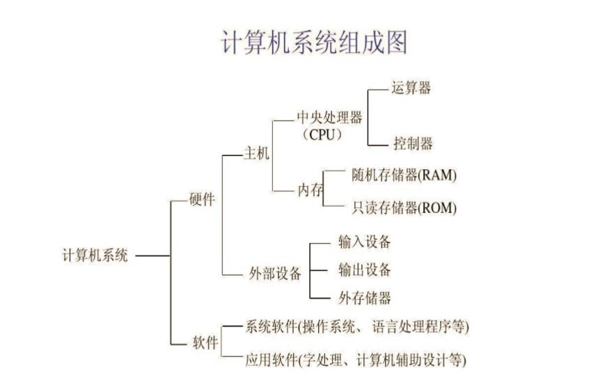

# Python 理论部分复习

!!! abstrat icon-only
   
    2026.7
    
    理论部分：

       - 题型：判断、单选、填空、选择性填空
       - 范围：教材 1-8 章（除 2.7 、6.7.2 、7.3 、7.4 、8.3 、8.4 、8.5）  
    
    实验部分：

       - 范围：教材 1-6 章（除 2.7 、6.7.2）

## 1 Python 概述

### 1.1 计算机基础

#### 文本编码

- ASCII 码：八位二进制表示字母、数字、专门符号

- Unicode 码：包括字符集、编码方案等，为每种语言的每个字符设定了统一且唯一的二进制编码
    - UTF-8 编码：把 Unicode 码转换字节或位

#### 进制转换

- 1 位八进制等于 3 位二进制，1 位十六进制等于 4 位二进制

- 十进制转二进制：
    - 整数部分不断除以 2 ，倒序取余数
    - 小数部分不断乘以 2 ，顺序取整数部分
        
        >⚠️十进制小数不一定有对应的二进制形式！

#### 原码、反码、补码

- 原码：8 位二进制，最高位 0 表示正，1 表示负

- 正数的原码、反码、补码一样

- 负数的反码：原码符号位不变，其他位取反

- 负数的补码：反码加 1

#### 计算机组成



- 操作系统：管理和控制计算机硬件与软件资源的计算机程序，直接运行在“裸机”上的最基本的系统软件
    - 如 Linux 、Windows 、Mac OS

#### 程序设计语言

- 机器语言

- 汇编语言

- 高级语言：有编译型、解释型
    - 如 C 、C++ 、Java 、Python

### 1.2 Python 特点

- 面向对象、解释型、高级动态语言

### 1.3 标识符和变量

- 标识符：由字母、下划线、数字组成，但不能以数字开头，并且区分大小写

- 关键字：不能作为标识符

    | False | await | else | import | pass |
    |-------|-------|------|--------|------|
    | None  | break | except | in | raise |
    | True  | class | finally | is | return |
    | and   | continue | for | lambda | try |
    | as    | def | from | nonlocal | while |
    | assert | del | global | not | with |
    | async | elif | if | or | yield |


- 常量：不能改变的量，如数学常数

- 变量：为了引用内存中的值而给它取的名字，实际是将名字和对象关联起来，赋值时不是实际复制值，而是对象的引用
    - 内置函数 `id()` 返回对象的标识，即对象地址

### 1.4 输入及输出函数

#### 输入

```py
s = input()     # 输入取成字符串
m, n = input().split()      # 输入多个值，默认空格划分
```

#### 输出

```py
print(1, 2)     # 输出结尾自动换行
print(1, 2, end = '')       # 结尾不换行  
```

## 2 用 Python 语言编写程序

### 2.1 数字类型 

- 整数 `int`
    
    >⚠️两个整数相除（`/`），结果为浮点数

    - 开头 `0b` 或 `0B` 代表二进制数
    - 开头 `0o` 或 `0O` 代表八进制数
    - 开头 `0x` 或 `0X` 代表十六进制数

- 浮点数 `float`
    
    >⚠️浮点数运算有误差
    >
    >   ```py
    >   2.1 - 2.0 == 0.1    # 返回为 False
    >   ```
    >
    >⚠️浮点数整除（`//`）、取余（`%`），结果都是浮点数

    - 可以使用科学计数法表示，如 `0.000012` 表示为 `1.2e-5`
        - $e$ 的前后都不能为空，并且后面要是整数


- 复数 `complex` ：由实部和虚部组成，虚部用 `j` 表示，如 `2 + 3j`
    - `real` 方法取实部，`imag` 方法取虚部，`complex()` 函数创建复数

    ```py
    print(complex(1))     # 输出 (1+0j)
    print(complex(1j))     # 输出 (1j)
    print(complex(0, 1))    # 输出 (1j)
    ```

    >⚠️`complex(j)` 会报错

#### `math` 库

使用 `math` 库之前，需要 `import` 导入

```py
import math
math.pi     # 返回 π 值
math.sqrt(9)    # 返回 3.0
```

根据导入方式调用函数
```py
from math import sqrt
sqrt(9)     # 注意这里使用 math.sqrt() 会报错
```

### 2.2 字符串 `str`

字符串用 `''` 或 `""` 括起来

```py
'abc'   # 返回 'abc'
print('abc')    # 输出 abc
```

#### 转义字符

有些字符直接输入有歧义，用转移字符替代

| 转义字符 | 含义 |
| --- | --- |
| `\\` | \ |
| `\'` | ' |
| `\"` | " |
| `\a` | 响铃 |
| `\b` | 退格 |
| `\n` | 换行 |
| `\t` | 横向制表符 |
| `\r` | 回车 |
| `\f` | 换页 |
| `\ooo` | 最多三位八进制数表示 ASCII 码 |
| `\xyy` | 两位十六进制数（在 `x` 之后）表示 ASCII 码 |

#### 字符串运算

- `str() + str()` 两个字符串拼接

- `str() * int()` 一个字符串复制后拼接

### 2.3 布尔类型 `bool`

布尔类型的变量只有 `True` 和 `False` 两种值，可以通过[关系运算符](#_10)和[逻辑运算符](#_11)计算

#### 关系运算符

- `==`
- `!=`
- `>`
- `>=`
- `<`
- `<=`

>⚠️不同类型比大小会报错

#### 逻辑运算符

逻辑运算符的对象可以是任意类型，其中 `False` 、`None` 、`int(0)` 、`float(0.0)` 、`""` 、空的容器类型对象，都判断为假，其他为真

按照优先级由高到低为：

- `not exp`
    - 若 `exp` 为真，则结果为 `True`
    - 若 `exp` 为假，则结果为 `False`
- `exp1 and exp2` 
    - 若 `exp1` 为真，则结果为 `exp2` 的值
    - 若 `exp1` 为假，则结果为 `exp1` 的值（不计算 `exp2`）
- `exp1 or exp2`
    - 若 `exp1` 为真，则结果为 `exp1` 的值（不计算 `exp2`）
    - 若 `exp1` 为假，则结果为 `exp2` 的值

>⚠️`and` 和 `or` 的返回结果不一定是布尔型

### 2.4 空类型

空类型只有一个值，即空值，用 `None` 表示

>⚠️注意 `None` 不能理解为 0
>   ```py
>   None == 0   # False
>   ```

### 2.5 列表 

用 `[]` 包裹，元素之间用 `,` 隔开

```py
print([1, 2])   # 输出 [1, 2]
```

#### 列表推导式

```py
[i for i in range(5)]     # [0, 1, 2, 3, 4]
[i*2 for i in range(5) if i%2 == 1]     # [2, 6]
```

### 2.6 运算符的优先级和结合性

1. `**` 幂运算从右向左

    ```py
    2 ** 3 ** 2     # 512
    ```

2. `+` 、 `-` 表示正号和符号

    ```py
    2 ** -2     # 0.25
    ```

3. ……

### 2.7 相关内置函数

- 内置函数 `type()` 查询对象的类型
    - 如 `type('python')` 返回 `<class 'str'>`

#### 类型转换函数

- `bool()` 

- `int()`
    ```py
    int()   # 0
    int("02")   # 2
    int("   3   ") # 3
    int("3  4")     # 报错
    int("11", 2)    # 29
    int(0b11)   # 3
    ```

- `float()`

- `complex()`

- `str()`

- `ord()` 返回 Unicode 字符对应十进制数

- `chr()` 返回十进制数对应的 Unicode 字符

- `bin()` 将十进制数转为二进制字符串

- `oct()` 将十进制数转为八进制字符串

- `hex()` 将十进制数转为十六进制字符串

- `list()`

    >⚠️传入参数必须有包裹，否则报错
    >
    >   ```py
    >   list(1, 2)   # 报错
    >   list((1, 2))    # [1, 2]
    >   list('12')    # ['1', '2']
    >   ```

#### 表达式

表达式可以计算，由常量、变量、运算符或函数按规则构成，返回运算结果

```py
1 if n % 2 == 1 else 0      # 条件表达式
```

### 2.8 语句

- 一行中多条语句，用 `;` 隔开
- 长语句要跨行时，行尾用 `\` 表示

#### 赋值语句

```py
a, b = b, a     # 交换 a, b 的值
a = b = 1   # 链式赋值
a = (b = 1)     # 报错，因为 `b = 1` 是一个语句，没返回
a *= 3 + 1     # a = a * (3 + 1)     
```

#### `if` 语句

```py
if exp1:
    do1
elif exp2:  # 可以没有
    do2
else:   # 可以没有
    do3
```

>⚠️`else` 总是与和自己缩进相同的最近的 `if` 匹配

#### `for` 语句

```py
for variable in lst:
    do
```

- `range(start, stop, step)` 函数
    - 开始计数包含 `start` ，结束计数不包含 `stop`
    - `step` 可以省略，默认 1

    ```py
    list(range(3))    # [0, 1, 2]
    sum(range(3))    # 3
    range(3)[1]    # 1
    ```

### 2.9 格式化输出

#### `format()` 函数

采用内置函数 `format()` ，返回为字符串

```py
"{:d}".format(11)      # 输出整型十进制 11     
"{:b}".format(11)      # 转二进制输出 1011 
"{:o}".format(11)      # 转八进制输出 13
"{:x}".format(11)      # 转十六进制输出 b

"{:.2f}".format(11.111)     # 保留小数点后 2 位输出 11.11
"{:.2e}".format(11.111)     # e前保留 2 位小数，科学计数法输出 1.11e+01

"{}".format('hi')     # 直接输出字符串
"Hello, my age is {}".format(20)  # 输出 Hello, my age is 20

"{:5d}".format(11)      # 指定输出宽度 5 ，默认右对齐（超过宽度直接输出）
"{:5.2f}".format(11.111)    # 指定输出宽度 5 （默认右对齐，小数点算一位），保留 2 位小数
"{:5s}".format('hi')    # 指定输出宽度 5 ，默认左对齐

"{:>5s}".format('hi')   # 指定右对齐，输出宽度 5
"{:<5d}".format(11)     # 指定左对齐，输出宽度 5
"{:^5d}".format(11)     # 指定居中，输出宽度 5
"{:*^5d}".format(11)    # 指定居中，输出宽度 5 ，用 * 填补空位

"{0:5d}{1:5d}{2:5d}".format(11, 11, 11)    # 输出三个格式化参数
```

#### f-string 方法

同样返回字符串

```py
f"{11}"       # 直接输出 
f"{11:08d}"   # 指定宽度 8 ，（数字默认右对齐）左边补 0
f"{11:b}"     # 转二进制输出
f"{11:x}"     # 转十六进制输出

f"{11.111:.2f}"     # 保留二位小数输出
f"{1111:,}"         # 加千位分隔符输出
f"{11.111:.2%}"     # 百分比输出，并且百分数保留二位小数（相当于实际保留四位小数）

f"{11:<10}"     # 左对齐，指定宽度 10 输出（默认补空格）
f"{11:*^10}"    # 居中，指定宽度 10 ，补 *
f"{'s':>10}"    # 右对齐，指定宽度 10 输出

f"{1}{2}{3}"    # 多个参数输出
```

### 2.10 对象

Python 用对象表示数据，对象三要素：

 - `id` 存储位置
 - `type` 类型
 - `value` 值

对象可以分为：

 - 可变对象：值可变，但是修改后 `id` 不变，如列表、集合、字典
 - 不可变对象：值不可变，修改值即改变 `id`，如数字、字符串、逻辑量、元组

## 3 字符串、列表、元组

### 3.1 序列

序列是一类数据容器的统称，容器中包含多个元素，有先后次序，通过下标访问

- 例如列表、字符串、元组、`range()` 结果

#### 访问

以一个名称为 `a` 的序列为例：

- `a[0]` 访问第一个元素
- `a[-1]` 访问最后一个元素
- `a[0:2]` 访问包括下标 0 和 1 的子序列
- `a[0:2:2]` 访问从下标 0 开始的子序列，步长 2 （默认步长 1 ）
- `a[::-1]` 访问整个序列，步长 -1 即倒着访问

>⚠️访问序列单个元素越界，会报错

#### 复制

- 将一个序列变量赋值给另外一个变量，它们指向同一个序列
    ```py
    a = [1, 2]
    b = a
    # 如果修改 a ，那么 b 也会改变，反之亦然
    ```

- 使用切片，可以创建一个新序列

    ```py
    a = [1, 2]
    b = a[:]
    # 最外层各自独立
    ```

    >⚠️这种方法是浅拷贝，只有第一层互不影响，这意味着如果第一层中有可变对象，那么 `a` 或 `b` 改动它时会影响对方

#### 拆包

可以把一个序列的元素赋值给多个变量，但是数量必须对应，否则报错

```py
s = 'abcd'
a, b, _, _ = s     # _ 表示匿名变量，只获取 a = 'a' 和 b = 'b'
a, *b, d = s    # 变量名前加 * 获取子序列，获得 a = 'a' 和 b = ['b', 'c'] 和 d = 'd'
```

#### 加法、乘法

- `+` 两个序列拼接
- `*` （一个序列和 `int` 相乘）重复序列

#### 判断序列元素

```py
1 in [0, 1, 2]      # True
[1, 2] in [0, 1, 2]     # False
[1, 2] in [0, [1, 2]]      # True

'e' in 'hello'      # True
'he' in 'hello'     # True
```

#### 其他函数

- `len()` 返回序列元素个数

- `max()` 返回序列中最大值

- `min()` 返回序列中最小值

>⚠️大小按照 Unicode 码比较

- 根据元素值获取元素索引
    ```py
    lst = [3, 4, 5, 4, 5]
    lst.index(4)    # 1 （返回第一个值的位置）
    lst.index(0)    # 找不到会报错
    ```

### 3.2 字符串 `str`
 
- 如果有多对引号，必须 `''` 和 `""` 交替出现，否则报错
- `''''''` 括起来的字符串可以包含多行，输出时根据输入格式分行
- 字符串引号开始前加 `r` 表示是原始字符串，不会识别转义字符
- 字符串不可修改，只能整个重新赋值，表示一个新的字符串 

#### 常用函数

- `s.title()` 每个单词的首字母改大写（以非字母开头的词，则把第一个字母改为大写）
- `s.lower()` 大写字母改小写
- `s.upper()` 小写字母改大写
- `s.strip()` 删除两端空格
    - `s.rstrip()` 删除右端空格
    - `s.lstrip()` 删除左端空格
- `s.find(sub[, start[, end]])` 查找子串 `sub` 首次出现的位置（没有返回 -1 ）
- `s.replace(old, new)` 用 `new` 替换 `old`
- `''.join(x)` 把序列 `x` （元素都要为字符串类型）合并为字符串，`''` 中填分隔符
- `s.split()` 拆分成列表
- `s.count(sub[, start[, end]])` 计算 `sub` 出现的次数

### 3.3 列表 `list`

- 列表中的元素可以是不同类型
- 列表中的元素可以修改

#### 创建

```py
a = []      # 空列表
a = [1, 2, 3]       

a = list('hello')     # ['h', 'e', 'l', 'l', 'o']
a = list(range(5))      # [0, 1, 2, 3, 4]
```

#### 删除元素

```py
a = [1, 2, 3]
del a[1]
# a = [1, 3]
```

#### 切片赋值

用另外一个列表替换当前列表切片部分

```py
a = [1, 2, 3]
a[1:] = [1]
# a = [1, 1]
```

#### 常用函数

- `l.append(x)` 末端添加元素 `x`
- `l.clear()` 移除所有元素
- `l.count(x)` 计算 `x` 出现的次数
- `l.copy()` 复制一个新列表，注意这是深拷贝，新列表与原列表完全独立
- `l.extend(x)` 把列表 `x` 添加到末端
- `l.index(value[, start[, stop]])` 查找第一个值为 `value` 的下标（没有则报错）
- `l.insert(index, x)` 在下标 `index` 处插入元素 `x` （指定位置不存在则加末端）
- `l.pop(index)` 返回并删除一个元素，默认最后一个
- `l.remove(value)` 删除值为 `value` 的第一个元素（没有则报错）
- `l.reverse()` 翻转列表
- `l.sort()` 排序（默认升序，并且元素要可比较大小，否则报错）

### 3.4 元组 `tuple`

- 元组的元素不可以修改，包括增添、删除、排序等
    >⚠️实际上这个不能修改，是指元素的地址不能修改，而地址指向的对象如果可变，是可以修改的。例如元组的一个元素为一个列表，那么列表里面的内容可以修改。

- 元组的元素可以是任意类型
- 使用 `()` 包裹

#### 创建

```py
a = (1, 2, 3)
a = tuple([1, 2, 3])
```

#### 常用函数

- `t.count(x)` 计算元素 `x` 出现的次数 
- `t.index(x)` 查找第一个 `x` 出现的下标（没有则报错）

### 3.5 `random` 库

`random` 模块用于产生伪随机数，需要先 `import random`

- `random.random()` 返回 $[0.0, 1.0)$ 区间内的浮点数
- `random.uniform(a, b)` 返回 $[a, b]$ 区间内的浮点数
- `random.randint(a, b)` 返回 $[a, b]$ 区间内的整数
- `random.randrange(start, stop, step)` 在指定范围内返回随机数
- `random.choice(sequence)` 从序列中获取随机数
- `random.shuffle(x)` 将列表 `x` 中的元素随机排列
- `random.sample(sequence, k)` 从指定序列中随机获取 `k` 个元素并随机排序
- `random.seed(n)` 对随机数生成器进行初始化

## 4 条件、循环、其他语句

### 4.1 条件语句

- [基本条件语句](#if)
- 条件语句可以嵌套

### 4.2 循环语句

#### `while` 循环

```py
while exp:
    do1
else:   # 可以省略
    do2
```

>⚠️如果 `while` 循环正常退出，会执行 `else` 语句；但是 `while` 循环中出现 `break` ，那么不会执行 `else` 语句 

#### `for` 循环

```py
for variable in lst:
    do1
else:   # 可以省略
    do2
```

>⚠️如果 `for` 循环正常结束，会执行 `else` 语句；但是 `for` 循环中出现 `break` ，那么不会执行 `else` 语句

#### 关键字说明

- `break` 结束所在的这一个循环体，执行之后的语句
- `continue` 跳过所在的这一轮循环，进行下一轮循环
- `pass` 不执行任何操作，用于在未确定执行什么操作时占位

### 4.3 搜索算法

#### 线性搜索

依次遍历

#### 二分搜索

要求序列有序，效率比线性搜索高

### 4.4 排序

#### 选择排序

以目标升序为例，每次选取未排序数据中的最小值，加入已排序序列最后

#### 冒泡排序

以目标升序为例，不断两两比较相邻数据，使得大数据排在小数据之后

## 5 集合和字典

### 5.1 集合 `set`

- 集合是一类容器，元素没有顺序，并且值不能重复
- 使用 `{}` 包裹
- 集合的元素必须是不可变对象，例如列表、字典、集合就不可以

#### 创建

```py
a = {1, 2, 3, 1}    # 自动去掉重复元素 a = {1, 2, 3}
a = set()   # 创建空集合
a = set([1, 2, 3])      # 转换成集合
```

>⚠️ `a = {}` 创建的是一个空字典，而不是空集合
>⚠️集合会自动调整内部元素的顺序

#### 访问

由于集合内元素无序，不能通过下标访问，一般通过遍历访问

#### 元素、子集、超集、相等的判断

- `in` 判断元素是否在集合中
- `s1.issubset(s2)` 判断 `s1` 是否为 `s2` 的子集，`s2.issuperset(s1)` 判断 `s2` 是否为 `s1` 的超集
    - 如果集合 `s1` 的元素同样都在 `s2` 中，那么 `s1` 为 `s2` 的子集，`s2` 为 `s1` 的超集 
- `==` 判断两个集合是否包含完全相同的元素
- `<` 、`<=` 、`>` 、`>=` 可以判断子集、真子集、超集、真超集

#### 常用函数

以操作名称为 `a` 的集合为例

- `len(a)` 
- `min(a)` 
- `max(a)`
- `sum(a)`
- `a.add(x)`
- `a.remove(x)` 如果 `x` 不存在会报错

#### 运算

以两个集合 `s1` 和 `s2` 的运算为例

- `s1.union(s2)` 求并集
- `s1 & s2` 求交集
- `s1 - s2` 求 `s1` 中有而 `s2` 中没有的元素集合
- `s1 ^ s2` 求并集挖掉交集

### 5.2 字典 `dict`

字典是用键值做索引来存储数据的集合，一个键值和对应数据形成一个条目

- 不可变对象才能作为字典的键值，例如数字、字符、元组

#### 创建

```py
# 创建空字典
d = {}
d = dict()

d = {'a':1, 'b':2}
d = dict(a = 1, b = 2)
d = dict([('a', 1), ('b', 2)])
```

#### 操作

```py
d = {1:10, 2:20, 3:30}

# 用键值访问数据
d[1]    # 返回 10
d[0]    # 找不到，报错

# 用键值修改条目
d[1] = 100

# 用键值增加条目
d[4] = 40

# 用 del 删除条目
del d[1]
del d[0]    # 不存在键值，会报错

# 假定不理会报错，到目前为止 d = {2:20, 3:30, 4:40}

# 用键值遍历
for key in d:
    print(d[key])

# 计算条目总数
len(d)

# 检查某个键值是否在字典中
1 in d      # True
0 in d      # False

# 比较两个字典是否相同
dd = {2:20, 3:30, 4:40}
ddd = {2:10, 3:30, 4:40}
d == d      # True 因为键值和数据都相同
d == ddd        # False

# 合并字典，如果两个字典有相同键值，那么数据取后一个
d_merge = {**d, **ddd}      # d_merge = {2:10, 3:30, 4:40}
```

#### 常用函数

以名称为 `d` 的字典为例

- `d.keys()` 返回全部键值组成的序列
- `d.values()` 返回全部数据组成的序列
- `d.items()` 返回序列，其中每一项是一个元组，包含键值和对应数据
- `d.clear()` 删除所有条目
- `d.get(key, value)` 返回键值 `key` 对应的数据，找不到返回 `value`
- `d.pop(key)` 返回键值 `key` 对应的数据并删除这个条目，找不到会报错

## 6 函数

### 6.1 定义

- 内置函数
    - 如 `len()`

- 自定义函数
    - `def f():`

- 匿名函数（适合定义简单函数）
    - 如 `f = lambda x, y: x + y`

函数也是一个对象，定义好之后，才能使用

### 6.2 参数传递

>⚠️当实参是不可变对象时，函数中形参改变不影响实参；当实参是可变对象时，函数中形参改变可能会影响实参

#### 位置参数

按传入实参位置复制给形参

#### 关键字参数

指定实参对应的形参名字

>⚠️如果同时使用位置和关键字传参，那么优先位置传参，关键字参数不能在中间隔断，只能放最后，但关键字参数内部可以打乱顺序

#### 默认值参数

在定义函数的时候可以指定参数默认值，但是默认值同样只能放最后

如以下函数定义会报错
```py
def f(x = 1, y):
    return x
```

#### 不定长数目参数

- `def f(a, *b)` 将不知数目的参数收集为元组

- `def f(a, **b)` 将不知数目的参数收集为字典（要求实参传入带变量名）

### 6.3 返回

- 用 `return` 语句返回，没有 `return` 默认返回值为 `None`

### 6.4 命名空间和作用域

- 标识符查找顺序是：局部 $\to$ 全局 $\to$ 内置

- 如果希望在函数中（局部）使用全局变量，使用 `global` 关键字声明该变量

### 6.5 内置函数

>注意这与内置模块中的函数这一概念不同，内置模块例如 `math` 、 `random` 需要导入，而内置函数都不用专门导入

#### `sorted()` 

对字符串、列表、元组、字典等对象进行排序，返回一个新的列表，参数包括

- `iterable` 序列
- `key` （可省略）具体用于排序的元素，例如字典的数据
- `reverse` （可省略）`True` 降序，`False` 升序，默认升序

#### `map()`

根据提供的函数对序列进行映射，返回一个新列表或迭代器，参数有

- `function` 映射方法
- `iterable` 序列 

例如
```py
a = map(int, input().split())
```

#### `zip()`

将可迭代的对象作为参数，将对象中对应的元素打包成一个个元组，返回由这些元组组成的列表或迭代器

例如
```py
a = [1, 2, 3, 4]
b = [10, 20, 30]
c = [100, 200, 300]
zip(a, b, c)   # [(1, 10, 100), (2, 20, 200), (3, 30, 300)]
```

#### `eval()`

把字符串当成 Python 表达式来执行，并返回结果，如
```py
eval('1 + 2 + 3')   # 返回 6
```

#### `exec()`

把字符串当成 Python 程序运行，如
```py
exec('print("hi")')     # 输出 hi ，但是无返回
```

#### `all()`

将可迭代对象作为参数，参数都是 `True` 时返回 `True` ，否则返回 `False` 

#### `any()`

将可迭代对象作为参数，参数有 `True` 时返回 `True` ，否则返回 `False`

### 6.6 程序结构

- Python 标准库拆分为多个模块，每个模块以文件形式存放，定义一组 Python 函数和其他对象
- 模块需要 `import` 导入

#### 模块的引入和删除

以 `math` 模块为例
```py
import math     
import math as m    # 以 m 作为别名
from math import *      # 调用时不需要加模块名
from math import sqrt     # 调用时这个函数不需要加模块名

del math    # 删除模块
```

### 6.7 递归

函数调用自身，必须有终止条件和递归条件

## 7 文件

### 7.1 文件读写

#### 打开文件

```py
file = open(filename, mode)
```

- `file` 函数返回的文件对象
- `filename` 文件名
- `mode` 字符串
    - 第一部分指明操作
        - `r` 只读（默认）
        - `w` 覆盖写入，不存在 `filename` 时创建一个新文件
        - `a` 追加写入，不存在 `filename` 时创建一个新文件
        - `x` 创建一个新文件并写入，已存在则出错
        - `+` 与上述方式一起使用，实现读与写
    - 第二部分（可省略）指明文件类型
        - `t` 文本类型文件
        - `b` 二进制类型文件

#### 其他常见读写函数

以文件对象 `f` 为例

- `f.read(size)` 读取长度为 `size` 的字符串（如果未给定参数或为负数，则读取所有内容）
- `f.readline()` 读取整行，返回字符串
- `f.readlines()` 读取所有行，返回列表
- `f.write(s)` 把字符串 `s` 写入文件
- `f.writelines(s)` 写入元素都为字符串的列表（要换行需自行加入换行符）
- `f.seek(off, whence=0)` 设置文件当前位置
- `f.tell()` 返回当前文件读写的位置
- `f.close()` 关闭文件

### 7.2 异常处理

可以使用 `try-except` 语句实现异常处理
```py
try:
    do
except exp1:    # 可以有多个
    do1
except:
    do2
else:
    do3
finally:
    do4
```

- 正常程序执行 `try` 中的内容，然后执行 `else` 中的内容
- 发生异常时，终止程序，跳转到对应 `except` 异常处理块中执行，找不到则执行没有 `exp` 的那个 `except`
- 不论有无异常，最后都执行 `finally` 中的内容

#### 常见的标准异常

| 异常 | 描述 |
| --- | --- |
| `SystemExit` | 解释器请求退出 |
| `FloatingPointError` | 浮点计算错误 |
| `OverflowError` | 数值运算超出限制 |
| `ZeroDivisionError` | 被除数为 0 |
| `KeyboardInterrupt` | 用户中断执行 |
| `ImportError` | 导入模块或对象失败 |
| `IndexError` | 序列中无此索引 |
| `RuntimeError` | 运行时错误 |
| `AttributeError` | 对象无此属性 |
| `IOError` | 输入或输出操作失败 |
| `OSError` | 操作系统错误 |
| `KeyError` | 映射中没有这个建 |
| `TypeError` | 对类型无效的操作 |
| `ValueError` | 传入无效参数 |

#### `raise` 语句

采用 `raise` 语句可以自己定义异常类型

#### `assert` 语句

断言语句 `assert` ，在系统变量 `_debug_` 为 `True` 时有效

## 8 类和对象

### 8.1 面向对象程序设计

面向对象程序设计使用对象进行程序设计，实现代码复用和设计复用

- 面向对象的三大特点是：封装、继承、多态

### 8.2 类与对象

- 类是定义属性和行为的模版
- 每个类有自己的命名空间，类名就是空间名
    - 每个对象也有自己的名字空间
- 存储在类名称空间中的名称是类的成员
    - 类成员包含类属性、类方法（使用 `.` 访问）
- 用类产生的对象称为实例（可以认为就是对象）
- 可以用内置函数 `isinstance(obj, Cla)` 来测试对象 `obj` 是否为类 `Cla` 的实例

#### 创建类

```py
# 创建类
class Aclass():

# 创建对象
a = Aclass()
```

#### init 方法

- `_init_` 方法是 Python 类中一种特殊方法，称为构造方法，当创建类的对象时被自动调用
- `_init_` 方法中可以声明类所产生的对象的属性，并为其赋初值，注意不能有返回值

#### `self` 参数

- 按惯例，类的实例方法的第一个形参为 `self` ，代表将来要创建的对象本身
- 在类的方法中访问实例变量时，要以 `self` 为前缀
- 在外部通过对象调用对象方法时不需要传递这个参数，而通过类调用对象方法则需要显式为 `self` 参数传值
