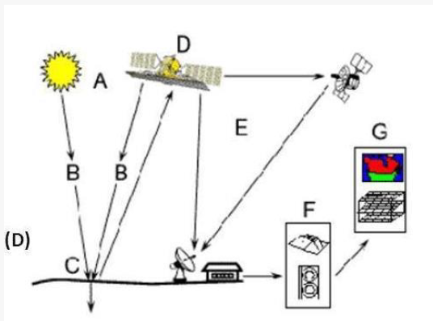
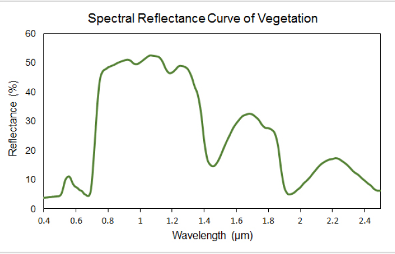
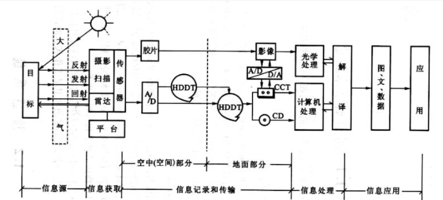

# 绪论

## 1 遥感的定义

从远处探测感知物体，也就是不直接接触物体，通过探测仪器接收来自目标地物的电磁波信息，经过对信息的处理，判别出目标地物的属性。

>但是，非接触也导致遥感是不准确的，没有两幅完全一样的遥感图像。

## 2 遥感过程和遥感系统

### 2.1 遥感过程

- A 能量源 / 光源

- B 能量向外辐射并穿过大气

    - 云反射可见的太阳辐射，并向太空发射红外辐射以及能对降水程度进行间接测量。
    - 微波可用于观测降水。

- C 能量与目标地物相互作用

- D 传感器记录辐射能量

    >包括地物的辐射能量和反射能量

    >
    >
     注意由于叶绿素的原因 0.6-0.8 $\mu m$ 段（红光到近红外波段）突然上升，叫红边。
     定义植被归一化指数 NDVI 

- E 信号接收和转换

- F 信号解译和分析

- G 应用

### 2.2 遥感系统

## 3 遥感的特点

- 大面积同步观测

- 多尺度

    >这一概念在地学中非常重要，同一地物在不同尺度下特征不同，这意味着分析时需要不同的数学方法。    

    - 空间（地面）分辨率：遥感图像上能够详细区分的最小单元的尺寸或大小，即传感器能够把两个目标作为清晰的实体，记录下两个目标物之间最小的距离，是用来表征影像分辨地面目标细节能力的指标。

- 多波段

    - 光谱分辨率：指传感器所选用的波段数量的多少（通道数）、各波段的波长位置（中心波长）、及波长间隔的大小（带宽）。

- 多时相

    - 时间分辨率：指在同一区域进行的相邻两次遥感观测的最小时间间隔。

### 总结

大面积同步观测、数据的综合性和可比性、时效性、经济性、局限性。

## 4 遥感的类型

### 不同平台

- 地面遥感
- 航空遥感
- 航天遥感

### 不同电磁波段

- 可见光遥感（是近似的可见光）
- 红外遥感
- 微波遥感

### 传感器的不同工作方式

- 被动传感
- 主动遥感

## 5 遥感常见应用

- 地质灾害监测
- 环境污染
- 地质构造
- 海洋监测
- 遥感考古
- 夜间灯光
- 雾霾监测
- 温度监测
- 干旱监测
- AUV 海底图像拼接
- 虚拟现实航迹回溯

## 6 遥感发展简史

- 1608-1838 无记录地面遥感阶段
- 1839-1857 有记录地面遥感阶段
- 1858-1956 空中摄影遥感阶段
- 1957 至今 航天遥感阶段

## 7 我国遥感发展历程

- 50 年代 航空摄影和应用工作
- 60 年代 航空摄影工作初具规模，应用范围不断扩大
- 70 年代 腾冲遥感实验获得巨大成功
- 80 年代 发展阶段
- 21 世纪 快速发展

## 8 遥感的发展趋势

### 遥感卫星

- 更高空间分辨率
- 更高时间分辨率
- 更高波谱分辨率
- 更高辐射分辨率

### 遥感应用

- 全球地球综合观测系统
- 高精度遥感模型与参数反演
- 遥感产品真实性检验与不确定性
- 遥感数据与地球系统模式同化
- 遥感大数据与主动服务

## 9 遥感数据处理亟待解决的问题

- 海量数据的有效压缩、存储、管理、传输和使用
- 多源遥感数据融合、遥感信息自动识别和应用
- 遥感应用处在定性向定量过渡的阶段，其精度远不能满足社会需求
- 遥感产品的真实性检验与不确定性