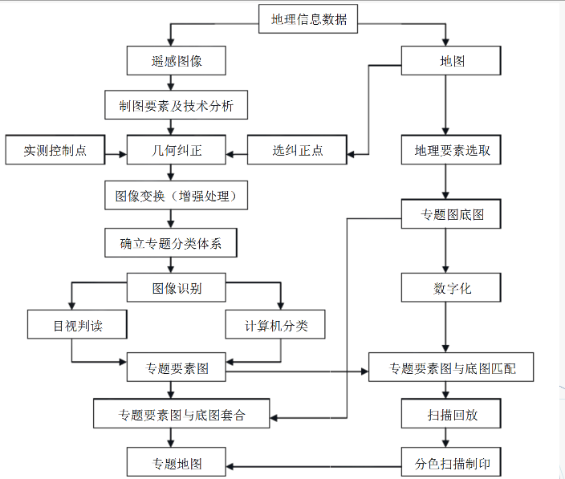

# 遥感影像目视解译与制图

## 1 遥感影像目视解译原理

### 1.1 遥感影像解译方法

#### 目视解译

专业人员通过直接观察或借助判读仪器在遥感影像上获取特定目标地物信息的过程。

#### 计算机解译

以计算机系统为支撑环境，利用模式识别技术与人工智能技术，根据遥感影像中目标地物的各种影像特征，结合专家知识库中目标地物的解译经验和成像规律等知识进行分析和推理，实现对遥感影像的理解，完成对遥感影像的解译。

### 1.2 遥感影像目视解译过程

目视解译实质是遥感成像的逆过程，遥感影像经过遥感解译，成为地表景观。

### 1.3 遥感影像目标地物识别特征

#### 目标地物识别特征

遥感影像中目标地物特征是地物电磁波辐射差异在遥感影像上的典型反映，由影像纹理、色调、反差等通过地形、地貌、水系、植被等分布形式表现出来，按其表现形式的不同，可以概括为：

 - 色：目标地物在遥感影像上的颜色，包括色调、颜色和阴影等；
 - 形：目标地物在遥感影像上的形状，包括形状、纹理、大小和图案等；
 - 位：目标地物在遥感影像上的空间位置，包括空间位置、相关布局等。

#### 目视解译标志

遥感影像上那些能够作为识别、分析、判断景观地物的影像特征，包括直接解译标志和间接解译标志。

其中，直接解译标志指判读目标自身特点直接在遥感影像上表现出来，可根据这一特点直接判别地物类型，主要就是色、形、位。

## 2 遥感影像目标地物识别特征

### 2.1 直接解译标志

#### 色调与颜色

色调指光的主波长，在遥感影像中指色彩的基本倾向。

色调与颜色是地物波谱在像片上的表现，是遥感解译的最基本标志。

色调与颜色的差异是相对的，受到多种因素影响，包括：

 - 自然因素：地物颜色、含水量、风化程度、地面土壤、植被覆盖率、光照条件、成像季节；
 - 人为因素：成像波段选择、假彩色合成参数。

遥感影像因此存在同物异谱和异物同谱的现象。

#### 阴影

遥感影像上光束被地物遮挡而产生的光谱反射率差异（影子），包括：

 - 本影：地物未被太阳照射到的部分在像片上的构像，获得地物的立体感；
 - 落影：阳光直接照射物体时，物体投在地面上的影子在像片上的构像。

根据地物阴影的形状、位置，可以推测成像时间、地物高度等信息。

不同类型遥感影像中阴影形成的原因可能不同，如可见光遥感就是没有接收光产生阴影，热红外遥感阴影是由于温度低辐射能量少，微波遥感阴影是由于没有返回主动发射的微波。

#### 形状

指地物轮廓在遥感影像上的投影，根据影像空间分辨率和影像成图比例表现形式不同：

 - 人造地物：有规则的几何外形和清晰边界；
 - 自然地物：有不规则的几何外形和过渡边界。

#### 大小

地物的形状、面积的直接显示，是遥感解译最重要的特征之一，根据物体的大小可以推断物体的属性：

 - 不知比例尺时：可比较两个物体的相对大小；
 - 已知比例尺时：可直接算出地物的实际大小和分布规模。

物体本身大小、反射率差异、影像空间分辨率、图像比例尺都会影响图像上的物体大小。

#### 纹理

通过色调或颜色变化表现的细纹或细小的图案，在某一确定的图像区域中以一定的
规律重复出现，可揭示地物的细部结构或内部细小的物体，如点状、粒状、线状、斑状等。

纹理分为：

 - 结构纹理：纹理单元按一定的规律生成；
 - 点状纹理：个体在空间上重复出现的规律性不强。

纹理特征会受影像比例尺的影响，小比例尺纹理特征明显，大比例尺个体清晰。

#### 图型

指目标地物以一定规律排列而成的图型结构，反映岩性、构造的不同，是地质解译重要标志之一。常见的如条带状、网格状、斑点状、环带状等。

#### 位置

指目标地物在空间分布的地点，包括地理位置和相对位置。

目标地物与周围地理环境总是存在一定的空间联系，并受周围地理环境的制约，如根据地理位置，可以推断区域所处温度带、发育植被类型等。

而根据相对位置，可以为具体目标解译提供重要判据。

### 2.2 间接解译标志

由于现有遥感技术的局限性，许多问题不能从影像直接目视判读，而需要从其它相关事物之间的联系，通过逻辑推理综合获取，这一过程称间接解译，所采用的依据称间接解译标志，如环境质量评价等。

## 3 心理特点对遥感影像解译的影响

- 同一时刻，只有一种地物是目标地物

- 判读者的知识和经验对目标地物的确认有一定的导向作用

- 心理惯性对目标地物的识别有一定的影响

- 观察的时效性

## 4 遥感影像目视解译方法及步骤

### 4.1 遥感影像的判读依据

- 蓝绿波段：对水体有穿透能力，可用于区分土壤和植被，编制森林类型图等

- 绿色波段：分辨植被

- 红色波段：处于叶绿素吸收区域，用于观测道路 / 裸露土壤 / 植被种类效果很好

- 近红外：用于估算生物数量，尽管这个波段可以从植被中区分出水体，分辨潮湿土壤，但是对于道路辨认效果不如 TM3

- 中红外：用于分辨道路 / 裸露土壤 / 水，它还能在不同植被之间有好的对比度，并且有较好的穿透大气、云雾的能力

- 热红外：感应发出热辐射的目标

- 中红外：对于岩石 / 矿物的分辨很有用，也可用于辨识植被覆盖和湿润土壤

- 微米全色：得到的是黑白图象，分辨率为 15m ，用于增强分辨率，提供分辨能

### 4.2 遥感影像目视解译的一般原则

- 总体观察

- 综合分析

- 对比分析

- 观察方法正确

- 尊重影像客观实际

- 解译耐心认真

- 重点分析

### 4.3 遥感影像目视解译的一般顺序

- 从已知到未知，已知主要指解译者或他人熟悉的环境地物，未知指已知以外的影像区域

- 先易后难，易识别的地物先解译，再根据客观规律和影像特征不断进行解译实现，逐渐积累经验
    - 先山区后平原
    - 先地表后深部
    - 先整体后局部
    - 先宏观后微观
    - 先图形后线形

### 4.4 遥感影像目视解译方法

- 直接判读法：解译标志有色调、色彩、大小、形状、阴影、纹理、图案等

- 对比分析法：同类地物对比分析、空间对比分析、时相动态对比法

- 信息复合法：利用透明专题图或透明地形图与遥感影像复合，根据专题图或者地形图提供的多种辅助信息，识别遥感影像上目标地物的方法

- 综合推理法：综合考虑遥感影像多种解译特征，结合生活常识，分析、推断某种目标地物的方法

- 地理相关分析法：根据地理环境中各种地理要素之间的相互依存、相互制约的关系，借助专业知识，分析推断某种地理要素性质、类型、状况与分布的方法

### 4.5 遥感影像目视解译步骤

1. 准备工作阶段

    - 明确解译任务与要求
    - 收集与分析有关资料
    - 选择合适波段与恰当时相的遥感影像

2. 初步解译与判读区野外验证

    - 初步解译的主要任务：
        - 掌握解译区域特点
        - 确立典型解译样区
        - 建立目视解译标志
        - 探索解译方法，为全面解译奠定基础

    - 野外考察：
        - 填写各种地物的判度标志登记表，以作为建立地区性的判度标志的依据
        - 在此基础上，制定出影像判度的专题分类系统
        - 建立遥感影像解译标志

3. 室内详细判读

    - 先图外后图内：先了解影像图框外提供的各种信息
    - 先整体后局部：先整体观察，综合分析目标地物与周围环境的关系
    - 勤对比多分析：多个波段对比、不同时相对比、不同地物对比

4. 野外验证与补判

    - 野外验证包括检验专题解译中图斑的内容是否正确和检验解译标志
    - 疑难问题补判是对室内判读中遗留问题的再次解译

5. 目视解译成果的转绘与制图

    - 手工转绘成图
    - 在精确几何基础的地理地图上采用转绘仪进行转绘成图

## 5 遥感影像制图

### 5.1 计算机辅助遥感制图

### 5.2 遥感专题制图

遥感专题制图指以遥感图像为编制专题地图的基本资料进行专题制图。

1. 专题图总体设计

    - 确定制图区域
    - 确定制图比例尺
    - 选定地图投影和分幅范围
    - 表示方法和成图形式的选择，如以线划图表示还是以影像图形式表示或是线划与影像两者并存

2. 资料的收集和分析
    - 卫星影像：根据成图比例尺和影像判读要求，选择合适的卫星影像数据
    - 航空影像：针对需要作重点详查的地区进行航空摄影或收集最新的航摄资料，航片资料要与卫星图像复合
    - 地图资料：收集各种有关的地图资料，如地形图、高程等
    - 现场调查资料
    
    将收集到的资料进行分析整理，以确定编图的基本资料、补充资料和参考资料。

3. 初步判读

    在对资料进行分析的基础上，在室内对卫星影像进行初步判读，以了解制图区域的基本的土地覆盖情况、影响特征和可判读的程度等

4. 专题信息分类系统的拟定

    参照有关的国家标准、行业标准执行

5. 卫星影像的处理与识别分类

    - 图像的几何纠正
    - 图像投影变换
    - 图像增强与分类处理，利用人工判读或计算机分类方式对图像进行分类

6. 制图技术方案与技术路线的确定

    基于 GIS 的遥感专题图的制作，其内容包括工作底图的选择、地理基础底图的数字化、专题要素的提取方法、专题要素与基础底图的协调等

7. 详细判读绘制草图

    采取目视判读与计算机分类相结合的方法，在野外调绘建立的各类判读标志的基础上，从卫星影像上提取专题要素内容，并绘制出判读草图

8. 野外校核

    解译草图完成后，必须到野外采取抽样的方法进行全面的校核、验证

9. 修改草图

    及时修改已发现的或遗漏的问题，修改后定稿的判读草图即为判读稿图
    

10. 专题要素图与地理底图的复合

    - 专题要素图是由判读稿图与基础底图两者叠加后，经局部套合，将专题内容从判读稿图上转绘到基础底图上而形成

    在 GIS 系统环境下，将专题要素图与基础地理底图进行匹配与精确复合

11. 专题图的印刷出版