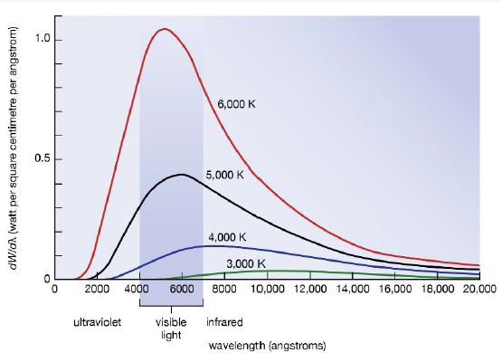

# 遥感物理基础 A

## 1 遥感物理基础

- 电磁辐射从辐射源到遥感器之间的传输过程中，要经历吸收、再辐射、反射、散射、偏振及波谱重新分布等一系列过程。

- 地球表面物体地物由于其电子、离子 、分子以及晶体的振动和转动等物理过程而具有波谱特性（分为原子光谱、分子光谱、固体（晶格结构）光谱）。

- 不同的地物由于其组成成分、内部结构和表面状态以及时间、空间环境的不同，它们辐射、反射、吸收和透射等电磁波谱特性也不同。而且许多地物在可见光至热红外波段内都具有与它们组分有关的光谱吸收特征，而且许多地物的光谱吸收特征具有专一性。

- 遥感物理就是研究和了解电磁辐射与地物相互作用的机理和过程，这对认识所获得的遥感数据以及识别地物目标是必不可少、至关重要的研究内容。

## 2 遥感物理研究内容

### 地面波谱测试、分析与模型发展

- 可见光、短波红外、热红外、微波

- 反射、发射、散射、偏振、方向特性

- 成分、状态、结构

- 统计、物理、综合分析

### 空中遥感器性能分析与评价

- 空间分辨率

- 时间分辨率

- 信噪比

- 光谱分辨率

- 辐射动态范围

- 等效噪声温差

### 定量化

- 定量

- 大气校正

- 物理量定量反演

- 地形校正

- 尺度转换

- 角度校正

## 3 建模、反演与波谱测量

- 建模：指针对某种物理过程，建立与之对应的数学方程或方程组的问题。

- 反演：基于模型知识基础上，依据可测参数值去反推目标的实时状态参数，就是用已知值推未知值，就像解方程或解方程组的问题。

都需要地面测量数据作为先验知识。

## 4 电磁波谱

### 4.1 基本概念

- 波：振动的传播
    - 纵波：质点振动方向和波的传播方向相同
    - 横波：质点振动方向和波的传播方向垂直

- 电磁波：交互变化的电磁场在空间中传播，是横波。

- 电磁波谱：电磁波按照波长或频率、波数、能量大小按顺序进行排列，可见光部分称为光谱。（注意，由于遥感使用的是电磁波，波谱与光谱的概念经常混用）

### 4.2 与遥感相关的主要参量

- 频率、波长：对应遥感传感器的接收波段

- 传播方向：对应辐射源、地物和遥感平台间三者的位置关系 

- 振幅：对应遥感影像中的强度、亮度

- 偏振、相位：微波遥感中偏振被称为极化，极化是微波遥感中的一个重要参数

### 4.3 紫外线

- 波段：0.01-0.38 $\mu m$ ，太阳辐射含有紫外线，通过大气层时，波长小于 0.3 $\mu m$ 的紫外线几乎都被吸收，只有 0.3-0.38 $\mu m$ 波长的紫外线部分能够穿过大气层，且散射严重。

- 应用：
    - 主要用于探测碳酸盐岩的分布，碳酸盐岩在 0.38 $\mu m$ 以下的短波区域对紫外线的反射比其它类型的岩石强。
    - 油污染的监测，因为水面漂浮的油膜比周围水面反射的紫外线要强烈。

- 探测高度：由于大气层中臭氧对紫外线的强烈吸收和散射作用，通常探测高度在 2000 米以下。

### 4.4 可见光

波段：0.38-0.76 $\mu m$ ，是遥感中最常用的波段。在此波段大部分地物都具有良好的亮度反差特性，不同地物在此波段的图像易于区分。

### 4.5 红外

#### 波段

主要是 0.76-1 $\mu m$ ，又可以划分为

 - 0.76-3 $\mu m$ 近红外，与可见光相似，又称光红外
 - 3-6 $\mu m$ 中红外
 - 6-15 $\mu m$ 远红外
 - 15-1000 $\mu m$ 超远红外

物体在常温范围内发射红外线的波长多在 3-40 $\mu m$ 之间，而 15 $\mu m$ 以上的超远红外易被大气和水分子吸收。

#### 热红外

中红外、远红外和超远红外是产生热感的原因，统称为热红外。

### 4.6 微波

#### 波段

主要是 1$mm$ - 1$m$ ，又分为

 - 毫米波
 - 厘米波
 - 分米波

#### 特点

 - 微波辐射和红外辐射都具有热辐射性质。由于微波的波长比可见光、红外线要长，能穿透云、雾而不受天气影响，所以能进行全天时、全天候的遥感探测。

 - 微波遥感可以采用主动或被动方式成像，另外，微波对某些物质具有一定的穿透能力，能直接透过植被、冰雪、土壤等表层覆盖物。

### 4.7 米波

- 超短波 1-10 $m$
- 短波 10-100 $m$
- 中波 100-1000 $m$
- 长波 1-10 $km$
- 超长波 10-100 $km$

>使用人工辐射源的主动遥感一般使用长波，因为能量比较强，可以传播的距离比较远。

## 5 电磁波极限分辨率

- 瑞利判据：当一个艾里斑的边缘与另一个艾里斑的中心正好重合时，此时对应的两个物点刚好能被人眼或光学仪器所分辨。
    
    - 衍射图样的中心区域有最大的亮斑，艾里斑的角度与波长及小孔的直径满足 $\sin \theta = 1.22 \frac{\lambda}{d}$ 。

- 实际应用时常用 $\frac{\lambda}{4}$ 作为识别的理论极限分辨率。

## 6 电磁波 / 电磁辐射的传播

### 6.1 反射、折射与偏振

- 电磁波在两种不同介质的分界面将发生反射和折射，这时，入射能量的一部分或全部将返回原介质；另一部分能量将偏离原入射方向进入另一种介质，偏折的大小取决于电磁波在这两种介质中的传播速度之比及入射时的角度；当传播速度是波长的函数时还将发生散色现象，即不同波长的电磁波偏折的方向不同。

- 在反射、折射、吸收和散射过程中还可能改变电磁波的偏振状态。

### 6.2 吸收

电磁辐射不论在导体或电介质中传播时，都存在吸收过程，吸收的强弱程度与原子、分子及固体的结构有关。吸收系数还与电磁辐射的波长有关，即吸收具有选择性。

- 电磁波在介质中传播时强度随距离的增加而逐渐衰减，在这个过程中辐射能转化为其他形式的能量，通常是转变为热能。

- 电磁辐射在导体中传播时部分电磁能转化为热能而耗损，电磁辐射强度随传播深度的增加呈指数衰减。

### 6.3 散射

- 电磁辐射在不均匀介质中传播时，出现偏离原传播方向的现象，称为散射。散射强度随微粒的大小或分子密度的涨落尺度与入射电磁辐射波长之间的关系而变化。

- 电磁辐射在均匀介质中传播时，被强迫振动的束缚电子产生的次波是相干的，由麦克斯韦方程推知它们的传播方向是不变的，所以不产生散射。

## 7 电磁辐射的度量

### 7.1 辐射源

广义的，任何物体都是辐射源，不仅能吸收其它物体对它的辐射，也能向外辐射

 - 太阳辐射： 可见光遥感和近红外遥感的重要辐射源
 - 地球辐射： 热红外遥感的辐射源
 - 人工辐射源： 主动遥感辐射源

### 7.1 辐射能量 $Q$

电磁辐射具有能量，表现在：

 - 使被辐照的物体温度升高
 - 改变物体的内部状态
 - 使带电物体受力而运动
 - ……

辐射能量的单位是焦耳 $J$ 。

### 7.2 辐射通量 $\Phi$

辐射通量指单位时间内通过某一面积的辐射能量

$$
\Phi = \frac{dQ}{dt} ，
$$

是波长的函数。

总辐射通量是各波段辐射通量之和或辐射通量的积分。

### 7.3 辐射通量密度 $E$

辐射通量密度指单位时间内通过单位面积的辐射能量

$$
E = \frac{d\Phi}{ds} 
$$

在遥感中辐射通量密度又可以表示为：

 - 辐照度 $I$ ，即被辐射的物体表面单位面积上的辐射通量

    $$
    I = \frac{d\Phi}{ds} 
    $$

 - 辐射出射度 $M$ ，即辐射源表面单位面积上的辐射通量

    $$
    M = \frac{d\Phi}{ds} 
    $$

### 7.4 辐射亮度 $L$

- 对于点辐射源，是在某一方向上单位立体角内的辐射通量。

- 对于面辐射源，是单位投影表面、单位立体角内的辐射通量。

## 8 黑体辐射

### 8.1 绝对黑体

如果一个物体对于任何波长的电磁辐射全部吸收，则这个物体是绝对黑体，这是一种理想的吸收体，满足吸收系数为 1 ，反射系数为 0 。

### 8.2 黑体辐射特性

普朗克定律指出，黑体辐射特性由温度唯一决定。

- 辐射通量密度随波长连续变化，每条曲线只有一个最大值。

- 温度越高，辐射通量密度越大，不同温度的曲线不相交。

- 随着温度升高，辐射最大值所对应的波长向短波方向移动。

### 8.3 普朗克定律的延伸

- 斯特番-玻尔兹曼定律：绝对黑体总辐射出射度与黑体温度的四次成正比

    $$
    M = \sigma T^4 。
    $$

    >结合太阳常数推算出太阳的有效温度为 $5770K$ 左右。

- 维恩位移定律：黑体辐射光谱中最强的辐射波长与黑体绝对温度成反比

    $$
    \lambda_{max} \cdot T = b 。
    $$

### 8.4 黑体温度与颜色的关系

黑体温度越高，辐射曲线的峰顶越向左移，颜色变化为暗红 $\rightarrow$ 红 $\rightarrow$ 橙 $\rightarrow$ 黄 $\rightarrow$ 青。

## 9 实际物体辐射

一般地物吸收系数小于 1 ，反射系数大于 0 ，不适用于黑体辐射定律。

### 9.1 基尔霍夫定律

在热力学平衡的条件下，不同物体对相同波长的单色辐射出射度与单色吸率之比值都相等，并等于该温度下黑体对同一波长的单色辐射出射度，即辐照度仅与波长和温度有关。

这也说明，绝对黑体不仅具有最大的吸收率，也具有最大的发射率，没有反射。

### 9.2 地物发射率 $\epsilon$

地物单位面积上辐射能量与同温度下同面积黑体的辐射能量之比

$$
\epsilon = \frac{M}{M_{blackbody}} 。
$$

地物发射率会受到地物种类、表面状况、温度、辐射波长等因素影响。

>地球可以等效为约 300 $K$ 的黑体，最强辐射波长大概 10 $\mu m$ 。

### 9.3 灰体

灰体没有显著的选择性吸收，吸收率虽然小于 1 但是基本不随波长变化。

一般金属材料都可以近似看成灰体。

## 10 太阳辐射

太阳辐射是最主要的辐射源，尤其用于被动遥感。

地球表面不同区域接收到的太阳辐射大小不同。

### 10.1 太阳常数

在不受大气影响，距离太阳一个天文单位（日地平均距离）处，垂直于太阳辐射方向，单位面积单位时间黑体所接收的太阳辐射能量，约为 1353 $W / m^2$ 。

### 10.2 太阳总辐射通量

太阳常数与以日地距离为半径的球面积的乘积。

### 10.3 太阳光谱

太阳发出的辐射包含可见光、紫外线、红外线等所有形式的电磁波。

### 10.4 特点

- 太阳辐射光谱是连续的；

- 辐射能量主要集中在 0.3-3 $\mu m$ 段，其中约有 43.5% 集中在可见光波段 0.38-0.76 $\mu m$ ，峰值在 0.47 $\mu m$ 处；

- 紫外-红外波段能量集中、稳定，是被动遥感利用的主要波段，此时太阳活动对遥感的影响最小；

- 海平面的太阳辐照度分布曲线与大气层外太阳辐照度分布曲线有很大不同，主要是由于地球大气层对太阳辐射的吸收和散射造成的。

