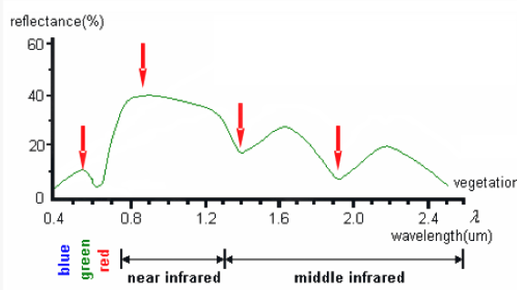
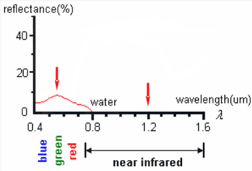
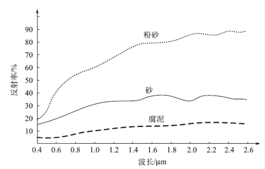

# 遥感物理基础 C

## 1 地物辐射和地物波谱

### 能量与地物相互作用

电磁波与地物表面及大气的相互作用与其频率密切相关。

任何物质都会反射、吸收、透射和辐射电磁波，不同性质和结构的物质会产生不同频率的电磁波。根据能量守恒定律

$$
\alpha + \tau + \rho = 1 
$$

其中 $\alpha$ 为吸收率，$\tau$ 为透射率，$\rho$ 为反射率。

### 1.1 地物波谱

地物辐射和反射的电磁波能量在电磁波谱范围内随波长分布。

- 地物波谱特性：指地面各种物体所具有的辐射、吸收、反射和透射能力随波长而变化的电磁波特性。

### 1.2 地物辐射

- 热辐射：地球上温度高于绝对零度的物体都能自发地发射电磁波，这是组成物体的大量粒子无规则热运动的结果。

- 地物辐射波谱：地物热辐射强度按波长的分布。

### 1.3 地球辐射

地球辐射指地球自身的热辐射，是热红外遥感的主要辐射源。

地球辐射是接近 $300K$ 的黑体辐射，最大波长 $9.66 \mu m$ 左右，属于远红外波段；而能量分布在近红外到微波范围，主要集中在 6-30 $\mu m$ 。

## 2 地表自身热辐射

- 波谱发射率：自然界中一切物体都在不断向外发出电磁波，发射率随着波长的变化而变化，为衡量不同地物发射电磁波能力大小，常用波谱发射率来表示地物的发射能力。

- 发射波谱曲线： 将所有波长的发射率连接起来形成一条以波长为横坐标，发射率为纵坐标的曲线。

影响地物发射率的因素有波长、地物的性质、表面状况、温度等。

### 2.1 红外辐射特性

传感器接收的辐射信息由地物反射的太阳辐射与自身向外发出的辐射组成。

 - 可见光-近红外：范围 0.76-2.5 $\mu m$ ，能量主要来自太阳辐射，地物辐射很小，二者之比约为 1000:1 ，此波段的图像反映的是地物的反射能量

- 中红外：范围 3-5 $\mu m$ ，对火灾、活动火山等高温目标识别敏感，可以有效捕捉高温信息

- 热红外：范围 8-14 $\mu m$ ，此波段地物反射的能量很小，可以忽略不计，影像记录的主要是地物热辐射

- 远红外：范围 15-30 $\mu m$ ，此波段大气透过率低，不能进行卫星遥感

## 3 地物反射

### 3.1 物体表面的分类

通常分为光滑面与粗糙面。但是二者并非绝对，而是相对于入射电磁辐射的波长而定。

判别表明光滑的一种方法是瑞利准则：

$$
h < \frac{\lambda}{8 \sin{\gamma}}
$$

### 3.2 反射面类型

- 镜面反射：满足于瑞利准则的表面，定义为光滑面，也称为镜面。特点是反射能量集中分布在反射角等于入射角的方向上。

- 漫反射：不满足瑞利准则的表面，定义为粗糙面，也是漫反射面。漫反射面的辐射亮度是一个常数，即是在入射辐照度不变的情况下，漫反射面的反射亮度与观测的角度无关。

- 方向反射：介于漫反射和镜面反射之间，各向都有反射，但各向反射强度不均一。

### 3.3 反射特征

- 反射率：地物的反射能量与入射总能量之比，用百分数表示
    - 受到入射光波长、入射角大小、地物表面粗糙程度和颜色的影响。
    - 反射率大的地物在传感器中记录的亮度值大，图像色调浅。

- 在紫外、可见光、近红外波段，主要反射太阳的辐射，遥感信息所反映的主要是地物的反射率。

- 反射光谱曲线：地物反射率随波长是变化的，以波长为横坐标，反射率为纵坐标，将地物反射率波长的变化绘制成曲线。

#### 影响光谱反射率特征的主要因素

- 太阳位置
    - 太阳高度角和方位角不同，地面物体入射照度也就发生变化，为了尽量减小太阳位置对遥感的影响，地球资源卫星一般采用太阳同步轨道，确保卫星以相同的方向经过同一纬度的当地时间是相同的

- 传感器位置
    - 一般卫星遥感传感器大部分设计成垂直指向地面，这样影响较小，但由于卫星姿态引起的传感器指向偏离垂直方向，仍会造成反射率变化

- 地理位置
    - 不同的地理位置（经纬度变化），太阳高度角和方位角、地理景观等都会引起反射率变化
    - 海拔高度不同，大气透明度改变也会造成反射率变化

- 地形
    - 地形坡度、山的阳坡和阴面会造成反射率变化

- 季节、时间、生长周期的变化
    - 随着时间的推移、季节的变化，同一种地物的光谱反射率特性曲线也发生变化

- 地物本身的差异、气候变化、地面温度和湿度变化

- 测量过程、仪器稳定性等综合差异

#### 典型地物反射光谱曲线

- 植物反射波谱

    

    - 蓝、红光波段为吸收带
    - 绿光波段为弱反射带
    - 近红外波段为强反射带，但在 $1.45 \mu m$ 、$1.95 \mu m$ 、$2.7 \mu m$ 三个波段存在水的吸收带

- 水体反射波谱

    

    - 反射主要在蓝绿光波段
    - 其他波段反射很弱，特别是近红外、中红外波段有很强的吸收带，反射率几乎为零
    - 泥沙的存在对水的反射率影响较大，使得反射率上升

- 土壤 / 裸地 反射波谱特征

    

    - 随着波长增加而反射增大，呈比较平滑的特征
    - 没有明显的反射峰和吸收谷值

## 4 光谱测量方法及作用

### 4.1 反射光谱特性的测量方法

- 样品的实验室测量
    - 规律性、条件单一，可以进行成分关系研究，但不利于模拟自然环境

- 野外测量

### 4.2 光谱测量的作用

- 传感器波段的选择、验证、评价
- 建立地面、航空和航天遥感数据的定量关系
- 进行地物光谱数据与地物特征的相关分析、建模

## 5 波谱特征分析注意事项

- 地物波谱值具有一定的变化范围，波谱曲线是具有一定宽度的曲线带

- 存在同物异谱和同谱异物现象
    - 同物异谱指在某一个谱段区间，由于时空环境变化，相同类型地物呈现不同的光谱特征。如地形起伏山地的同种植物类别的反射率受太阳高度、坡度、坡向等影响而发生曲线不完全相同。
    - 同谱异物指在某一个谱段区间，不同类型的地物呈现出相同的光谱特征的现象。

