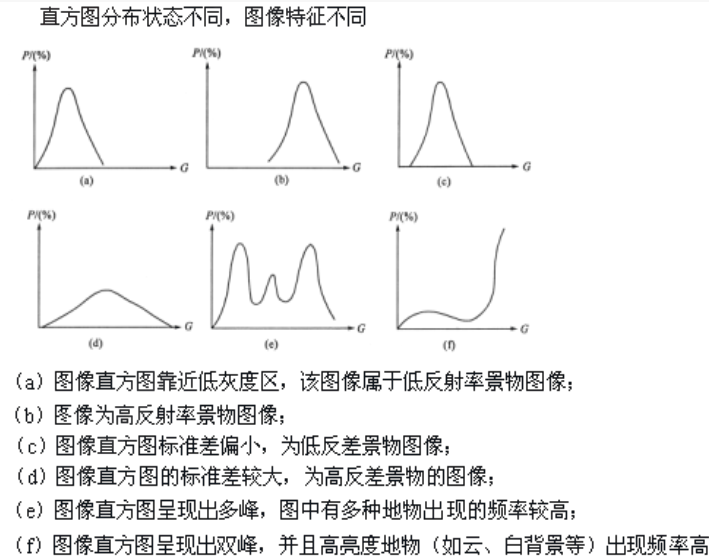

# 遥感图像处理 B

## 1 遥感图像增强

### 1.1 目的

- 采用灰度线性变换、直方图均衡化、图像融合、多光谱变换等一系列方法改善图像的视觉效果，提高图像的清晰度。

- 为特定的研究目的，突出遥感图像中与研究有关的信息，削弱、分离无关的信息，使图像更易判读。

但是要注意，图像增强不能增加原始图像的信息，有时反而会损失一些信息。

### 1.2 方法

#### 空间域处理

直接对图像进行各种运算，以得到图像的增强结果，如灰度变换、直方图均衡。

#### 频率域处理

将空间域图像变换成频率域图像，在频率域中对图像的频谱进行处理，然后再进行反变换，以达到增强图像的目的，如滤波、小波变换等。

>相当于进行特征变换后，再进行处理

## 2 图像灰度直方图

直方图是图像中各亮度的像元数分布图，反映灰度与其出现概率之间的关系,利用直方图，可以简单识别影像中地物类数及影像质量好坏。

一般来说，包含大量像元的图像，像元的亮度随机分布应是正态分布。而直方图为非正态分布，说明图像的亮度分布偏亮、偏暗或亮度过于集中，图像的对比度小，需要调整该直方图到正态分布，以改善图像的质量。

## 3 线性变换增强

简单线性变换是按照比例拉伸原始图像灰度等级范围

 - 充分利用显示设备的显示范围，使输出直方图的两端达到饱和
 
 -  变化前后图像每一个像元呈一对一关系，像元总数不变

## 4 直方图均衡化增强

直方图均衡化指通过改变原始图像各像素在各灰度级上的概率分布来实现图像灰度变换的处理方法，通常用来增加图像全局对比度，尤其是当图像的有用数据对比度相当接近的时候。

### 效果

增强了峰值处的对比度，两端（最亮和最暗）对比度减弱了。

### 缺点

- 变换后图像的灰度级减少，某些细节消失

- 某些图像，如直方图有高峰，经处理后对比度不自然地过分增强

## 5 直方图匹配增强

指将一幅图像的直方图变成规定形状的直方图而进行的图像增强方法，具体是将某幅影像或某一区域的直方图匹配到另一幅影像上，使两幅影像的色调保持一致。

## 6 密度分割增强

密度分割是一种用于影像密度分层显示的彩色增强技术，将图像（或影像）的色调密度分划成若干个等级，并用不同的颜色分别表示这不同的密度等级，得到一幅彩色的等密度分割图像。

密度分割可使影像轮廓更清晰，突出某些具有一定色调特征的地物及分布状态，在显示环境污染范围、隐伏构造、以及寻找地下水等方面有广泛的应用，并取得较好的效果。

## 7 图像平滑增强

受传感器和大气等因素的影响，遥感图像上出现某些亮度变化过大或出现一些亮点(也称噪声)的区域，为了抑制噪声，使图像亮度趋于平缓的处理方法就是图像平滑。

图像平滑（低通滤波）实际上是消除各种干扰噪声，使图像中高频成分消退，即平滑掉图像的细节，使其反差降低，保存低频成分。但是，平滑过程会导致图像边缘模糊化。

## 8 图像锐化增强

- 目的：为了突出图像上地物的边缘、轮廓、或某些线性目标要素的特征。这种滤波方法提高了地物边缘与周围像元之间的反差。

- 效果：增强图像中的高频成分，突出图像的边缘信息，提高图像细节的反差。

## 9 代数运算增强

代数运算指两幅或多幅遥感图像（波段）之间进行点对点的加减乘除运算，来达到增强某些信息或消除某些影响的目的的过程。

### 9.1 加法运算 

两幅图像相加，可以产生图像叠加效果，去除叠加性随机噪音。

- 多景影像定位相加，对影像进行衔接，填补单景遥感图像的空白区域

- 生成图像叠加效果，如绿波段和红波段图像相加可得到近似全色图像

### 9.2 减法运算

- 增加不同地物间光谱反射率以及在两个波段上变化趋势相反时的反差
- 消除背景影响
- 检测同一场景两景影像之间的变化，用于动态监测

例如，差值植被指数是用红外波段与红波段图像相减时，即为植被指数 

$$
DVI ＝ BIR－BR，
$$

其中 BR 为可见光红光波段反射率， BIR 为近红外波段反射率。这个指数对土壤背景的变化极为敏感，有利于植被生态的监测，又称环境植被指数 EVI 。

### 9.3 乘法运算

- 改变图像灰度级

- 图像局部显示

### 9.4 除法运算

有些地物在某些波段较小,在另一些波段较大，通过选择适当波段进行比值运算，可以有效的增强某些地物之间的反差，解决图像中存在的同物异谱。比值运算能压抑因地形坡度和方向引起的辐射量变化，消除地形起伏造成的阴影影响。

例如，比值植被指数是用红外波段与红波段图像相除时，即为比值植被指数 

$$
RVI ＝ \frac{BIR}{BR}，
$$

其中 BR 为可见光红光波段反射率， BIR 为近红外波段反射率。

## 10 遥感数据的融合增强

### 10.1 多源遥感影像数据特点

- 冗余性：不同的多源遥感影像数据对环境或目标的表示、描述或解译结果相同或相近

- 互补性：指信息来自不同的自由度且相互独立

- 合作性：不同传感器在观测和处理信息时对其它信息有依赖关系

- 信息分层的结构特性：数据融合所处理的多源遥感信息可以在不同的信息层次上出现，这些信息抽象层次包括像素层、特征层和决策层，分层结构和并行处理机制还可保证系统的实时性

### 10.2 遥感图像融合的定义

把那些在时间、空间、波谱上关于同一目标的冗余或互补的多源数据（不同类别传感器、多时相），按照一定的规则（或算法），进行运算处理，获取比任何单一数据更精确高、更丰富的信息，在规定的地理投影坐标系上，生成一幅具有新的空间、波谱和时间特征的合成图像数据的处理过程。

### 10.3 遥感图像融合的目标

- 空间分辨率提高

- 目标特征增加

- 分类精度提高

- 信息互补

### 10.4 图像融合的层次

由低到高分为：

 - 基于像素级的融合
 - 基于特征级的融合
 - 基于影响理解的决策层融合

## 11 遥感数据 IHS 融合增强

### 11.1 意义

- 提高目视解译效果
- 实现不同数据之间的优势互补
- 实现遥感数据和地理数据的有机结合
- 扩大遥感数据的应用

### 11.2 方法

遥感数据是栅格格式数据，而非遥感数据进行网格化处理，成为与遥感数据分辨率一样的网格数据，作为分析的波段，与遥感数据进行融合

 - 矢量化非遥感数据进行坐标位置配准,直接叠加到遥感数据上
 - 不同层面的非遥感数据，经坐标位置配准，直接或掩膜到遥感数据中

## 12 遥感数据与非遥感数据的融合增强

## 13 图像多光谱变换

### 13.1 主成分分析

主成分分析 PCA 是一种降低维数统计方法，通过正交变换将一组可能存在相关性的变量转换为一组线性不相关的变量，转换后的这组变量叫主成分。

基本思想就是降维。

### 13.2 图像多光谱变换 - 傅里叶变换

傅里叶变换表示能将满足一定条件的某个函数表示成三角函数或者它们的积分的线性组合。

主要作用是将信号信息从时间域转换到频率域。

### 13.3 其他常见方法

- 小波变换

- 穗帽变换

- 因子分析

## 14 遥感数据镶嵌和裁剪

### 14.1 图像镶嵌

图像镶嵌指将二幅或多幅（具有重叠部分）影像拼在一起，构成一幅大范围整体图像的过程

 - 图像可以是不同时间同一传感器获取的，也可以是不同时间不同传感器获取的图像
 - 涉及几何位置的镶嵌和灰度(或色彩)的镶嵌两个过程

#### 主要内容

- 影像定位（几何位置镶嵌）：是指镶嵌影像间对应物体几何位置的严格对应，无明显的错位现象

- 色彩平衡（灰度镶嵌）：指位于不同影像上的同一物体镶嵌后不因两影像的灰度差异导致灰度产生突变现象

- 接缝线处理：可细分为重叠区接缝线的寻找以及拼接缝的消除。在镶嵌过程中，即使对两幅影像进行了色调调整，但两幅影像接缝处的色调也不可能完全一致，需对影像的重叠区进行色调的平滑以消除拼接缝

#### 关键问题

- 接边处理：如何在几何上将多幅不同的图像连接在一起

- 颜色平衡：如何保证拼接后的图像反差一致、色调相近、没有明显的接缝

- 速度与内存：尽可能节约计算机处理速度和内存空间

### 14.2 图像裁剪

图像裁剪的目的是将研究之外的区域去除，常用的是按照行政区划边界或自然区划边界进行图像剪裁。

#### 关键问题

- 像裁剪区的确定

- 无数据区的处理

