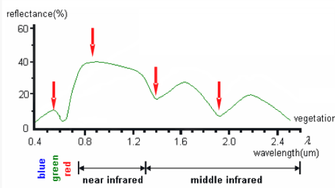
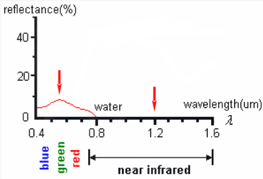
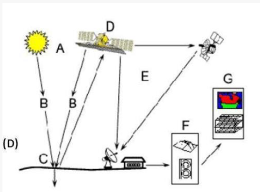

# 历年卷题目汇总

## 填空题

- 太阳近似黑体温度 **5770K** ，地球近似黑体温度 **300K** 。

- 可见光波长范围 **0.38-0.76 $\mu m$** 。

- 三种散射类型是 **瑞利散射**、**米氏散射**、**非选择性散射**。

- 遥感平台按高度分 **地面遥感**、**航空遥感**、**航天遥感**。

- 遥感按照波段分为 **可见光遥感**、**红外遥感**、**微波遥感**。

- 灰度重采样方法有 **最近邻法**、**双线性内插法**、**三次卷积法**。

- 遥感影像表现参数 / 分辨率有 **空间分辨率**、**时间分辨率**、**波普分辨率**、**辐射分辨率**。

- SAR 中文名是 **合成孔径雷达**，属于 **主动**（主动 / 被动）遥感。

- 遥感系统有哪五个组成部分 **信息源**、**信息获取**、**信息记录和传输**、**信息处理**、**信息应用**。

- 写出两种遥感数据的存储格式 **BSQ 格式**、**BIP 格式**、**BIL 格式**。

- 写出两个陆地资源卫星 **Landsat**、**QuickBird**、**高分卫星**。

## 名词解释

- 几何校正与几何配准

    >💡几何校正指消除因大气传输、传感器本身、地球曲率等因素造成的几何畸变，主要是纠正或者赋予影像平面坐标过程。

    >💡几何配准指将不同时间、不同波段、不同遥感器系统所获得的同一地区的图像(数据)，经几何变换使同一像点在位置上和方位上完全叠合的操作。

- 几何粗校正和几何精校正

    >💡几何粗校正是系统级校正，用构像公式（已知构像方程和传感器校正参数）等进行校正。

    >💡几何精校正是对离散数字图像中的每一个像元逐个进行校正处理的方法，能精确地改正动态扫描图像所有的各种误差。

- 辐射定标和大气校正

    >💡遥感数据记录的是亮度值，辐射定标就是建立遥感数据记录的亮度值与其所对应地物的物理量（辐射强度、反射率）之间的定量关系。

    >💡大气校正指将辐射亮度或者表观反射率转换为地表实际反射率。

- 空间分辨率

    >💡遥感影像上能够详细区分的最小单元的尺寸或大小，是用来表征影像分辨地面目标细节能力的指标。

- 波普分辨率和辐射分辨率

    >💡波普分辨率指传感器接受电磁波辐射所能区分的最小波长范围，或能分辨的最小波长间隔，间隔愈小，分辨率愈高，评价传感器探测能力和遥感信息容量的要指标。

    >💡辐射分辨率指传感器所能探测到的最小辐射功率，或遥感影像记录灰度值的最小差值，反映传感器对入射光的灵敏度、辨识度。

- 同物异谱和同谱异物

    >💡同物异谱指在某一个谱段区间，由于时空环境变化，相同类型地物呈现不同的光谱特征。如地形起伏山地的同种植物类别的反射率受太阳高度、坡度、坡向等影响而发生曲线不完全相同。

    >💡同谱异物指在某一个谱段区间，不同类型的地物呈现出相同的光谱特征的现象。

- 维恩位移定律

    >💡黑体辐射光谱中最强辐射波长与黑体绝对温度成反比。

- 太阳同步轨道和地球同步轨道

    >💡太阳同步轨道是轨道平面绕地球自转轴旋转的，方向与地球公转方向相同，旋转角速度等于地球公转的平均角速度的轨道，它距地球的高度不超过 6000 千米。当卫星每次飞越某地上空时，太阳都是从同一角度照射该地，亦即，卫星每次都在同一当地时间经过同一纬度。

    >💡运行周期与地球自转周期相同的顺行轨道，每天相同时刻经过地球上相同地点的上空，星下点轨迹是一条 8 字形的封闭曲线。

- 辐射出射度和辐照度

    >💡辐射出射度是辐射源物体表面单位面积上的辐射通量。

    >💡辐照度是被辐射的物体表面单位面积上的辐射通量。
    

- 绝对黑体和灰体

    >💡如果一个物体对于任何波长的电磁辐射全部吸收，则这个物体是绝对黑体。

    >💡灰体没有显著的选择性吸收，吸收率虽然小于 1 、但基本不随波长变化。

- 主动遥感和被动遥感

    >💡主动遥感由人工辐射源向目标地物发射电磁波，然后接收从目标地物反射回来的能量。

    >💡被动遥感接收自然界地物所辐射的能量。

- 目视解译和计算机解译

    >💡目视解译指专业人员通过直接观察或借助判读仪器，在遥感影像上获取特定目标地物信息的过程。

    >💡计算机解译是以计算机系统为支撑环境，利用模式识别技术与人工智能技术相结合，根据遥感影像中目标地物的各种影像特征，结合专家知识库中目标地物的解译经验和成像规律等知识，进行分析和推理，实现对遥感影像的理解，完成对遥感影像的解译。

- 监督分类和非监督分类

    >💡监督分类又称训练场地法，是一种由已知样本，外推未知区域类别的方法。选择具有代表性的典型实验区或训练区，用训练区中已知各类地物样本的光谱特性来训练计算机，获得识别各类地物的判别函数或模式，对未知地区的像元进行分类处理，分别归入到已知的类别中。

    >💡非监督分类又称聚类分析或点群分析，是一种无先验（已知）类别标准的分类方法，即事先对分类过程不施加任何的先验知识,仅凭数据（地物光谱特征相似度）自然聚类的特性，进行盲目的分类。

- 镜面反射和漫反射

    >💡满足于瑞利准则的表面，定义为光滑面，也称为镜面，特点是反射能量集中分布在反射角等于入射角的方向上。

    >💡不满足瑞利准则的表面，定义为粗糙面，它也是漫反射面，辐射亮度是一个常数，即是在入射辐照度不变的情况下，漫反射面的反射亮度与观测的角度无关。

- 全色波段和多光谱波段

    >💡全色波段指传感器在一个较宽的连续光谱范围内接收辐射能量，并将其综合记录为单一灰度值的波段；特点是光谱分辨率低但空间分辨率高，常用于获取高精度空间细节信息，如形状、边界等。

    >💡多光谱波段指传感器将电磁波谱划分为多个较窄且彼此分离的波段，如蓝、绿、红、近红外等，分别获取各波段的反射或辐射信息；特点是光谱分辨率高但空间分辨率相对较低，能够反映地物在不同波长下的光谱特性，便于进行地物识别与分类分析。
    

- 直方图

    >💡图像中各亮度的像元数分布图，反映灰度与其出现概率之间的关系，利用直方图，可以简单识别影像中地物类数及影像质量好坏。

- 颜色空间

    >💡颜色空间也称彩色模型，是在某些标准下用数学方法来形象化对彩色加以说明，其中的颜色通常用代表 3 个参数的三维坐标来描述。

## 简答题

- 什么是遥感？

    >💡遥感是从远处探测感知物体，也就是不直接接触物体，从远处通过探测仪器接收来自目标地物的电磁波信息，经过对信息的处理，判别出目标地物的属性。

- 什么是 NDVI ？理论依据是什么？写出计算公式。

    >💡归一化植被指数 

    $$
    NDVI = \frac{BIR - IR}{BIR + IR}，
    $$

    其中 IR 为可见光（红光）通道反射率，BIR 为近红外通道反射率。
    
    >💡理论依据主要源于植被的光谱反射特性，即植被由于叶绿素对红光具有强吸收作用，使红光反射率较低，而叶片内部细胞结构对近红外波段产生强烈散射，使近红外反射率较高；基于这种显著差异，NDVI 采用近红外与红光反射率的归一化差值来表征植被状况，通过增强两者差异并抑制光照条件等外界因素的影响，实现对植被覆盖度和生长活性的有效指示。

- 什么是大气窗口？大气窗口对遥感有什么影响？

    >💡由于大气层的反射、散射和吸收作用，使得太阳辐射的各波段受到衰减的作用程度不同，因而各波段的透射率也各不相同。通常把受到大气衰减作用较轻、透射率较高的波段称为大气窗口。

- 大气对遥感有什么影响？

    >💡大气使得太阳(地物)辐射的电磁波信号在到达地面或传感器之前受到衰减，并且由于大气的散射和本身的发射，将一部分并非地物反射的信号送入传感器，导致图像模糊、信噪比降低。
    >大气散射集中于太阳辐射能量较强的可见光波段，会导致反射辐射成分改变、传感器接收的电磁波信息改变；大气反射对各个波段产生不同程度的影响，严重地削弱了电磁波强度；大气中水的吸收很强，对红外遥感有极大的影响。

- 写出普朗克定律描述的特征（不用公式），它有什么用？

    >💡普朗克定律指出，黑体辐射特性由温度唯一决定。

    >   - 辐射通量密度随波长连续变化，每条曲线只有一个最大值。
    >   - 温度越高，辐射通量密度越大，不同温度的曲线不相交。
    >   - 随着温度升高，辐射最大值所对应的波长向短波方向移动。
    
    >💡普朗克定律建立了物体温度与辐射能量分布之间的定量关系，为遥感进行温度反演、波段选择和辐射建模提供了理论基础。

- 什么是维恩位移定律？

    >💡黑体辐射光谱中最强辐射波长与黑体绝对温度成反比。

- 什么是基尔霍夫定律？

    >💡在热力学平衡的条件下，不同物体对相同波长的单色辐射出射度与单色吸率之比值都相等，并等于该温度下黑体对同一波长的单色辐射出射度。

- 可见光-红外遥感，热红外遥感，微波遥感的能量来源分别是什么？为什么？

    >💡可见光-红外遥感的能量来源于太阳辐射，因为此波段地物本身辐射很小，主要接收地物对太阳辐射的反射或散射能量。
    
    >💡热红外遥感的能量来源于地物自身的热辐射，因为只要温度高于绝对零度的物体，就会向外发射电磁波，热红外波段正是这种自发辐射的主要范围。
    
    >💡微波遥感的能量主要来源于主动辐射，即人为向被探测物体发射具有一定波长的微波，很少的情况下会有被动式微波遥感（微波辐射计），能量来源于地物辐射的微波信号。

- 晴朗的天空为什么是蓝色的？

    >💡瑞利散射强度与波长四次方成反比，太阳光谱中波长较短的蓝紫光比波长较长的红光散射更明显。太阳光谱短波中以蓝光能量最大，在雨过天晴或秋高气爽时（空中较粗微粒比较少，以分子散射为主），在大气分子的强烈散射作用下，蓝色光被散射至弥漫天空，天空即呈现蔚蓝色。

- 微波遥感的优势是什么？

    >💡微波能穿透云雾、雨、雪，具全天候全天时工作能力。  
    >💡微波对地物具有一定的穿透能力，微波越长，穿透力越强。
    >💡微波能提供不同于可见光、红外遥感的信息，如微波高度计、合成孔径雷达等具有测量距离的能力；微波探测海面风力场；根据冰的界电常数不同，探测海冰的结构和分类；根据含盐度对水的界电常数的影响，探测海水的含盐度。
    >💡微波同时记录振幅和相位信息，可获取高程信息，利用干涉测量技术，可以监测地形变化，如冰川移动、地表沉降、滑坡监测等。

- 哪些因素导致遥感传感器记录的亮度值和地物实际反射率、亮度值等物理量有差异？

    >💡太阳位置和角度条件
    >💡大气吸收与散射
    >💡传感器定标
    >💡地形地势

- 目视直接解译的标志是什么？

    >💡判读目标自身特点直接在遥感影像上的表现，概括为

    >    - 色：目标地物在遥感影像上的颜色，包括色调、颜色和阴影等；
    >    - 形：目标地物在遥感影像上的形状，包括形状、纹理、大小和图案等；
    >    - 位：目标地物在遥感影像上的空间位置，包括空间位置、相关布局等。

- 为什么要进行灰度重采样而不是直接成图？

    >💡在几何纠正过程中，几何变换是把原始影像从原坐标系映射到目标坐标系，但变换后产生的新像元位置通常是非整数坐标，而原始影像的灰度值只在离散的像元中心上有定义，即新影像网格中的像元位置，在原影像中没有对应的现成灰度值。所以不能直接成图，必须进行灰度重采样，根据原影像已有像元的灰度值，插值计算出新位置上的灰度值，完成影像重建。

- 几何校正之后的灰度重采样有哪几种方法，优点和缺点是什么？

    >💡最近邻法，算法简单，保持原光谱信息，但是几何精度差，图像灰度具有不连续性，边界可能出现锯齿。

    >💡双线性内插法，计算较简单，灰度具有连续性且采样精度比较高，但是细节有可能丧失。

    >💡三次卷积法，图像灰度具有连续性且采样精度高，但是计算量大。

- 几何畸变的原因是什么？

    >💡内部畸变由传感器性能差异引起，因遥感器的结构、特性和工作方式不同而异，如透镜的焦距误差、采样速率的变化等。
    >💡外部畸变由运载工具姿态变化和目标物引起，包括地球自转引起的误差、地球曲率的影响、地形起伏的影响、传感器外方位元素变化的影响、大气折射的影响。

- 图像平滑和图像锐化分别是什么？

    >💡受传感器和大气等因素的影响，遥感图像上出现某些亮度变化过大或出现一些亮点(也称噪声)的区域，为了抑制噪声，使图像亮度趋于平缓的处理方法就是图像平滑，实际上就是消除各种干扰噪声，使图像中高频成分消退，即平滑掉图像的细节，使其反差降低，保存低频成分。
    >💡图像锐化是为了突出图像上地物的边缘、轮廓，或某些线性目标要素的特征而增强图像中的高频成分，这种滤波方法突出图像的边缘信号，提高了地物边缘与周围像元之间的反差。

- 什么是直方图？直方图有什么用？

    >💡图像中各亮度的像元数分布图，反映灰度与其出现概率之间的关系，利用直方图，可以简单识别影像中地物类数及影像质量好坏。一般来说，包含大量像元的图像，像元的亮度随机分布应是正态分布；如果直方图为非正态分布，说明图像的亮度分布偏亮、偏暗或亮度过于集中，图像的对比度小，需要调整该直方图到正态分布，以改善图像的质量。

- 全色波段为什么比多光谱波段的空间分辨率高？

    >💡全色波段分辨率高于多光谱波段，主要是因为能量获取与信噪比的差异。全色波段覆盖的光谱范围较宽，可以接收更多的辐射能量，使探测器获得更高的信噪比。在相同的传感器条件下，为了保证成像质量，系统可以将像元设计得更小，从而提高空间分辨率。相比之下，多光谱波段将能量分散到多个窄波段中，每个波段接收到的能量较少，如果像元过小会导致信噪比过低，因此通常需要较大的像元尺寸来保证成像质量，从而使空间分辨率相对较低。

- 为什么要进行遥感图像融合？

    >💡图像融合主要是为了获得比任何单一数据更精确、更丰富的信息，提供空间分辨率、增加目标特征、提高分类精度、信息互补。

## 解答题

- 画出植被和水体的典型波谱特征。

    >
    >
    >蓝、红光波段为吸收带，绿光波段为弱反射带，近红外波段为强反射带，但在 1.45$\mu m$ 、1.95$\mu m$ 和 2.7$\mu m$ 三个波段存在水的吸收带。

    >
    >
    >水体的反射主要在蓝绿光波段，其他波段吸收率很强，特别在近红外、中红外波段有很强的吸收带，反射率几乎为零。泥沙的存在会使水的反射率升高。

- 画出植被典型波谱特征，介绍常用的植被指数并解释原理。

    >
    >
    >蓝、红光波段为吸收带，绿光波段为弱反射带，近红外波段为强反射带，但在 1.45$\mu m$ 、1.95$\mu m$ 和 2.7$\mu m$ 三个波段存在水的吸收带。

    >用 $BIR$ 表示植被近红外波段的反射率，$IR$ 表示红光波段的反射率，常用植被指数有：

    >   - 归一化植被指数 $NDVI = \frac{BIR - IR}{BIR + IR}$ 
    >   - 差值植被指数 $DVI = BIR - IR$
    >   - 比值植被指数 $RVI = \frac{BIR}{IR}$
    >   - 土壤调整植被指数 $SAVI = \frac{BIR - IR}{BIR + IR + L} \cdot (1 + L)$ 
    >
    >主要原理是植物在可见光红光波段有很强的吸收性，近红外波段有很强的反射特性，通过对这两个波段观测值进行不同的组合，可以得到比单一波段更多的信息。
         

- 什么是维恩位移定律？某地发生森林火灾，温度 1500k 左右，应该如何进行遥感？并分析最佳波段，给出详细估算过程。

    >维恩位移定律指黑体辐射光谱中最强辐射波长与黑体绝对温度成反比。
    
    >根据 $\lambda_{max} \cdot T = b$ ，求出最佳波段 $\lambda = 1.93 \mu m$ 。
    
    >选择短波红外，接近辐射峰值，并且对高温比较敏感。

- 画出目视解译技术流程图，并对各流程详细说明。

    >1. 准备工作阶段
    >    - 明确解译任务与要求
    >    - 收集与分析有关资料
    >    - 选择合适波段与恰当时相的遥感影像
    >
    >2. 初步解译与判读区野外验证
    >    - 初步解译的主要任务：
    >        - 掌握解译区域特点
    >        - 确立典型解译样区
    >        - 建立目视解译标志
    >        - 探索解译方法，为全面解译奠定基础
    >    - 野外考察：
    >        - 填写各种地物的判读标志登记表，以作为建立地区性的判读标志的依据
    >        - 在此基础上，制定出影像判度的专题分类系统
    >        - 建立遥感影像解译标志
    >
    >3. 室内详细判读
    >    - 先图外后图内：先了解影像图框外提供的各种信息
    >    - 先整体后局部：先整体观察，综合分析目标地物与周围环境的关系
    >    - 勤对比多分析：多个波段对比、不同时相对比、不同地物对比
    >
    >4. 野外验证与补判
    >    - 野外验证包括检验专题解译中图斑的内容是否正确和检验解译标志
    >    - 疑难问题补判是对室内判读中遗留问题的再次解译
    >
    >5. 目视解译成果的转绘与制图
    >    - 手工转绘成图
    >    - 在精确几何基础的地理地图上采用转绘仪进行转绘成图

- 画出计算机解译流程图，并对各环节的内容进行详细说明。

    >原始图像数据预处理 $\rightarrow$ 图像变换及特征选择 $\rightarrow$ 分类器的设计 $\rightarrow$ 初始变量参数的确定 $\rightarrow$ 每个像素的分类判决 $\rightarrow$ 编码图像、结果检验 $\rightarrow$ 分类结果输出

    >1. 准备阶段
    >       - 选取分类区遥感影像，需考虑分辨率、成像时间、图像质量等
    >       - 收集与分析分类区有关信息
    >       - 图像预处理
    >       - 选择合适的图像分类方法和算法，制定分类系统，确定分类类别
    >
    >2. 训练样本提取
    >       - 找出代表这些类别的统计特征，考虑监督分类或非监督分类方法
    >
    >3. 分类器建立
    >       - 判决函数及其参数确定
    >
    >4. 分类与检验
    >       - 识别：对遥感影像中各像素进行分类
    >       - 检验与统计：分类精度检查，分类结果统计

- 一个完整的遥感过程包括什么？

    >
    >
    >A. 能量源或光源  
    >B. 能量向外辐射并穿过大气  
    >C. 能量与目标地物相互作用  
    >D. 传感器记录辐射能量  
    >E. 信号接收和转换  
    >F. 信号解译和分析  
    >G. 应用
