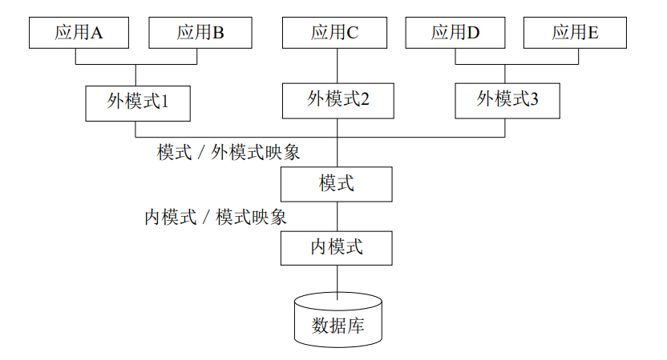

# 概论

## 关系数据库基本概念

### 数据模型

数据模型用来描述数据、组织数据、对数据进行操作。

- 概念数据模型：纯抽象

- 逻辑数据模型：严格定义，和数据库设计直接相关
    - 层次模型：如树
    - 网状模型：如图
    - **关系模型**：由多个关系组成，每个关系是一个规范化的二维表

- 物理数据模型：侧重实际存储结构，描述数据在磁盘或磁带上的存储、读取方法

!!! tip "如何描述一个数据模型"

    - 数据结构：行列、键值对、指针等等
    - 数据操作
    - 完整性约束：各种条件约束

### 三级模式

模式定义或描述一个数据集合，是相对稳定的。

!!! tip icon-only

    模式vs数据 类比 变量类型vs变量本身

一个数据库只有一个模式，包含：

 - 模式，一般指概念模式
 - 多个外模式，每个外模式对应一个外模式/模式映象
 - 一个内模式（一般是存储模式或者说物理模式），及模式/内模式映象   

## 空间数据库基本概念

### 空间数据

空间数据分为矢量数据、栅格数据。

- 矢量数据是用点、线、面等基本空间要素来表示人们赖以生存的自然世界的数据。其中不可再分的最小单元现象称为空间实体

- 栅格数据把地理空间中的事物和现象作为连续的变量或体看待，将地面划分为均匀网格，每个网格作为一个像素，所含代码表示其属性类型或仅是与其属性记录相联系的指针

### 空间数据的特征

- 空间特征

- 非结构化特征

- 空间关系特征

- 时态特征

- 多尺度特征
    - 空间多尺度
    - 时间多尺度

### 空间数据库

空间数据库是在地球表面某一范围内与空间地理相关、反映某一主题信息的数据集合，以空间目标作为存储对象。

### 空间数据库管理系统 SDBMS

主要功能：

 - 空间数据的定义与操作
 - 空间数据的组织、存储、管理
 - 后台的事务管理和运行管理
 - 数据库的建立与维护

## 空间数据库管理技术的生产与发展

文件系统 $\to$ 文件关系混合系统 $\to$ 空间数据库引擎 $\to$ 对象关系型数据库管理系统

## 空间数据库标准

- SFA SQL （几何对象模型、注记文本模型）

- SQL / MM （几何对象模型、）

---

!!! warning "注意"

    - 空间计算思想

    - 名词缩写
        - DBMS Database Management System
        - DDL Data Definition Language
        - DML Data Manipulation Language
        - DBA Database Administrators
        - SDBMS Spatial Database Management System
        - SDS Spatial Database System