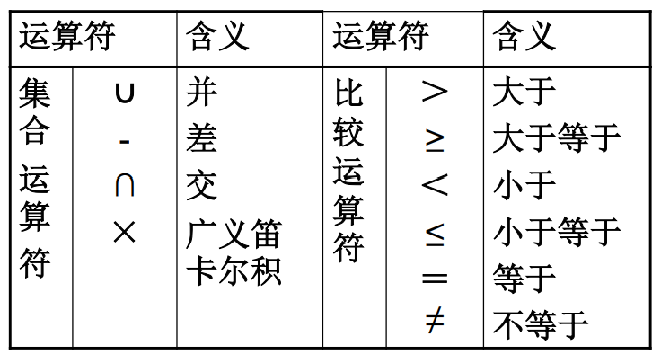
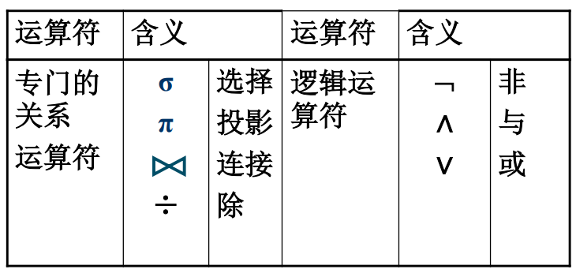
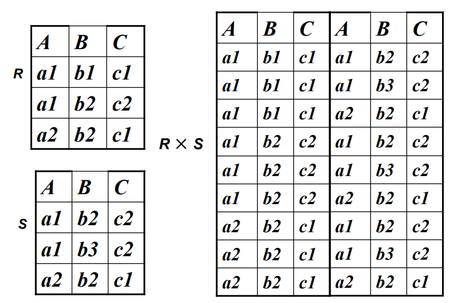
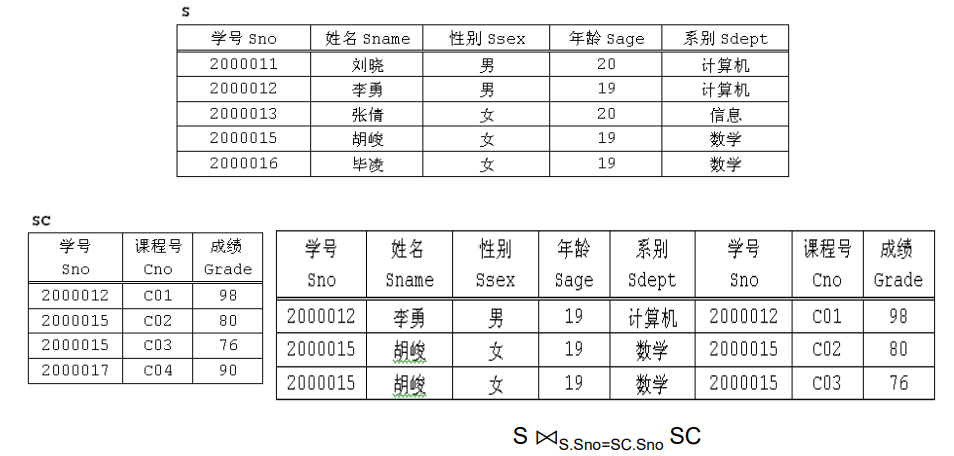
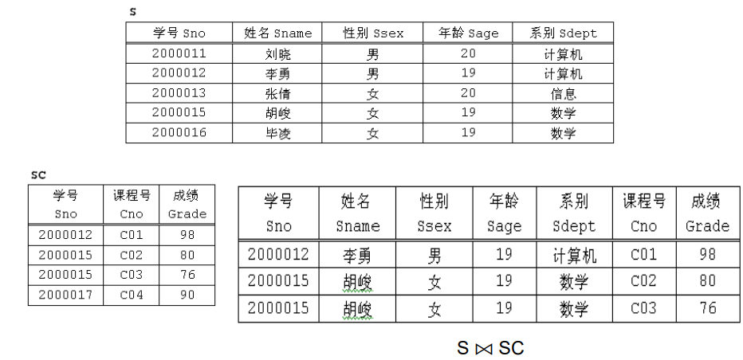
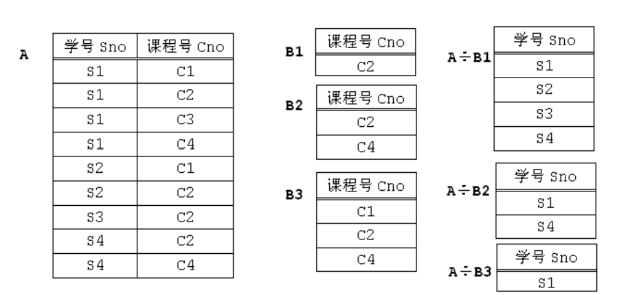

# 关系模型与关系代数

## 关系模型

关系模型是一种数据模型，由关系数据结构、关系数据操作、关系完整性约束组成。

### 关系数据结构

用关系来表示实体及之间的联系，从逻辑结构来说是一张非嵌套的二维表。

一张表由表名、表头、数据组成。

概念：

 - 属性 attribute ，关系中的一列即为一个属性
 - 域 domain ，一组具有相同数据类型的值的集合
 - （候选）码 key ，可以唯一确定一个元组的最小属性集合
 - 元组 tuple ，每个属性的具体数值组合（其实就是一行）
 - 分量，元组中的一个属性值
 - 关系模式 relation schema ，对关系的描述（一般是关系名和多个属性）
 - 关系实例 relation instance ，关系的内容

定义：给定一组域 $D_1$ 、$D_2$ 、$\cdots$ 、$D_n$ ，他们的笛卡尔积为

$$
D_1 \times D_2 \times \cdots D_n = \{ (d_1, d_2, \cdots , \cdots, d_n) \quad | \quad d_i \in D_i, i = 1, 2, \cdots , n \}
$$

一个关系由关系名、关系模式和关系实例组成，分别对应到表名、表头、表中的数据。

### 关系数据操作

操作的对象和结果都是集合。

关系数据语言包含关系代数语言、关系演算语言、介于关系代数和关系演算之间的语言（即结构化查询语言 SQL）。

### 关系完整性约束

- 实体完整性：若属性 A 是基本关系 R 的主码，则任何一个元组在属性 A 上不能取空值
    >主码是指候选码中选定的一个属性

- 参照完整性：关系间的引用、外码、参照完整性规则

- 用户定义完整性：根据具体模型情况而定

## 关系代数

### 概述

关系代数是一种抽象的查询语言，用对关系的运算来表达查询。三个要素包括运算对象（关系）、运算结果（关系）、运算符。

其中运算符包含：

 - 集合运算符，将关系看成元组的集合而做行的运算
 - 专门的关系运算符，不仅涉及行而且涉及列的运算
 - 算术比较符，辅助专门的关系运算符进行操作
 - 逻辑运算符，辅助专门的关系运算符进行操作

>⚠️集合运算会自动去重

#### 运算符

### 集合运算

并、交、差、广义笛卡尔积分

>🌰笛卡尔积
>
>

### 专门的关系运算

- 选择 $\sigma$ ：从一个关系中选出若干行，在下标给出选择条件 

- 投影 $\pi$ ：从一个关系中选出若干列，在下标给出条件

- 连接 $\bowtie$：从两个关系的笛卡尔积中选取属性间满足一定条件的元组下标给出连接条件
    - 等值连接：两个关系通过都有的一个属性连接
    - 自然连接：在等值连接的基础上，去掉重复列

    >🌰等值连接    
    >

    >🌰自然连接
    >

- $A \div B$：两个关系 $A$ 和 $B$ ，其中 $A$ 只有两个属性$X$ 和 $Y$ ，$B$ 只有一个属性 $Y$ ，对于 $A$ 中的每一个 $x$ 所对应的 $y$ 集合，如果包含 $B$ 中所有的 $y$ 值，则 $x$ 属于结果集

    >🌰除
    >

### 辅助运算

- 重命名
