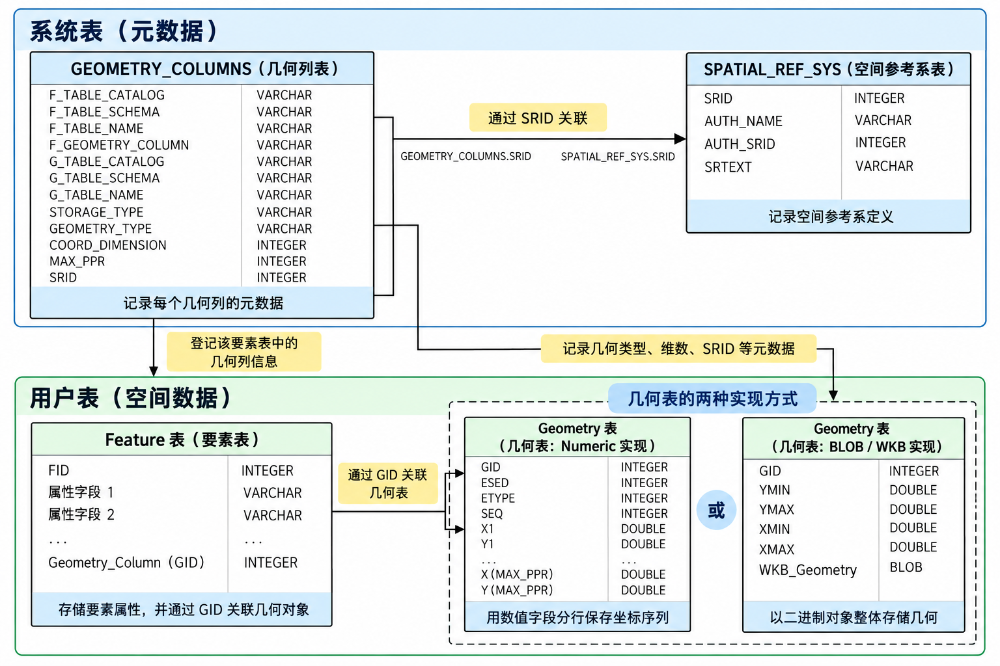
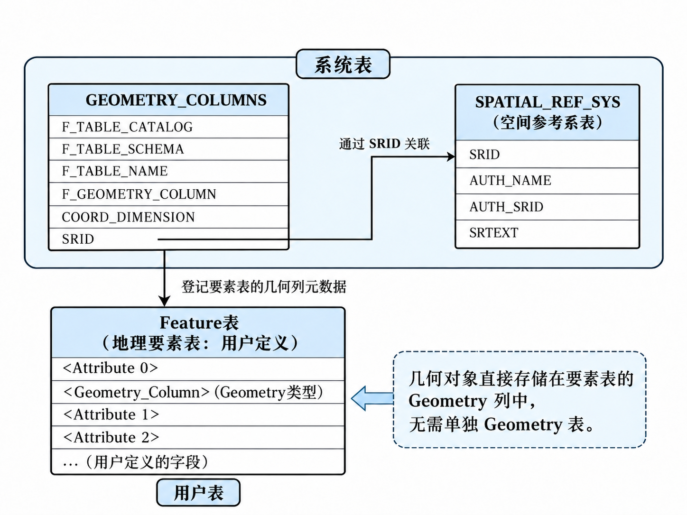

# 几何对象模型与查询

## 空间数据模型

### 概念

空间数据模型是对空间信息的一种数据组织方式，具体组织思路有对象模型、场模型、网络模型。

现有的空间数据库都是基于某种空间数据模型。

### 分类

GIS 中两大常见的数据模型：

 - 矢量模型，利用点、线、多边形的形式来表达现实世界
    - 几何模型，关注地物精确形状
        - 对象模型，不包含拓扑关系
        - 拓扑模型，包含拓扑关系
    - 网络模型，关注地物连通关系
 - 栅格模型，以二维矩阵的形式来表示空间地物或现象分布的数据组织方式

#### 注记文本模型

GIS 注记分为三类：

 - 注记标签。选择要素层中的某个属性值作为标记，附着在各要素的旁边显示，与要素具有正式的连接关系。
 - 注记文本。独立于要素层的一个文本数据集，由一些有序的格子独立放置的文本元素组成，可能沿着地理要素的方向、根据地理要素的范围进行放置，与地理要素无正式连接。
    >⚠️注记文本与点、线、多边形一样算一种类型的要素

 - 注记尺寸。用于标注几何体长、宽、高数值的注记。

## 几何对象模型

地理要素是对现实世界空间现象的抽象，由几何、属性、行为三类信息构成，其中几何的建模是数据库管理系统关心的基础问题。

关键是选择一组基本空间数据类型来满足地图常用几何信息的建模要求，其中 Open Geospatial Consortium 模型规范已逐渐得到认可。

!!! warning "注意"

      OGC仅能表达和处理简单的几何对象，即不自相交的几何对象。

### 概念模型

几何对象模型利用对象关系型数据库中的扩展数据类型（包括数据+方法）实现，类似于面向对象语言。

核心是一个依赖于空间参考系和测量参考系的几何类，派生出点、线、面、多点、多线、多面等类型。

#### 一些常见几何对象

- 点。零维几何对象类，代表空间中一个点。

- 曲线。由点序列描述一维的几何对象类。

- 折线。曲线的子类，采用线性插值。

- 线段。折线的特例。

- 环线。由折线派生而来，闭合的、不自相交或相切的折线。

- 面。二维几何对象类，代表一个外边界、零到多个内边界组成的几何对象。三维空间中则可能是一个同构的曲面。

- 多边形。二维坐标空间中由一个外边界、零到多个内边界定义的平坦表面，由一个或一个以上的线环聚合而成。暂不支持曲线。
   >⚠️要求多边形内部连通，内环与外环、内环与内环之间不能有重叠线，最多在有限个点处相交

- 三角形。多边形类的一个特例。

- 体表面。由简单面沿它们的边界缝合而成。

- 不规则三角网 TIN 。体表面的一个特例，由多个有公共边的连续三角形聚合。

- 几何集合。由一个或多个几何对象组成的集合，其中的元素必须具有相同空间参考系和测量参考系。

- 多点。零维的几何类集合，由多个点聚合而成，代表空间中的多个点。

- 多面。二维的几何集合类，由多个面聚合而成。

- 多多边形。多面的子类，由多个多边形对象聚合而成。
   >⚠️注意各多边形内部不能相交，边界只能在有限个点相交

- 多曲线。一维的几何类，由多条曲线聚合而成。

- 多折线。多曲线类的子类，由多条折线聚合而成。

#### 补充说明

1. 任何几何模型都有其边界、内部和外部
 - 边界：一个几何实体界限的集合，几何维数是其本身几何形状的维数减一
 - 内部：几何对象除边界外的所有直接位置的集合
 - 外部：空间全域与几何闭包之差

2. 几何对象除了由 $x$ 、$y$ 、$z$ 描述的坐标维数，还可以有一个 $M$ 坐标，可以理解为与距离度量有关的一个属性值，注意要符合线性参考系统。

3. 线性参考系统是沿线性网络要素，采用相对方位来存储地理位置的方法。基于该表达，只要指定沿某个线性构造的起点和终点，就能动态参考和构造此线性要素的各个部分，无需直接存储各部分的空间数据。

#### 空间拓扑关系

一共八种

 - 相离 disjoint
 - 相交 intersects
 - 包含于 within
 - 包含 contains
 - 相接 touches ：两个对象内部交集为空，边界交集非空
   >⚠️点或多点都不能与任何对象相接，因为点的内部是它自身，没有边界

 - 相等 equals
 - 交叠 overlaps ：两个维数相同的对象交集维数也相同，并且不能有包含关系

 - 穿越 crosses ：两个对象内部必须相交，并且交集的维数低于二者中较高的维数，不能含有包含关系

#### 九交模型

对于两个二维的空间物体，可以通过九种空间关系来描述它们之间的拓扑关系，通常排成一个 $3 \times 3$ 的矩阵。即边界 Bo 、内部 In 、外部 Ex 之间两两是否有交集。

$$
\mathrm{Matrix}(A,B)=
\begin{pmatrix}
\mathrm{In}(A)\cap\mathrm{In}(B) & \mathrm{In}(A)\cap\mathrm{Bo}(B) & \mathrm{In}(A)\cap\mathrm{Ex}(B) \\
\mathrm{Bo}(A)\cap\mathrm{In}(B) & \mathrm{Bo}(A)\cap\mathrm{Bo}(B) & \mathrm{Bo}(A)\cap\mathrm{Ex}(B) \\
\mathrm{Ex}(A)\cap\mathrm{In}(B) & \mathrm{Ex}(A)\cap\mathrm{Bo}(B) & \mathrm{Ex}(A)\cap\mathrm{Ex}(B)
\end{pmatrix}
$$

#### 维数扩展的九交模型 DE-9IM

维数扩展的九交模型进一步计算两个二维空间物体的边界、内部、外部两两交集的维数，用 -1 表示空集，0 、1 、2 分别表示对应维数的交集。

#### 几何对象的方法 / 函数

- `Dimension():Integer` 获取几何对象的几何维数

- `CoordinateDimension():Integer` 获取几何对象的坐标维数

- `GeometryType():String` 获取几何的数据类型，如点、线、面等

- `SRID():Integer` 获取几何类型的空间参考系

- `Envelope():Geometry` 获取 Geometry 的最小边界矩形

- `AsText():String` 返回 WKT 的表达形式，不包含 SRID 元数据

- `AsBinary():String` 返回 WKB 的表达形式，不包含 SRID 元数据

- `IsEmpty():Boolean` 判断几何类型是否为空

- `IsSimple():Boolean` 判断几何类型是否是简单的

- `Is3D():Boolean` 判断几何类型是否有 z 坐标

- `IsMeasured():Boolean` 判断几何类型是否有 M 值

- `Boundary():Geometry` 获取几何类型的边界

- `Distance(another:Geometry):Distance` 求两个 Geometry 间的距离

- `Buffer(distance:Distance):Geometry` 求 Geometry 满足某个距离要求的缓冲区

- `ConvexHull():Geometry` 求 Geometry 的凸包

- `Intersection(another:Geometry):Geometry` 求两个 Geometry 的交

- `Union(another:Geometry):Geometry` 求两个 Geometry 的并

- `Difference(another:Geometry):Geometry` 求两个 Geometry 的差

- `SymDifference(another:Geometry):Geometry` 求两个 Geometry 的对称差

- `Equals(another:Geometry):Boolean` 判断两个 Geometry 是否相等

- `Disjoint(another:Geometry):Boolean` 判断两个 Geometry 是否相离

- `Intersects(another:Geometry):Boolean` 判断两个 Geometry 是否相交

- `Touches(another:Geometry):Boolean` 判断两个 Geometry 是否相接

- `Crosses(another:Geometry):Boolean` 判断 Geometry 是否穿越另一个 Geometry

- `Within(another:Geometry):Boolean` 判断 Geometry 是否包含于另一个 Geometry

- `Contains(another:Geometry):Boolean` 判断 Geometry 是否包含另一个 Geometry

- `Overlaps(another:Geometry):Boolean` 判断两个 Geometry 是否交叠

- `Relates(another:Geometry, matrix:String):Boolean` 判断两个 Geometry 是否符合给定的九交矩阵

- `LocateAlong(mValue:Double):Geometry` 选取 M 值为 mValue 的点，形成一个新 Geometry

- `LocateBetween(mStart:Double, mEnd:Double):Geometry` 选取 M 值在 mStart 和 mEnd 之间的点，形成一个新 Geometry

### 逻辑模型

基于概念模型，OGC 提出了基于预定义数据类型和基于扩展几何类型的两种实现方法。

#### 基于预定义数据类型

利用关系数据库中已有的数字 numeric 类型或者二进制大对象 BLOB 类型实现空间数据的存储和惯例，这些数据类型的解释和维护由 DBMS 负责。将相关空间数据的访问方法作为扩展函数嵌入 DBMS 。

- 几何列表 GEOMETRY_COLUMNS 、空间参考系表 SPATIAL_REF_SYS ：系统表，存储用户表的元数据信息。
    - GEOMETRY_COLUMNS 表记录数据库中所有 Feature 表及其几何列的属性
    - SPATIAL_REF_SYS 表记录该数据库所支持的所有空间参考系

- 要素表 Feature 、几何表 Geometry ：用户表，存储空间数据。
    - Feature 表记录一组具有相同属性和行为的地理要素的集合
    - Geometry 表记录几何类型的空间坐标

      >numeric 和 BLOB 二者的区别是几何表结构不同，前者将几何类型的空间坐标作为数值存储，后者以 WKB 形式存储。

#### 基于扩展几何类型

利用对象关系数据库中对抽象数据类型的支持，定义 Geometry 类型及其相关的方法与函数，并用该扩展几何类型实现空间数据的存储和管理。

- 几何列表 GEOMETRY_COLUMNS 、空间参考系表 SPATIAL_REF_SYS ：系统表，存储元数据信息。

- 要素表 Feature ：用户表，存储属性数据和空间数据

### 物理模型

OGC SFA 规定了两种标准几何数据表示格式，用于表达和交换几何对象。

#### WKB 表达

SFA SQL 给出一种几何数据的二进制方式的存储格式，将数字类型串行化为网络数据表示或外部数据表示，存储在磁盘上。

#### WKT 表达

OGC 还提供一种基于文本格式几何数据交汇标准表达方式。

>⚠️WKB 和 WKT 只支持二维几何对象的表达，并没有任何有关空间参考系的信息。

## PostGIS 

PostGIS 是对象关系型数据库系统 PostgreSQL 的一个空间扩展，提供空间对象、空间索引、空间操作函数和空间操作符等空间信息服务功能。采用对象类型 + 函数的形式实现。

### PostGIS 常用数据类型

- `boolean` 布尔类型

- `box2d` 矩形框类型，由矩形左下角和右上角组成

- `box3d` 长方体类型，由左前下角和右后上角组成

- `bytea` 相当于 BLOB 类型，可变长的二进制值

- `integer` 字节为 4 的整数

- `double precision` 字节为 8 的浮点数

- `geometry` 几何类型

- `geometry[]` 几何数据类型数组

- `geometry set` 几何数据类型的集合

- `raster` 栅格类型

- `setof geomval` 几何对象与值对的几何，用于返回几个对象及与该集合对象对应的栅格值

- `text` 文本类型

- `character varying` 相当于 BLOB 类型，可变长的文本描述

## 矢量数据的常见操作

### 管理函数

- `AddGeometryColumn(varchar, varchar, varchar, int4, varchar, int4)` 添加几何字段

   >几何属性也可以在创建关系时直接创建

- `DropGeometryColumn(varchar, varchar, varchar)` 删除几何字段

- `DropGeometryTable(varchar, varchar)` 删除一个空间表

- `ProbeGeometryColumns()` 检查数据库几何字段并在系统表中归档

- `ST_SetSRID(geometry, int4)` 设置几何对象的空间参考

- `UpdateGeometrySRID(varchar, varchar, int4)` 更新空间表的空间参考

- `UpdateGeometryStats(varchar, varchar)` 更新空间表的统计信息

### 构造函数

根据给定的几何描述，构造相应几何对象：

- `ST_GeomCollFromText(text, [])` 根据 WKT 表达生成多几何对象

- `ST_GeomCollFromWKB(bytea, [])` 根据 WKB 表达生成多几何对象

- `ST_GeomFromGML` 根据 GML 表达生成几何对象

- `ST_GeomFromText` 根据 WKT 表达生成几何对象

- `ST_GeomFromWKB` 根据 WKB 表达生成几何对象

- `ST_LineFromMultiPoint(geometry)` 根据多点表达生成线串

- `ST_LineFromText(text, [])` 根据 WKT 表达生成线串

- `ST_LineFromWKB(bytea, [])` 根据 WKB 表达生成线串

- `ST_Point(float, float)` 根据给定的点对生成点

- `ST_PolyFromText(text, [])` 根据 WKT 表达生成多边形

- `ST_PolyFromWKB(bytea, [])` 根据 WKB 表达生成多边形

- `ST_Polygon(geometry, integer)` 根据给定的线串、SRID ，生成多边形

### 访问函数

获取几何对象的相关属性信息：

- `ST_Dimension(geometry)` 获取几何对象的维数

- `ST_EndPoint(geometry)` 获取线的终点

- `ST_Envelope(geometry)` 以多边形的形式返回几何对象的 MBR

- `ST_ExteriorRing(geometry)` 获取几何对象的外环

- `ST_GeometryType(geometry)` 获取几何对象类型

- `ST_GeometryN(geometry, int4)` 获取多几何对象的第 N 个对象

- `ST_InteriorRingN(geometry, int4)` 获取多边形的第 N 个内环

- `ST_IsClosed(geometry)` 判断几何对象是否闭合

- `ST_IsEmpty(geometry)` 判断几何对象是否为空

- `ST_IsRing(geometry)` 判断曲线是否闭合并且简单

- `ST_IsSimple(geometry)` 判断几何对象是否简单

- `ST_M(geometry)` 获得点对象的 $M$ 值

- `ST_NumGeometries(geometry)` 获取多几何对象中的对象个数

- `ST_NumInteriorRings(geometry)` 获取多边形内部环的个数

- `ST_NumPoints(geometry)` 获取线串中顶点个数

- `ST_PointN(geometry)` 获取几何对象第一个线串中的第 N 个点

- `ST_SRID(geometry)` 获取几何对象的空间参考 ID

- `ST_StartPoint(geometry)` 获取线的起点

- `ST_X(geometry)` / `ST_Y(geometry)` / `ST_Z(geometry)` 获取点对象的某一坐标

### 编辑函数

增加、删除、修改几何对象的坐标信息：

- `ST_AddBBox`

- `ST_AddPoint`

- `ST_Affine`

- `ST_DropBBox`

- `ST_LineMerge`

- `ST_Multi`

- `ST_RemovePoint`

- `ST_Reverse`

- `ST_Rotate`

- `ST_Scale`

- `ST_Segmentize(geometry, float8)`

- `ST_SetPoint`

- `ST_SnapToGrid`

- `ST_Transform`

- `ST_Translate`

- `ST_TransScale`

### 几何处理函数

获取一些衍生的几何对象：

- `ST_Buffer` 获取几何对象的缓冲区

- `ST_Boundary` 获取几何对象的边界

- `ST_Centroid` 获取几何对象的质心

- `ST_ConvexHull` 获取几何对象的凸包

- `ST_Difference` 获取 $A - B$ 的几何形状

- `ST_Intersection` 获取两个几何对象相交的部分

- `ST_MemUnion` 返回 $A$ 和 $B$ 合并后的几何（内存占用少，花费时间长）

- `ST_Union` 返回 $A$ 和 $B$ 合并后的几何

- `ST_PointOnSurface` 返回曲面上的点

- `ST_ShiftLongitude` 使经度在 0 到 360 $^\circ$ 之间

- `ST_SymDifference` 获取 $A$ 和 $B$ 不相交的部分

### 几何操作符

使用的对象必须有空间索引

- `=` 判断两个几何对象是否相等

- `~=` 判断两个几何对象是否不相等 

- `&<>` 判断 A 是否覆盖 B 或在 B 左侧

- `<<>>` 判断 A 是否在 B 左侧

- `&<|` 判断 A 是否覆盖 B 或在 B 下方

- `|&>` 判断 A 是否覆盖 B 或在 B 上方

- `<<|` 判断 A 是否在 B 下方

- `|>>` 判断 A 是否在 B 上方

- `@` 判断 A 是否被 B 包含

- `~` 判断 A 是否包含 B 

- `&&` 判断 A 是否覆盖 B

### 空间关系函数

判断两几何对象的拓扑关系：

- `ST_Contains` 是否包含

- `ST_Covers` 是否覆盖

- `ST_CoveredBy` 是否被覆盖

- `ST_Crosses` 是否相互穿过

- `ST_Disjoint` 是否相离

- `ST_DWithin` 距离是否在给定值内

- `ST_Equals` 是否相等

- `ST_Intersects` 是否相交

- `ST_Overlaps` 是否重叠

- `ST_Relate` 是否符合给定的九交模型矩阵或者获取维数扩展的九交模型（根据输入来确定输出）

- `ST_Touches` 是否相接

- `ST_Within` 是否被包含

### 量测函数

获取几何对象的各类测量值：

- `ST_Area` 计算面积

- `ST_Azimuth` 计算两点构成的方位角

- `ST_Distance` 计算两几何对象的距离

- `ST_DistanceSphere` 计算两几何对象的球面距离（单位米）

- `ST_DistanceSpheroid` 计算地球曲面上两点间最短距离，比上一个准确度更高

- `ST_Length2d` 计算二维坐标距离

- `ST_Length3d` 计算三维坐标距离

- `ST_LengthSpheroid` 根据给定的地球椭球参数，计算几何对象在地球曲面上的长度

- `ST_MaxDistance` 计算两个对象间的最大距离

- `ST_Perimeter` 计算二维坐标空间的周长

- `ST_3DPerimeter` 计算三维坐标空间的周长

### 线性参考

获取线性参考系下的部分几何对象，只对点和线有效：

- `ST_LineInterpolatePoint` 插值点

- `ST_LineLocatePoint` 计算位置参数

- `ST_LineSubstring` 计算线段

- `ST_LocateAlongMeasre` 返回与给定测量值匹配的几何对象

- `ST_LocateBetweenMeasure` 返回与给定测量值匹配的几何对象
