# 空间扩展 E/R 图

## 数据库设计

数据库的设计，是对某个给定的应用领域，为某一个部门或组织设计出某种数据库管理系统所支持的一个结构合理、使用方便、效率较高的数据库及其应用系统。数据库设计应该与应用系统设计相结合，包括：

 - 结构（数据）设计，设计数据库框架或数据库结构；
 - 行为（处理）设计，设计应用程序、事务处理等。

### 基本步骤

#### 需求分析

!!! abstract icon-only

    [数据流图](./lecture5.md/#_9)和[数据字典](./lecture5.md/#_10)

全面了解与分析用户需求，这一阶段决定了构建数据库系统的速度与质量。

#### 概念结构设计

!!! abstract icon-only

    E/R 图或 UML 图

整个数据库设计的关键，通过对用户需求进行综合、归纳与抽象，形成一个独立于具体 DBMS 的概念模型。

#### 逻辑结构设计

>关系数据库模式

将概念结构转换为某个 DBMS 所支持的数据模型，对其进行优化。

#### 物理结构设计

!!! abstract icon-only

    存储方式、索引和用户权限

为逻辑数据模型选取一个最适合应用环境的物理结构，使数据库的运行达到某种性能要求，如响应时间、处理频率等，保证数据库的安全性，如用户权限等。

#### 数据库实施

运用 DBMS 提供的数据语言、工具及宿主语言，根据逻辑设计和物理设计的结果建立数据库、编制与调试应用程序、组织数据入库、并进行试运行。

#### 数据库运行和维护

数据库应用系统经过试运行后即可投入正式运行，运行过程中必须不断地对其进行评价、调整与修改。

### 数据流图

数据流图是用于表达和描述系统的数据流向和对数据的处理功能，是现行系统的一种逻辑抽象、独立于系统的实现。使用的符号如图：

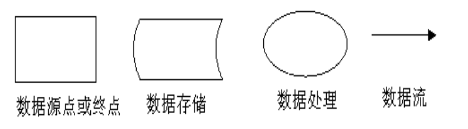

!!! example icon-only

    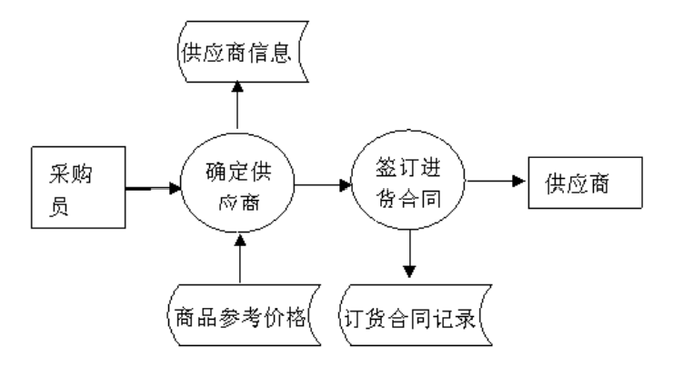

### 数据字典

数据字典是各类数据描述的集合，是进行详细的数据收集和数据分析后获得的主要结果，内容包括：

 - 数据项（数据的最小组成单位）
 - 数据结构（若干数据项组成一个数据结构）
 - 数据流
 - 数据存储
 - 处理过程

数据字典通过对数据项和数据结构的定义来描述数据流、数据存储的逻辑内容。

### 从数据流图和数据字典到 E/R 图

根据系统的具体情况，在多层的数据流图中选择一个适当层次的数据流图，让这组图中的每一部分对应一个局部应用，然后出发设计 E/R 图。

设计 E/R 图时将各局部应用涉及的数据分别从数据字典中抽取出来，参照数据流图，标定各局部应用中的实体、实体的属性、标识实体的码，确定实体之间的联系及其类型。

## E/R 图的基础

### Entity

实体和实体集合是 E/R 图最基本的单位，而实体集合又具有属性，其中最小的能确定一个实体的属性集合为 key。

!!! example icon-only

    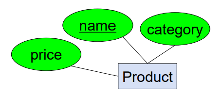

    其中 Product 就是一个实体，用矩形框表示，有 price 、name 、category 三个属性用圆圈表示，name 是 key 用下划线标出。

### Relationship

两个实体之间可能有关系，这在数学上定义为两个实体的笛卡尔积的子集。当然，关系也可能有属性。

关系的 key 就是它连通的两个实体的 key 的并集。当然，这不一定是可以区分唯一的最小属性集合。

!!! example icon-only

    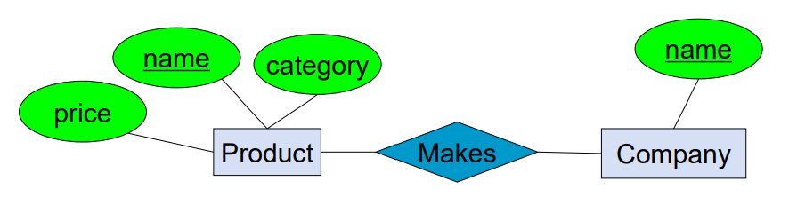

    其中 Makes 就是 Product 和 Company 之间的关系，用菱形表示。

一般来说，把对应关系归纳为一对一、多对一、一对多、多对多四类，在 E/R 图中表示为：

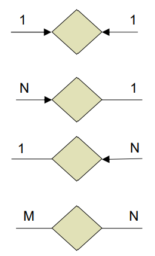

注意，这里箭头限制的是出发的实体所能对应的组合，只需要检查出发实体的所有相关记录是否合法即可。

### 约束

#### 码约束

key 要唯一标识实体，用下划线标出属性。

#### 单值约束

实体之间的联系只能是 `1:1` 或者 `1:n` 。

#### 参照完整性约束

被引用的实体必须存在。

#### 空间约束

在 E/R 图中，采用象形符号 pictograms 来表示空间含义。

- 实体象形图

    - 基本形状：点、线、面
        
        

    - 集合形状：一个实体由多个几何部分组成，并用基数来量化

        

        >数量标记如 $0,1$ 表示 0 个或 1 个；$0,n$ 表示 0 个或多个。 

    - 导出形状：由其他几何数据计算得到的形状

        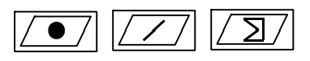

    - 备选形状：同一实体在不同情况下表示不同

        

    - 任意形状：用通配符 `*` 表示各种形状的组合

    - 自定义形状：用户自定义

- 联系象形图：描述实体间的空间联系特征

    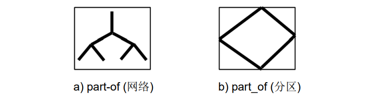

#### 其他约束

如年龄范围等等。

## 设计 E/R 图的一些技巧

### 如何选择 attribute 或 entity

要记录一个东西的多个值，可以把它作为一个实体。

!!! example "一个员工有多个地址"

    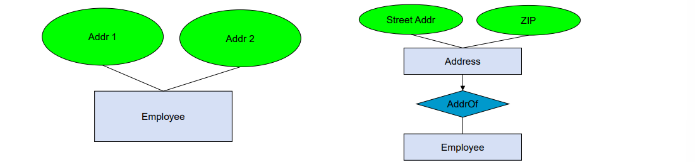

    右图会比左图设计的更合适。

### 如何选择 relationship 或 entity

如果只需表达实体之间是否存在某种关联，可以用联系；但是如果同一组实体之间可以多次发生某种事件，并且需要分别记录，就可以把事件作为实体。

!!! example "购买记录"

    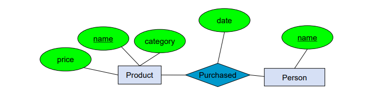

    上图中，一条购买记录由人名和商品名确定，因此只能记录一个人买一个商品一次。

    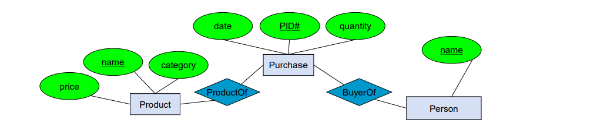

    上图中，一条购买记录由人名、商品名和购买序号确定，因此可以记录一个人买一个商品多次。

### 如何构建对应关系

多元关系中建立对应会产生更多的限制，那么可以考虑转为实体构建二元关系。

!!! example "表示人、商品、商店之间的关系"

    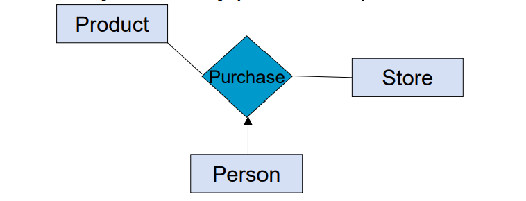

    上图是多元关系。

    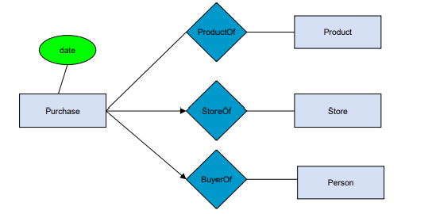

    上图将 Purchase 变为实体，转换为二元关系。

## 把 E/R 图转换成关系表

关键是实体和联系都可以转换成数据库中的关系表。

### 实体转换成表

一行就是一个实体，列就是实体的属性，并且带有主键。

!!! example icon-only

    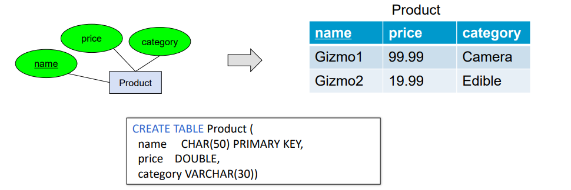

### 联系转换成表

列是联系自身带有的属性加上对应实体的主键，通过外码的方式进行引用。

!!! example icon-only

    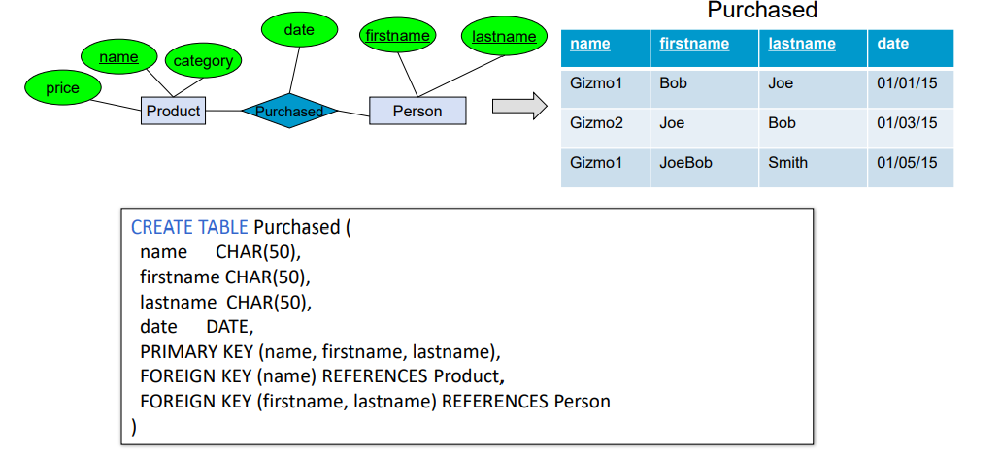

