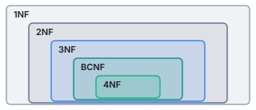

# 关系数据库设计理论

## 数据依赖对关系模式的影响

### 什么是依赖

数据依赖是数据的内在性质，指通过属性之间值是否相等体现的数据之间的相互关系，可以看成现实世界属性之间相互联系的抽象。

数据依赖包括：  
 
 - 函数依赖 Functional Dependencies  
 
 - 多值依赖 Multivalued Dependencies
 
 - 其他

#### 函数依赖

函数依赖，也就是某个属性或属性集确定后，另一个属性就唯一确定了，如同函数表达的映射关系。

!!! example "一个学校数据库`Student(Sno, Sdept, Mname, Cname, Grade)`"

    这个数据库的语义可以解释为：一个系 Sdept 有若干学生 Sno ，一个学生只属于一个系；一个系只有一个主任 Mname ；一个学生可以选修多门课程 Cname ，每门课程有一个成绩；每门课程有若干学生选修。

    根据上面的语义，这个数据库的属性的函数依赖有：

    ```
    Sno -> Sdept  
    Sdept -> Mname  
    (Sno, Cname) -> Grade
    ```

#### 多值依赖

多值依赖是指某一个或某几个属性确定后，剩下的属性完全独立，取值可以自由组合，必须把笛卡尔积的结果全部写进数据库。

!!! example "申请大学的数据库`Apply(SSN, name, Cname, HS, HScity, hobby)`"

    这个数据库存在语义：每个人有唯一美国社会安全号 SSN ；一个人可以在多个高中 HS 上学，有多个爱好，申请多个大学 Cname 。

    根据上面的语义，这个数据库的属性存在多值依赖：

    ```
    SSN ->> Cname  
    SSN ->> (HS, HScity)  
    SSN ->> hobby
    ```

>实际上可以注意到多值依赖描述的是属性或属性集之间的独立性。

### 数据依赖可能导致的问题

数据依赖可能会导致数据库的设计异常，主要包括  

 - 数据冗余：浪费大量存储空间，比如某些属性重复出现；

 - 更新异常：由于数据冗余，更新时维护数据完整性的代价大，比如重复出现的数据都要更改。

 - 插入异常：有些数据无法正常插入；

 - 删除异常：不该删除的数据不得不删除。

上文的两个例子 `Student` 和 `Apply` 就不是好的关系模式。我们追求的是不发生异常，并且数据冗余尽可能小。

因此，需要通过分解关系模式来消除不合适的数据依赖，并且能重构原有模式。

### 消除不合适的依赖的范式

对于不合适的数据依赖，可以依据一些范式进行分解，如图是常见范式的层级关系。



>第二范式不常用，因此接下来不提及。

#### 1st Normal Form

第一范式要求属性值具有原子性，也就是说一个属性的取值必须是单一值而不能是集合。

!!! failure icon-only

    | Student | Major |
    | ------- | ----- |
    | Mary    | {CS, EE} |
    | Zoe     | {CS, GIS} |

    这个表就违背了第一范式，因为 Major 这个属性没有原子性了。

#### BC Normal Form

BC范式加强了第三范式，它要求如果表中存在任何函数依赖 `A -> B` 的话，`A` 代表的属性或属性集必须能唯一确定一行数据记录。

!!! example "调整关系表`Apply(SSN, name, Cname)`"

    `Apply` 中存在的函数依赖有：  
    ```
    SSN -> name  
    (SSN, Cname) -> name
    ```

    但是对于第一条函数依赖，显然只确定 `SSN` 时，一行数据无法确定，因为无法确定申请的学校，因此违背了BC范式。
    
    调整的办法是分解为 `Student(SSN, name)` 和 `Apply(SSN, Cname)` 。这样学生姓名只存储一遍，减少了数据冗余。

#### 4th Normal Form

但是第三范式和BC范式无法处理多值依赖，仍然可能有设计异常的各种问题，因此提出第四范式。

第四范式要求关系模式 $R$ 中存在的任何多值依赖 $A \twoheadrightarrow B$ 能满足条件：$A$ 能够唯一确定一行数据；或者 $B \subseteq A$ 或者 $A\cup B=R$ 。

>实际上第一个条件也能处理函数依赖的情况，毕竟层级关系就决定了满足 4NF 肯定也满足 BCNF 和 3NF 。

!!! example "调整关系表`Apply(SSN, Cname, HS)`"

    `Apply` 中存在的多值依赖有：  
    ```
    SSN ->> Cname  
    SSN ->> HS
    ```

    但是显然原 `Apply` 不满足 4NF 要求的任何一条之一，调整的办法是分解为 `Apply(SSN, Cname)` 和 `Highschool(SSN, HS)` 。

## 函数依赖

### 函数依赖的分类

- 平凡函数依赖：如果有函数依赖 $A \to B$ ，能满足 $B \subseteq A$ 即平凡函数依赖。

- 非平凡函数依赖：如果有函数依赖 $A \to B$ ，能满足 $B \subsetneq A$ 即非平凡函数依赖。

- 完全非平凡函数依赖：如果有函数依赖 $A \to B$ ，能满足 $A\cup B=\varnothing$ 即完全非平凡函数依赖。

### 一些规则

- 分解规则：$A \to B_1, \cdots, B_m$ ➡️ $A \to B_1 \cdots, A \to B_m$

- 合并规则：$A \to B_1 \cdots, A \to B_m$ ➡️ $A \to B_1, \cdots, B_m$

- 传递规则：$A \to B, B \to C$ ➡️ $A \to C$

### 属性的闭包

给定一个关系表，函数依赖，和一个初始属性集合 $A$ 。那么 $A$ 的闭包 $A^+$ 就是从 $A$ 出发，根据已有的函数依赖，不断加入能够被确定的属性，直到无法再加入新属性为止。

计算闭包有一些重要的作用，下面主要介绍两种。


1. 闭包可以判断某个属性或属性集是否是关系表的超码。

    - 给定关系表和函数依赖，如果 $A^+$ 包含全部属性，那么 $A$ 就是超码。

2. 判断某个函数依赖是否成立。

    - 给定一组函数依赖 $S$ ，如果根据 $S$ 计算属性集 $A$ 的闭包 $A^+$ 满足 $A^+$ 包含 $B$ ，那么函数依赖 $A \to B$ 可以从 $S$ 推导得出。

!!! tip "如何指定函数依赖？"

    数据库设计时，只要保留能够推导出所有有效函数依赖的一组依赖，不必重复列出隐含依赖。

## BC 范式

### 分解关系模式的要求

对于关系模式 $R(A_1, \cdots , A_n)$ ，把它分解成 $R1(B_1, \cdots , B_k)$ 和 $R2(C_1, \cdots , C_m)$ 。正确的分解应该满足

$$
B \cup C = A , \quad R1 \bowtie R2 = R
$$

其实就是要求信息没有丢失。

### BCNF 的分解方法

给出关系表 $R$ 和它的函数依赖，如何分解成满足 BC 范式、并且无信息丢失的多个关系表呢？

1. 选择 $R$ 的一个子集 $R'$ ，并且 $R'$ 包含违背 BCNF 的函数依赖 $A \to B$ ；

2. 把 $R'$ 分解成 $R1(A, B)$ 和 $R2(A, rest)$ ，分别计算两者的函数依赖；

3. 如果新的关系表违背了 BCNF ，则回到 1 继续开始，直到所有关系表都满足 BCNF 。

!!! example icon-only

    给出关系表 $R(A, B, C, D)$ ，它有三个函数依赖 $AB \to C$ ，$C \to D$ ，$D \to A$ 。

    >我们可以发现第二个和第三个函数依赖违背了 BCNF 。

    这里以选择从第二个函数依赖开始分解为例：

    1. 分解成 $R1(C, D)$ 和 $R2(C, A, B)$ ；

    2. 发现 $R1$ 已经满足 BCNF ，但是 $R2$ 存在 $C \to A$ 违背了 BCNF ；

        >⚠️必须要注意没有显示写出的函数依赖或者说传递依赖！

    3. 把 $R2$ 分解成 $R3(C, A)$ 和 $R4(C, B)$ ；

    4. 发现 $R3$ 和 $R4$ 已经满足 BCNF ，结束。

    因此分解结果就是 $R1$ 、$R3$ 和 $R4$ 。

    >当然如果一个关系表有多个违背 BCNF 的函数依赖，那么从哪一个开始结果可能不同。

## BC 范式和第四范式的局限

当然，满足更高的范式也不能保证数据库的设计会更合理，还要考虑查询效率、关系数量等等。对关系模式的分解不是越彻底越好。比如 BCNF 分解就可能导致函数依赖丢失，必要时可以采用条件更弱的 3NF 。

### 关系模式转换的考虑

因此我们在 E/R 图和数据库的设计时可以考虑：

 - 对于 $1:1$ 或 $1:N$ 的联系，可以在满足范式要求的前提下，尽量合并到适当的实体关系中。

 - 对于多值属性，通常拆分成独立的关系，解决多值依赖问题。

 - 对于空间数据库，要考虑几何属性可能形成的函数依赖。

---

!!! info "词汇"

    - Functional Dependencies 函数依赖 
    
    - Multivalued Dependencies 多值依赖

    - Design anomalies 设计异常

    - Redundancy 数据冗余

    - Update anomalies 更新异常

    - Insert anomalies 插入异常

    - Deletion anomalies 删除异常

    - Normal form 范式

    - Boyce-Codd Normal Form BC范式

    - Atomic 原子性

    - Trivial FD 平凡函数依赖

    - Nontrivial FD 非平凡函数依赖

    - Completely nontrivial FD 完全非平凡函数依赖

